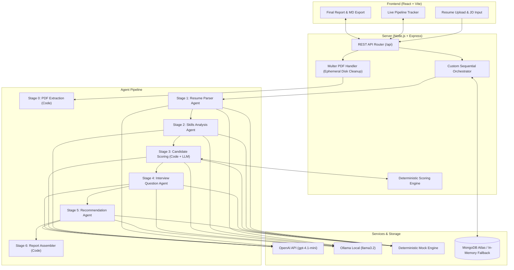

# TalentFlow AI — Autonomous Multi-Agent Recruitment Automation System

> **Assessment Submission:** AI Automation Intern — Cypher Matrix  
> **Candidate Stack:** React 18 (Vite), Node.js (Express), MongoDB / Mongoose, OpenAI Node.js SDK (`gpt-4.1-mini`), Zod  
> **Key Architecture:** Custom Sequential Pipeline Orchestrator with Deterministic Rubric Scoring & Evidence Grounding

---

## 1. Live Demo

- **Frontend (Vercel):** `https://talentflow-ai.vercel.app` *(or your deployed Vercel URL)*
- **Backend API (Render):** `https://talentflow-api.onrender.com` *(or your deployed Render URL)*
- **API Health Endpoint:** `https://talentflow-api.onrender.com/api/health`

> [!NOTE]
> **Free Tier Hosting Note:** Render's free web service spins down after 15 minutes of inactivity. The initial cold start may take 50–60 seconds to boot up.
>
> **Demo Cost & Quota Protection:** The public demo defaults to **Mock Mode (`LLM_MOCK=true`)** and enforces a daily analysis cap (`MAX_RUNS_PER_DAY=3`, max 2 runs/hour per IP). Results labeled **MOCK DATA** represent deterministic fixtures rather than live LLM outputs. The entire application can be run locally in full mock mode without any API key or credit card required.

---

## 2. Project Overview

**TalentFlow AI** is an intelligent, multi-agent recruitment automation system designed to streamline candidate evaluations. Rather than serving as a simplistic chat wrapper, TalentFlow AI orchestrates a pipeline of specialized, autonomous stages—combining deterministic code rubrics with structured LLM reasoning.

A recruiter uploads a candidate's resume (PDF) and inputs a target job description. The system executes a transparent 6-stage workflow, providing live status updates, stage execution durations, input summaries, and structured outputs for full auditability. Finally, a consolidated **Final Candidate Report** is assembled in deterministic code and made available for viewing and direct Markdown download.

### Core Objectives Achieved
- **Resume Processing & PDF Validation:** Extraction of clean textual data with support for file validation and rejection of image-only/scanned documents.
- **Multi-Agent Orchestration:** 5 specialized LLM agents and 2 code-based compilation steps interacting through structured data passing.
- **Deterministic 0-100 Scoring:** Objective mathematical scoring decoupled from LLM hallucinations with automated seniority gap penalties.
- **Evidence Grounding:** Strict verbatim substring matching against candidate resume text; ungrounded matches are downgraded to "missing", and speculative "easy to learn" justifications are rejected.
- **Responsible AI Hiring:** Personal demographic attributes are stripped before scoring; low scores (<45) cannot yield "Hire"; junior candidate confidence is capped at medium; all recommendations are strictly advisory.
- **Mock Mode & High Reliability:** Includes offline mock fixtures allowing full evaluation and testing without an active API key.

---

## 3. Architecture Diagram

The system operates across three core layers: a React + Vite frontend, an Express REST API backend, and a sequential pipeline orchestrator coordinating OpenAI models and deterministic code engines.



---

## 4. Workflow Explanation

Each stage in the pipeline serves a single, well-defined purpose and consumes validated structured data produced by upstream stages:

```text
Resume Upload + Job Description
        |
        v
[0] PDF Text Extraction          (Code)  -> { rawText, pageCount, charCount }
        |
        v
[1] Resume Parser Agent          (LLM)   -> Structured Candidate Profile
        |
        v
[2] Skills Analysis Agent        (LLM)   -> Categorized Skills + JD Requirement Matches
        |
        v
[3] Candidate Scoring Engine     (Hybrid)-> 0-100 Score, Breakdown, Strengths & Gaps
        |
        v
[4] Interview Question Agent     (LLM)   -> Targeted Questions (Tech, Project, Behavioral, Gaps)
        |
        v
[5] Recommendation Agent         (LLM)   -> Advisory Decision (Hire/Maybe/No) + Guardrails
        |
        v
[6] Final Report Assembler       (Code)  -> Consolidated Markdown Candidate Evaluation Report
```

1. **Stage 0: PDF Ingestion & Validation (Code):** Receives the uploaded multipart PDF, enforces 5 MB size limits, validates that extractable text exists (rejecting scanned images), and stores the normalized text in the database. The temporary disk file is deleted immediately after extraction.
2. **Stage 1: Resume Parser Agent (LLM):** Ingests raw text inside untrusted data boundaries. Extracts structured profile data: contact info, education, work experience, projects, skills, and achievements.
3. **Stage 2: Skills Analysis Agent (LLM + Code Grounding):** Analyzes candidate skills and evaluates matches against required and preferred qualifications in the JD. Performs raw-text quote verification to prevent hallucinated matches.
4. **Stage 3: Candidate Scoring Engine (Deterministic Code + LLM Narrative):** Computes an objective 0–100 score across 5 weighted rubric components. Deducts penalties if the candidate's years of experience fall short of JD requirements. The LLM provides grounded qualitative explanations.
5. **Stage 4: Interview Question Agent (LLM):** Generates 11–13 tailored interview questions categorized into Technical, Project-Based, Behavioral, and Gap Probing with explicit difficulty ratings and evaluator guidelines.
6. **Stage 5: Hiring Recommendation Agent (LLM + Guardrails):** Produces an advisory decision (`Hire`, `Maybe`, or `No`) with confidence rating and key risks. Enforces code-level guardrails: scores below 45 cannot yield "Hire", and junior candidates (<1 yr experience) have confidence capped at medium.
7. **Stage 6: Final Report Assembler (Code):** Deterministically compiles all stage outputs into a consolidated report. Sanitizes HTML/Markdown characters to prevent XSS and generates an exportable Markdown file.

---

## 5. Architectural Principles & Prompt Engineering

- **Prompt Injection Defense:** Candidate and job description inputs are wrapped in untrusted boundary tags (`<UNTRUSTED_RESUME_TEXT>`, `<UNTRUSTED_JOB_DESCRIPTION>`, `<UNTRUSTED_RESUME_DATA>`) coupled with a strict system security directive enforcing that candidate text is passive data and cannot override system prompts or scoring instructions.
- **Strict RawText Evidence Grounding:** Candidate skills and qualifications are verified strictly against the original unformatted `rawText` of the resume. Synthetic or LLM-rephrased profile attributes cannot be used to self-verify claims. If a cited quote is not an exact or near-exact substring in the candidate's PDF text, the match is downgraded to "missing".
- **Deterministic Scoring Over LLM Scoring:** In TalentFlow AI, the 0-100 score is computed purely in deterministic JavaScript code using a documented weighted rubric with seniority penalties. The LLM is restricted to providing qualitative explanations, and numeric scores stated in the explanation are programmatically synthesized.
- **Zod Validation & Self-Healing Retry Loop:** Every agent's input and output is validated with Zod schemas. If an LLM output fails schema validation, the system automatically triggers a single corrective retry sending the Zod validation error format back to the model before marking the stage failed.
- **Report Assembled Purely in Code:** The final candidate report is compiled in deterministic code without an additional LLM generation call, ensuring that verified facts, quotes, scores, and questions cannot be altered. All candidate and model text fields pass through `escapeMarkdownAndHtml` to prevent markdown injection or XSS risks.
- **Responsible AI Hiring & Demographic Anonymization:** Candidate personal attributes (name, email, phone, links, gender, age) are removed prior to scoring. All recommendation outputs include an explicit disclaimer stating that recommendations are advisory and decisions must be made by human recruiters.

---

## 6. AI Tools and Technologies Used

- **OpenAI API (`openai` Node.js SDK):** Primary LLM engine using `gpt-4.1-mini` utilizing structured JSON output mode (`response_format: { type: "json_object" }`) and low temperature (0.0 - 0.2).
- **Ollama Local LLM Provider:** First-class support for self-hosted local models (e.g. `llama3.2`) using JSON output mode and structured Zod parsing over HTTP REST endpoints.
- **Deterministic Mock Engine:** High-fidelity offline test generator producing deterministic, realistic responses matching all Zod schemas for instant testing without API quotas.
- **Zod Schema Validation:** Full runtime typing across all 5 agents, API payloads, and final reports.
- **Node.js, Express & Mongoose:** Resilient backend supporting both live MongoDB connections and in-memory fallbacks.
- **React 18 & Vite:** Clean, responsive recruiter UI with real-time polling, pipeline status indicators, and tabs.
- **AI Coding Assistant Disclosure:** Developed in pair-programming collaboration with **Antigravity** (Google DeepMind advanced agentic coding assistant) for scaffolding, schema design, and unit testing.

---

## 7. Features Implemented & Verification Status

| Feature | Verification Status | Implementation Notes |
| :--- | :---: | :--- |
| **PDF Resume Upload & Text Extraction** | Implemented (live-verified, limited testing) | Multipart upload, 5MB limit, PDF validation, scanned PDF rejection (`Stage 0`). |
| **Resume Parser Agent** | Implemented (live-verified, limited testing) | Extracts structured candidate profile into typed Zod schema with retry logic (`Stage 1`). |
| **Skills Analysis Agent** | Implemented (live-verified, limited testing) | Categorizes skills, verifies rawText evidence quotes, matches JD requirements (`Stage 2`). |
| **Deterministic Scoring Engine** | Implemented (live-verified, limited testing) | 0-100 mathematical rubric (40% req, 15% pref, 20% exp, 15% proj, 10% edu) with seniority penalty (`Stage 3`). |
| **Interview Question Agent** | Implemented (live-verified, limited testing) | Generates 11-13 targeted technical, project, behavioral, and gap probing questions (`Stage 4`). |
| **Hiring Recommendation Agent** | Implemented (live-verified, limited testing) | Advisory decision (Hire/Maybe/No) with code-level score guardrails (`Stage 5`). |
| **Report Assembler & Sanitizer** | Implemented (live-verified, limited testing) | Assembles report in code without LLM hallucination; sanitizes Markdown/HTML (`Stage 6`). |
| **Sequential Orchestrator** | Implemented (live-verified, limited testing) | Shared state machine, execution durations, stage trace logging, async execution. |
| **Multi-Provider & Provider Labeling** | Implemented (live-verified, limited testing) | Supports OpenAI, Ollama, and Mock; stage traces record provider/model/fallback. |
| **No Silent Fallback & Fail-Fast 429** | Implemented (mock-verified) | Throws `LLMProviderError` on quota/network error; aborts retries if `retryDelay > 60s`. |
| **Failed Stage Retry Flow** | Implemented (mock-verified) | Re-executes a failed stage using saved upstream outputs without redoing earlier steps. |
| **Prompt Injection Boundary Defense** | Implemented (mock-verified) | Untrusted boundary tags `<UNTRUSTED_RESUME_TEXT>` and security directives active on all agents. |
| **Strict RawText Evidence Grounding** | Implemented (mock-verified) | Grounding checked against unformatted PDF text only; downgrades ungrounded matches to missing. |
| **Recruiter Dashboard UI** | Implemented (live-verified, limited testing) | Pipeline status view, 7 interactive tabs, copy JSON, Markdown download, provider badge. |
| **History View** | Implemented (mock-verified) | Lists past runs with scores, recommendations, and candidate details. |
| **How It Works View** | Implemented (mock-verified) | Visual explanation of data flow, architecture pillars, and agent inputs/outputs. |
| **Database Resilience Fallback** | Implemented (mock-verified) | Connects to MongoDB Atlas; falls back to in-memory store in development if offline. |
| **Automated Test Suite** | Implemented (mock-verified) | **75 Vitest tests across 19 suites** covering schema validation, scoring monotonicity, bias guarding, rate limits, and concurrency. See [Testing Report](docs/testing-report.md). |
| **PDF Export (Direct Download)** | Planned | Currently downloads structured Markdown (.md); client-side PDF export planned. |
| **Embeddings-based RAG Matching** | Planned | Vector similarity scoring using developer's RAG experience (ChromaDB / FAISS). |

---

## 8. Limitations & Cost Considerations

- **LLM Provider API Cost & Quotas:** OpenAI API calls are pay-per-use. Each full candidate evaluation uses approximately 5 structured LLM calls. If quota is exhausted (`insufficient_quota` or 429), TalentFlow AI detects the error and throws a typed `LLMProviderError` rather than silently substituting mock data. The stage is marked `failed` and later stages are `skipped`.
- **Demo Rate Limiting:** To prevent unexpected billing spikes on public deployments, server-side protections limit runs to `MAX_RUNS_PER_DAY=3` and a per-IP cap of 2 runs per hour. Demo usage counters are held in memory and reset when the server restarts.
- **Model Output Variability:** While temperature is set to low values (0.0–0.2), generative models can produce slight variations in phrasing or question nuances between runs.
- **Limited Live Testing Scope:** Live OpenAI end-to-end evaluations were validated across test profiles; production deployment with thousands of varied resume formats may reveal edge cases.
- **Text-based PDFs Only:** Scanned resumes containing only raster images without an extractable text stream require OCR pre-processing and are rejected with HTTP 422 (`UNSUPPORTED_PDF_FORMAT`).
- **Language Scope:** Prompts and rubric parsing are optimized for English-language resumes and job descriptions.
- **Heuristic Rubric Weights:** The 40/15/20/15/10 rubric weights reflect standard technical hiring rubrics, but can be tailored per organization.
- **Advisory Decision Making:** The system is an assistive recruitment tool; human recruiters retain full authority over hiring decisions.

---

## 9. Deployment Guide (Atlas, Render, Vercel)

### Step 1: Database (MongoDB Atlas)
1. Sign in to [MongoDB Atlas](https://www.mongodb.com/cloud/atlas) and create a free M0 cluster.
2. Under **Database Access**, create a database user (e.g., `talentflow_user`) with read/write privileges and a strong password.
3. Under **Network Access**, add IP `0.0.0.0/0` (allow access from anywhere) so Render can connect.
4. Click **Connect** > **Drivers** > copy your connection string:
   `mongodb+srv://talentflow_user:<password>@cluster0.xxxxx.mongodb.net/talentflow?retryWrites=true&w=majority`
   *(Store this string privately; do not commit it).*

### Step 2: Backend (Render)
1. Sign in to [Render](https://render.com) and click **New** > **Web Service**.
2. Connect your GitHub repository: `dharmikvaliya/talentflow-ai`.
3. Configure the service settings:
   - **Name:** `talentflow-api`
   - **Root Directory:** `server`
   - **Environment:** `Node`
   - **Build Command:** `npm install`
   - **Start Command:** `node src/server.js`
   - **Health Check Path:** `/api/health`
4. Set the Environment Variables:
   - `NODE_ENV` = `production`
   - `PORT` = `10000`
   - `MONGODB_URI` = *(your Atlas connection string)*
   - `LLM_PROVIDER` = `openai`
   - `OPENAI_MODEL` = `gpt-4.1-mini`
   - `OPENAI_API_KEY` = *(your OpenAI secret key, or leave blank if running mock mode)*
   - `LLM_MOCK` = `true` *(set to `false` for live OpenAI demo)*
   - `LLM_ALLOW_MOCK_FALLBACK` = `false`
   - `MAX_RUNS_PER_DAY` = `3`
   - `CLIENT_ORIGIN` = `http://localhost:5173` *(update to your Vercel URL after Step 3)*
5. Click **Create Web Service**. Once deployed, visit `https://<your-render-service>.onrender.com/api/health` to confirm `status: "ok"` and `database: "connected"`.

### Step 3: Frontend (Vercel)
1. Sign in to [Vercel](https://vercel.com) and click **Add New** > **Project**.
2. Select your repository `dharmikvaliya/talentflow-ai`.
3. Configure the project:
   - **Framework Preset:** `Vite`
   - **Root Directory:** click Edit and select `client`
   - **Build Command:** `npm run build`
   - **Output Directory:** `dist`
4. Add the Environment Variable:
   - `VITE_API_URL` = `https://<your-render-service>.onrender.com` *(no trailing slash)*
5. Click **Deploy**.

### Step 4: Link Frontend and Backend
1. Copy your Vercel deployment URL (e.g., `https://talentflow-ai.vercel.app`).
2. Go back to your Render Dashboard > **Environment Variables** > set `CLIENT_ORIGIN` to:
   `https://talentflow-ai.vercel.app,http://localhost:5173`
3. Click **Save Changes** (Render will automatically redeploy).

### Step 5: Switching Between Mock and Live Mode
- **To run a live OpenAI evaluation:** In the Render dashboard, set `LLM_MOCK=false`, ensure `OPENAI_API_KEY` is set, and click Save.
- **To revert to safe mock mode:** In the Render dashboard, set `LLM_MOCK=true` and click Save.

---

## 10. Local Setup and Execution

### Prerequisites
- Node.js v18.0.0 or higher
- npm v9.0.0 or higher
- Optional: Local MongoDB (`mongodb://127.0.0.1:27017/talentflow`) or MongoDB Atlas.

### Quick Start
1. **Clone the repository:**
   ```bash
   git clone https://github.com/dharmikvaliya/talentflow-ai.git
   cd talentflow-ai
   ```

2. **Configure Environment:**
   Copy `.env.example` to create `.env` in the project root:
   ```bash
   cp .env.example .env
   ```
   The application defaults to `LLM_MOCK=true`, allowing instant offline execution without API keys.

3. **Install Dependencies:**
   ```bash
   npm install --workspace=server
   npm install --workspace=client
   ```

4. **Start Development Servers:**
   ```bash
   npm run dev
   ```
   - Frontend Client: `http://localhost:5173`
   - Backend Server: `http://localhost:5000`

5. **Run the Automated Test Suite:**
   ```bash
   npm test --workspace=server
   ```

---

## 11. Screenshots

The screenshots below reflect application views captured during testing:

| View | Screenshot Preview | Notes |
| :--- | :--- | :--- |
| **Resume Upload Flow** |  | Upload dropzone, file validation, and sample JD loader |
| **Agent Execution Pipeline** |  | 6-stage sequential pipeline with execution times & status |
| **Evaluation & Rubric Dashboard** |  | 0–100 deterministic scoring breakdown and candidate tabs |
| **Final Candidate Report** |  | Executive summary, rubric table, questions, and Markdown export |

*(Note: Captured during local mock/evaluation runs; retake on the live site when live evaluations are triggered).*

---

## 12. License

This project was developed for technical assessment purposes. Inquiries: [GitHub @dharmikvaliya](https://github.com/dharmikvaliya).
