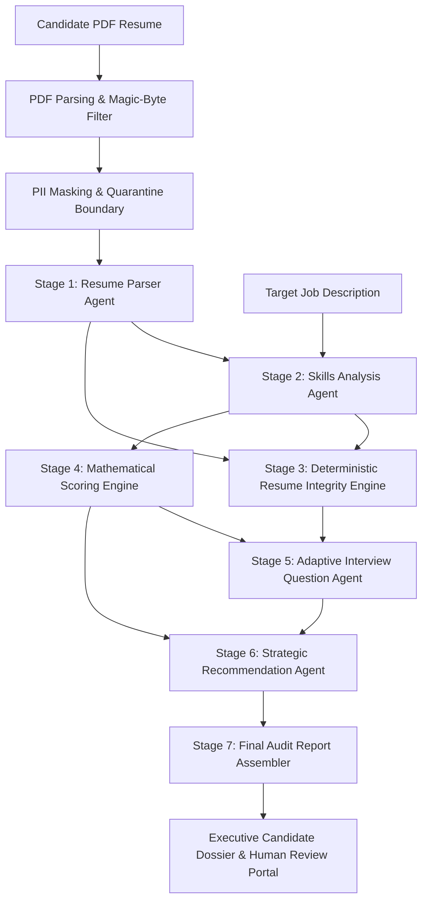

# TalentFlow AI – Cypher Matrix
## Autonomous Agentic AI Recruitment, Evidence-Based Verification & Multi-Provider Architecture

[-success?style=for-the-badge&logo=vitest)](submission/TEST_EVIDENCE.md)
[](https://talentflow-ai-cyphermatrix.vercel.app)
[](https://talentflow-cyphermatrix-api.onrender.com)
[](LICENSE)

> **Internship Assignment Submission:** Cypher Matrix  
> **Candidate / Author:** Dharmik Valiya  
> **Recipient:** HR Sushmita & Technical Evaluation Committee  
> **Deadline:** November 6, 2026 – End of Day  
> **Repository:** [https://github.com/dharmikvaliya/TalentFlow-AI-CypherMatrix](https://github.com/dharmikvaliya/TalentFlow-AI-CypherMatrix)  
> **Active Branch:** `main`  
> **Live Web Application:** [https://talentflow-ai-cyphermatrix.vercel.app](https://talentflow-ai-cyphermatrix.vercel.app)  
> **Live REST API:** [https://talentflow-cyphermatrix-api.onrender.com](https://talentflow-cyphermatrix-api.onrender.com)  

---

## 1. Executive Overview

Traditional Applicant Tracking Systems (ATS) and first-generation LLM recruitment tools rely heavily on keyword matching and ungrounded generative summaries. Candidates game these systems using keyword stuffing, verbatim copying of job requisitions, and claiming uncorroborated technologies in top-level summary blurbs.

**TalentFlow AI – Cypher Matrix** is a production-hardened, multi-agent recruitment intelligence platform designed around a fundamental engineering principle:

$$\text{Demonstrated Professional Evidence} \gg \text{Keyword Presence}$$



---

## 2. Key Engineering Achievements

1. **Multi-Provider AI Abstraction Layer:**
   - Standardized OpenAI-compatible REST adapter supporting **OpenAI (`gpt-4.1-mini`), Groq (`llama-3.3-70b-versatile`), OpenRouter (`openrouter/free`), NVIDIA NIM (`nemotron-3-nano-omni-30b-a3b-reasoning`), Local Ollama (`llama3.2`), and 100% Offline Mock**.
   - Together AI was comprehensively researched and benchmarked, then safely designated as **Research-Only** (excluded from active runtime) to eliminate external billing dependencies.
   - Dynamic in-flight provider switching via UI dropdown or REST API (`POST /api/providers/active`).

2. **Deterministic Resume Integrity Engine (Stage 3):**
   - Pure JavaScript algorithms executing in **$< 2\text{ ms}$ on local CPU with zero token cost**.
   - Detects statistical keyword stuffing ($\ge 4\%$ share, $\ge 7$ occurrences with work experience discounting).
   - Identifies contiguous verbatim job description copying using a 3-to-6-word sliding window.
   - Flag uncorroborated skill inflation where skills appear only in summaries without employment backing.
   - **Fairness Guarantee:** High-risk classification strictly requires $\ge 2$ independent corroborated signals, protecting authentic high-density senior technical resumes.

3. **Explainable Mathematical Capability Scoring (Stage 4):**
   - 0–100 score computed deterministically in code across 5 weighted evidence tiers:
     $$\text{Score} = 0.35 S_{\text{req}} + 0.25 S_{\text{exp}} + 0.20 S_{\text{proj}} + 0.10 S_{\text{pref}} + 0.10 S_{\text{edu}}$$
   - **Score Insulation Guarantee:** Integrity findings are surfaced qualitatively and never deduct from technical capability scores.

4. **Adaptive Interview Probing (Stage 5):**
   - Automatically injects neutral, targeted technical verification questions for uncorroborated candidate skills.

5. **Enterprise Security & Candidate Privacy:**
   - Prompt-injection defense quarantining untrusted resume text inside `<untrusted_resume_content>` boundaries.
   - Client and server-side PII scrubbing (phone numbers, emails, physical addresses, and external social links).
   - In-memory PDF upload validation with magic-byte verification (`%PDF-`) and 5MB buffer ceilings.
   - Strict zero live-to-mock fallback policy ensuring live provider errors are never silently masked.

6. **Automated Testing & Benchmark Results:**
   - **26 test files passed, 210 of 210 tests passed (100% pass rate)**.
   - 100% binary gaming-risk accuracy (12/12) and 100% score stability ($\text{Variance} = 0.0$) on the synthetic benchmark dataset.

---

## 3. Quick Reviewer Verification

### Run Automated Test Suite (Zero Dependencies)
```powershell
cd server
npm test
```
*Result: 26 passed test files, 210 passed tests in ~2.5s.*

### Build Production Client
```powershell
cd client
npm run build
```
*Result: Vite production bundle built in `client/dist`.*

---

## 4. Documentation Package Directory

Comprehensive documentation has been structured into 17 standardized engineering guides:

| Number | Document | Description |
| :--- | :--- | :--- |
| **01** | [01_EXECUTIVE_SUMMARY.md](docs/01_EXECUTIVE_SUMMARY.md) | Executive project summary and strategic business context. |
| **02** | [02_REQUIREMENTS_AND_SCOPE.md](docs/02_REQUIREMENTS_AND_SCOPE.md) | Complete HR requirement mapping and bidirectional traceability matrix. |
| **03** | [03_AI_PROVIDER_RESEARCH.md](docs/03_AI_PROVIDER_RESEARCH.md) | In-depth foundation model evaluation, token economics, and latency benchmarks. |
| **04** | [04_PROVIDER_COMPARISON.md](docs/04_PROVIDER_COMPARISON.md) | Multi-provider comparison matrix (Together AI documented as research-only). |
| **05** | [05_SYSTEM_ARCHITECTURE.md](docs/05_SYSTEM_ARCHITECTURE.md) | High-level system topologies, component design, and database schema. |
| **06** | [06_AGENT_DESIGN_AND_WORKFLOW.md](docs/06_AGENT_DESIGN_AND_WORKFLOW.md) | 7-stage multi-agent orchestration, state transitions, and schemas. |
| **07** | [07_RESUME_ANALYSIS_METHODOLOGY.md](docs/07_RESUME_ANALYSIS_METHODOLOGY.md) | Hierarchical evidence tiers and skill qualification models. |
| **08** | [08_RESUME_GAMING_DETECTION.md](docs/08_RESUME_GAMING_DETECTION.md) | Mathematical formulation of keyword stuffing, copying, and inflation detection. |
| **09** | [09_EXPLAINABLE_SCORING.md](docs/09_EXPLAINABLE_SCORING.md) | Deterministic capability scoring formula and score insulation guarantees. |
| **10** | [10_SECURITY_AND_PRIVACY.md](docs/10_SECURITY_AND_PRIVACY.md) | Prompt-injection quarantine, PII scrubbing, and OWASP compliance. |
| **11** | [11_TEST_DATASET_AND_METHODOLOGY.md](docs/11_TEST_DATASET_AND_METHODOLOGY.md) | 12-case synthetic evaluation suite specifications and ground truth. |
| **12** | [12_EVALUATION_RESULTS.md](docs/12_EVALUATION_RESULTS.md) | Empirical benchmarks, confusion matrices, and stage timing telemetry. |
| **13** | [13_BEFORE_AFTER_COMPARISON.md](docs/13_BEFORE_AFTER_COMPARISON.md) | Systematic codebase diff between original TalentFlow and Cypher Matrix. |
| **14** | [14_KNOWN_LIMITATIONS.md](docs/14_KNOWN_LIMITATIONS.md) | Engineering boundaries, edge cases, and algorithmic constraints. |
| **15** | [15_FUTURE_IMPROVEMENTS.md](docs/15_FUTURE_IMPROVEMENTS.md) | Phased engineering roadmap (OCR, GraphRAG, ATS webhooks). |
| **16** | [16_DEPLOYMENT_AND_OPERATIONS.md](docs/16_DEPLOYMENT_AND_OPERATIONS.md) | Production cloud infrastructure, environment configuration, and runbooks. |
| **17** | [17_REFERENCES.md](docs/17_REFERENCES.md) | Academic literature, RFCs, NIST/OWASP standards, and citations. |

---

## 5. Submission Artifacts & Evidence

The formal internship submission package is available in the `submission/` directory:

- **Formal Technical Report (Markdown):** [`submission/FINAL_INTERNSHIP_SUBMISSION_REPORT.md`](submission/FINAL_INTERNSHIP_SUBMISSION_REPORT.md)
- **Print-Ready Technical Report (PDF):** [`submission/FINAL_INTERNSHIP_SUBMISSION_REPORT.pdf`](submission/FINAL_INTERNSHIP_SUBMISSION_REPORT.pdf)
- **Deliverable Traceability Checklist:** [`submission/DELIVERABLE_TRACEABILITY.md`](submission/DELIVERABLE_TRACEABILITY.md)
- **Automated Test & Live API Evidence:** [`submission/TEST_EVIDENCE.md`](submission/TEST_EVIDENCE.md)
- **Authentic Application Screenshots:** [`submission/screenshots/`](submission/screenshots/)

---

## 6. Technology Stack

| Layer | Technology | Version | Purpose |
| :--- | :--- | :--- | :--- |
| **Frontend** | React 18 / Vite | `18.3.1` / `6.1.0` | High-performance SPA with provider switching |
| **Icons & UI** | Lucide React | `0.475.0` | Accessible pipeline visualization |
| **Routing** | React Router | `6.28.2` | Client-side routing |
| **Backend** | Node.js / Express | `24.11.1` / `4.21.2` | REST API gateway & agent orchestration |
| **Database** | MongoDB Atlas / Mongoose | `8.10.0` | Isolated storage (`talentflow_cyphermatrix`) |
| **Validation** | Zod | `3.24.2` | Runtime schema validation across all stages |
| **Testing** | Vitest | `2.1.8` | Offline test harness (210/210 passing) |
| **Hosting** | Vercel & Render | Production | Global edge CDN & containerized web service |

---

## 7. License & Author

- **Author:** Dharmik Valiya
- **Organization:** Cypher Matrix Internship Submission
- **Recipient:** HR Sushmita & Engineering Leadership
- **License:** MIT License
