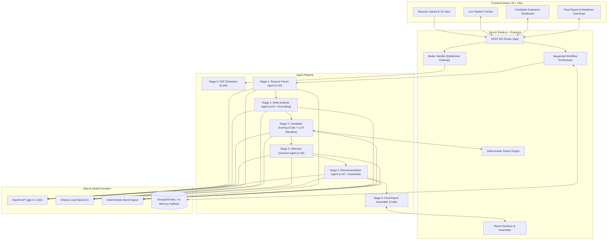
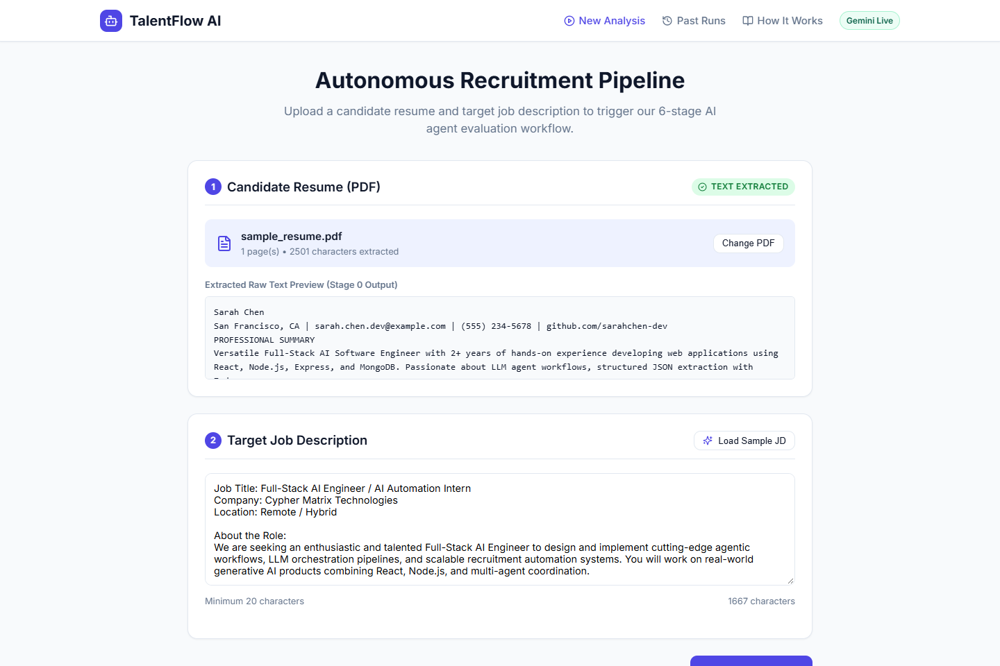
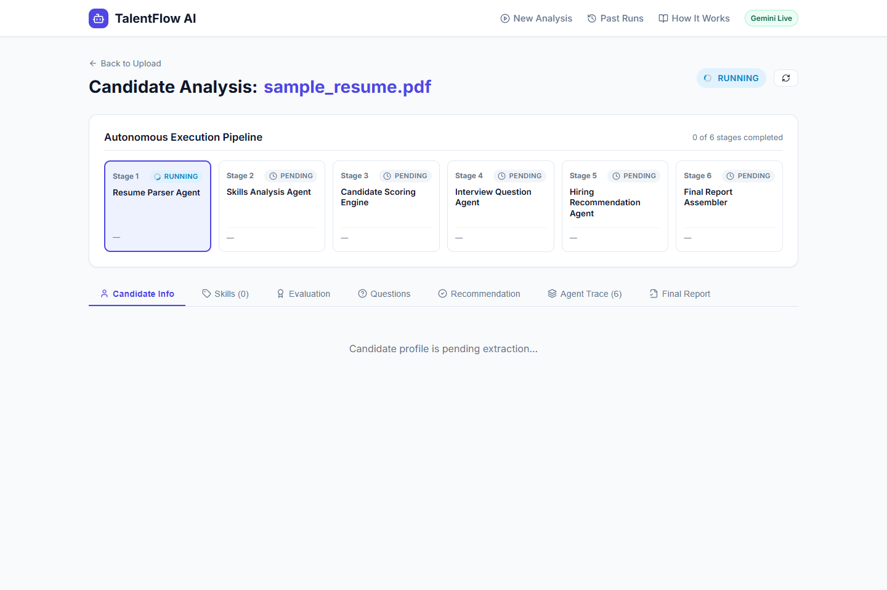
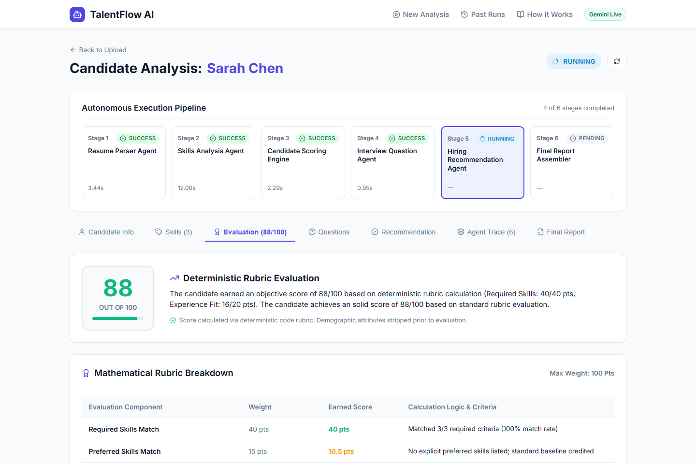
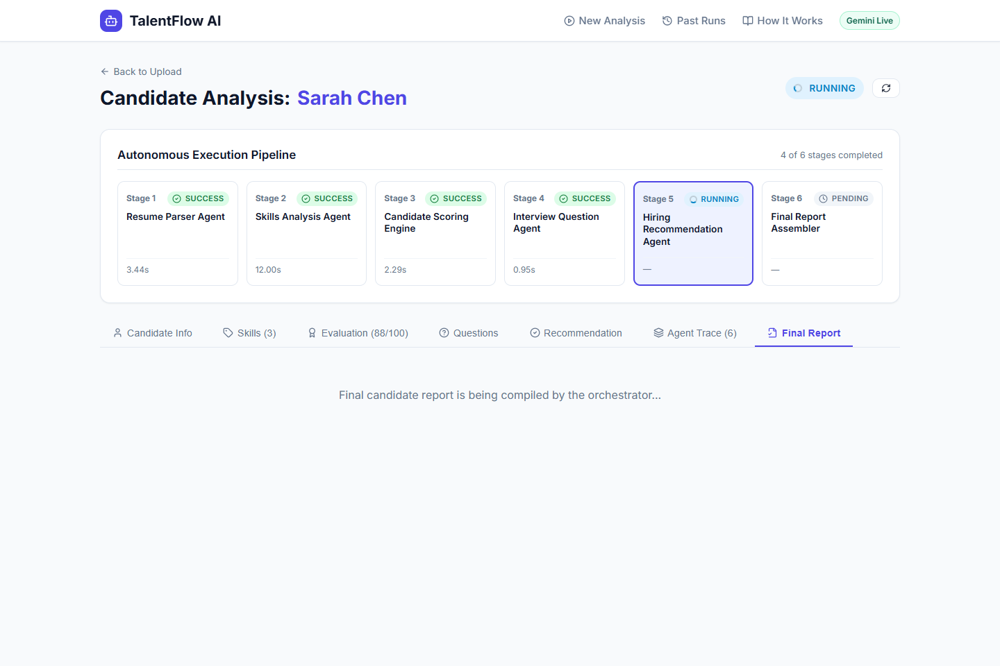

# TalentFlow AI — Autonomous Multi-Agent Recruitment Automation System

> **Assessment Submission:** AI Automation Intern — Cypher Matrix
> **Candidate Stack:** React 18 (Vite), Node.js (Express), MongoDB Atlas / Mongoose, OpenAI Node.js SDK (`gpt-4.1-mini`), Zod Schemas
> **Key Architecture:** Custom Sequential Multi-Agent Orchestrator with Deterministic Rubric Scoring & Verbatim Evidence Grounding
> **Repository:** [https://github.com/dharmikvaliya/talentflow-ai](https://github.com/dharmikvaliya/talentflow-ai)

---

## 1. Live Deployment & Demo Links

- **Frontend Application (Vercel):** [https://talentflow-ai-alpha.vercel.app](https://talentflow-ai-alpha.vercel.app)
- **Backend API (Render):** [https://talentflow-ai-zytt.onrender.com](https://talentflow-ai-zytt.onrender.com)
- **API Health Endpoint:** [https://talentflow-ai-zytt.onrender.com/api/health](https://talentflow-ai-zytt.onrender.com/api/health)

### Observed Live Deployment Configuration
A live query to the production backend health endpoint (`/api/health`) reports the following configuration:
```json
{
  "status": "ok",
  "service": "TalentFlow AI API",
  "version": "1.0.0",
  "environment": {
    "llmMockMode": false,
    "configuredProvider": "openai",
    "modelConfigured": "gpt-4.1-mini",
    "allowMockFallback": false,
    "database": "connected"
  }
}
```

> [!IMPORTANT]
> **Operational & Quota Considerations on Public Cloud:**
> 1. **Free-Tier Hosting Spin-Down:** Render's free web service spins down after 15 minutes of idle time. The initial cold start may take 50–60 seconds before responding to requests.
> 2. **Live Execution vs. Quota Bounds:** The backend is configured for live OpenAI calls (`LLM_MOCK=false`, `gpt-4.1-mini`) with MongoDB Atlas connectivity. However, public cloud end-to-end evaluations depend on active OpenAI billing credits and enforce server-side cost protections (`MAX_RUNS_PER_DAY=3`, per-IP cap of 2 runs/hour). Full multi-agent workflow execution has been verified in controlled test runs; public demo runs may encounter provider rate limits or cold-start timeouts.
> 3. **Offline Zero-Cost Local Testing:** Local development defaults to **Mock Mode (`LLM_MOCK=true`)**, allowing the complete multi-agent pipeline and 82-test automated suite to run offline with zero API keys or external billing.

---

## 2. Project Overview & Objectives

**TalentFlow AI** is an intelligent, autonomous recruitment automation system built for the **AI Automation Intern** assessment at **Cypher Matrix**.

Modern hiring teams face two critical challenges: resume screening at scale is time-intensive, and conventional generative AI chat wrappers often hallucinate qualifications, inject scoring bias, and produce ungrounded candidate recommendations.

TalentFlow AI solves this by replacing conversational prompts with a **structured, auditable, multi-stage pipeline**:
- Ingests candidate resumes (PDF) and target job descriptions.
- Coordinates 5 specialized LLM agents and 2 deterministic code engines in a transparent sequence.
- Enforces code-level mathematical scoring and raw-text quote verification to eliminate hallucinations.
- Delivers an interactive recruiter dashboard and exportable candidate evaluation reports.

### Core Objectives Delivered
- **Robust PDF Ingestion:** Text extraction using `pdf-parse`, strict 5 MB file size enforcement, format validation, and immediate cleanup of temporary server files.
- **Multi-Agent Pipeline Orchestration:** Sequential state machine passing typed Zod data structures between specialized agents.
- **Deterministic 0–100 Rubric Scoring:** Mathematical scoring decoupled from LLM scoring hallucinations, with automated penalties for seniority gaps.
- **Strict Verbatim Evidence Grounding:** Verifies quoted resume evidence against the unformatted raw resume text; ungrounded claims and speculative "easy to learn" justifications are rejected.
- **Responsible AI Guardrails:** Candidate demographic data is stripped prior to scoring; scores below 45 strictly cannot yield a "Hire" recommendation; junior candidate confidence is capped at medium; all recommendations are explicitly advisory.
- **High-Reliability Testing & Mock Engine:** Complete offline mock engine mirroring all schemas for automated testing and cost-free evaluation.

---

## 3. System Architecture & Technology Stack

The system follows a decoupled three-tier architecture:



### Technology Stack Summary

| Layer | Technologies | Purpose |
| :--- | :--- | :--- |
| **Frontend UI** | React 18, Vite, React Router 6, Lucide Icons, Custom CSS | Interactive recruiter dashboard, upload dropzone, real-time stage monitoring, and tabbed candidate review. |
| **Backend API** | Node.js (>=18), Express 4.21, Multer, Helmet, CORS | RESTful API, Render single-hop proxy integration, file upload handling, and error scrubbing. |
| **Orchestration** | Custom asynchronous sequential workflow engine | Manages stage transitions, execution durations, shared state passing, and single-stage retry flows. |
| **Validation & Typing** | Zod 3.24 | Strict runtime schema validation across all API requests, agent inputs, and structured JSON outputs. |
| **LLM Integration** | OpenAI Node.js SDK (`openai` 7.34), Ollama HTTP API | Structured JSON mode (`response_format: { type: "json_object" }`) using `gpt-4.1-mini` at low temperature (0.0–0.2). |
| **Database** | MongoDB Atlas, Mongoose 8.10 | Persistent storage for candidate records and workflow runs, with automatic in-memory fallback for offline dev. |
| **Testing** | Vitest 3.0, PDFKit | Automated test runner with 82 unit, integration, security, and concurrency tests. |
| **Hosting** | Vercel (Frontend), Render (Backend), MongoDB Atlas (Database) | Production cloud deployment architecture. |

---

## 4. Multi-Agent Workflow & Execution Pipeline

The workflow coordinates 7 discrete stages (5 LLM agents and 2 code-based compilation steps). Each stage receives validated data from prior stages, executes its specialized task, and records timing and trace metadata.

```text
Resume Upload (PDF) + Target Job Description
                     |
                     v
 [Stage 0: Code]  PDF Text Extraction & Format Validation
                     |  -> { rawText, pageCount, charCount }
                     v
 [Stage 1: LLM]   Resume Parser Agent
                     |  -> Structured Candidate Profile (Zod validated)
                     v
 [Stage 2: Hybrid] Skills Analysis Agent + Verbatim Grounding
                     |  -> Categorized Skills + Grounded JD Requirement Matches
                     v
 [Stage 3: Hybrid] Candidate Scoring (Deterministic Rubric + LLM Narrative)
                     |  -> 0-100 Mathematical Score + Strengths & Gaps
                     v
 [Stage 4: LLM]   Interview Question Generator Agent
                     |  -> 11-13 Categorized Questions + Evaluator Criteria
                     v
 [Stage 5: Hybrid] Hiring Recommendation Agent + Policy Guardrails
                     |  -> Advisory Decision (Hire / Maybe / No) + Risks & Confidence
                     v
 [Stage 6: Code]  Final Report Assembler & XSS/Markdown Sanitizer
                     |  -> Consolidated Markdown Candidate Evaluation Report
```

### Granular Stage Specifications

| Stage | Name | Type | Input | Output | Description & Guardrails |
| :---: | :--- | :---: | :--- | :--- | :--- |
| **0** | **PDF Extraction** | Code | Multipart PDF resume file | `rawText`, `pageCount`, `charCount` | Validates file header and size (<=5MB). Rejects scanned/image-only PDFs (<30 chars) with HTTP 422. Deletes temporary upload immediately. |
| **1** | **Resume Parser** | LLM | `rawText` in `<UNTRUSTED_RESUME_TEXT>` | Structured Profile (JSON) | Extracts contact details, education, work experience, projects, skills, and certifications into typed schema. Includes 1-shot self-healing schema retry loop. |
| **2** | **Skills Analysis** | LLM + Code | Parsed Profile + Job Description | Categorized Skills & JD Matches | Groups skills into categories (languages, frameworks, databases, tools, soft skills). Matches candidate evidence against JD requirements. Verifies citations verbatim against `rawText`. |
| **3** | **Candidate Scoring** | Code + LLM | JD Matches + Experience + Profile | 0–100 Score, Breakdown, Explanation | Computes mathematical 0–100 score in pure code across 5 weighted components. Deducts seniority gap penalties. LLM provides qualitative explanations only. |
| **4** | **Interview Questions** | LLM | Profile + JD + Scoring Gaps | 11–13 Targeted Questions | Generates questions across 4 categories: Technical, Project Deep-Dive, Behavioral, and Gap Probing. Assigns difficulty and expected response criteria. |
| **5** | **Hiring Recommendation** | LLM + Code | Score + Experience + Gaps | Decision (`Hire`, `Maybe`, `No`), Confidence | Produces advisory decision. Enforces code-level guardrails: score < 45 cannot yield "Hire"; junior candidates (<1 yr exp) have confidence capped at medium. |
| **6** | **Report Assembler** | Code | All upstream stage outputs | Consolidated Markdown Report | Deterministically compiles complete evaluation report in code without LLM hallucination risk. Sanitizes Markdown table pipes and HTML tags. |

---

## 5. Candidate Scoring Methodology & Guardrails

To prevent LLM bias and non-deterministic scoring discrepancies, **candidate scoring is computed entirely in deterministic JavaScript code** ([`server/src/config/scoringRubric.js`](server/src/config/scoringRubric.js)).

### Weighted Rubric Breakdown (0–100 Scale)

$$\text{Final Score} = \text{ReqScore} + \text{PrefScore} + \text{ExpScore} + \text{ProjScore} + \text{EduScore} - \text{SeniorityPenalty}$$

| Rubric Component | Weight | Calculation Logic |
| :--- | :---: | :--- |
| **Required Skills Match** | **40%** | Ratio of matched vs. total required JD skills. Matches verified against resume text receive full credit; partial matches receive half credit; missing skills receive 0. |
| **Preferred Skills Match** | **15%** | Ratio of matched vs. total preferred skills in the JD. |
| **Experience Relevance** | **20%** | Evaluates total years of relevant software/AI engineering experience and alignment with target role seniority. |
| **Project & Portfolio Alignment** | **15%** | Assesses demonstrated complexity, tools used, and relevance of personal/academic/open-source projects. |
| **Education & Certifications** | **10%** | Degree field relevance (e.g. Computer Science/Engineering) and professional certifications. |
| **Seniority Gap Deduction** | **Penalty** | If the candidate has fewer years of experience than the minimum required by the JD, **3 points are deducted per missing year** (up to a 15-point maximum deduction). |

### Strict Responsible AI Guardrails
1. **Low-Score Hire Prohibition:** If the candidate's computed score is below 45/100, the recommendation engine programmatically overrides any LLM output to prevent a `Hire` recommendation.
2. **Junior Confidence Cap:** Candidates with less than 1 year of professional experience have their recommendation confidence capped at `medium` (cannot be `high`).
3. **Demographic Anonymization:** Candidate personal attributes (name, email, phone, personal links, age, gender markers) are stripped from the prompt payload before scoring to guard against demographic bias.
4. **Verbatim Evidence Grounding:** All skill match citations are verified using substring matching against the raw text of the resume. If an LLM claims a skill is present but cites nonexistent text or claims the skill is "easy to learn", the match is automatically downgraded to `missing`.
5. **Advisory Decision Notice:** Every evaluation output states explicitly that AI recommendations are assistive guidelines and that final hiring decisions must be made by human hiring managers.

---

## 6. Recruiter Dashboard & User Interface

The React + Vite frontend provides an interactive recruitment interface:

- **Upload & JD Input Page:** Dropzone for PDF resumes with file validation, character counter for job descriptions, and one-click sample loader for rapid testing.
- **Live Pipeline Tracker:** Real-time visual progress tracker showing the current stage, active spinner, completion checkmarks, and stage execution durations.
- **7-Tab Candidate Review Dashboard:**
  1. **Candidate Info Tab:** Contact details, education summary, work experience timeline, projects, and certifications.
  2. **Skills Analysis Tab:** Visual skill badges categorized by domain, plus a requirement matching table with matched/partial/missing indicators and verbatim resume citations.
  3. **Evaluation & Rubric Tab:** 0–100 score gauge, detailed rubric component breakdown cards, seniority penalty indicators, strengths, and identified qualification gaps.
  4. **Interview Questions Tab:** 11–13 tailored questions categorized into Technical, Project Deep-Dive, Behavioral, and Gap Probing with difficulty badges and evaluator assessment tips.
  5. **Recommendation Tab:** Advisory recommendation (`Hire`, `Maybe`, `No`), confidence rating badge, key hiring risks, and responsible AI advisory disclaimer.
  6. **Final Report Tab:** Complete consolidated evaluation report with one-click **Download Markdown Report (.md)** button.
  7. **Agent Traces Tab:** Technical audit log displaying exact model used, provider badge (OpenAI / Ollama / Mock), execution latency per stage, and raw JSON input/output inspection.
- **History View:** Chronological log of past workflow runs with candidate names, target positions, scores, and status.
- **How It Works View:** Interactive architectural breakdown explaining pipeline stages, rubric formulas, and security boundaries.

---

## 7. Screenshots & Demo Evidence

The screenshots below reflect application views captured during testing:

| View | Screenshot Preview | Interface Highlights |
| :--- | :--- | :--- |
| **Resume Upload & JD Input** |  | PDF drag-and-drop dropzone, file validation, and sample JD loader |
| **Multi-Agent Pipeline Tracker** |  | 6-stage live execution tracker with timing, status, and animated spinners |
| **Evaluation Dashboard & Rubric** |  | 0–100 score gauge, rubric breakdown cards, and candidate profile tabs |
| **Consolidated Candidate Report** |  | Full report viewer with Markdown export and advisory disclaimer |

> *(All four screenshot files are committed and verified in `screenshots/`).*

---

## 8. Implementation Status

| Feature / Capability | Status | Implementation Details |
| :--- | :---: | :--- |
| **PDF Upload & Format Validation** | **Implemented** | Multipart upload via Multer, 5MB limit, `pdf-parse` extraction, scanned/image-only PDF rejection (HTTP 422), ephemeral temp file cleanup. |
| **Resume Parser Agent (`Stage 1`)** | **Implemented** | Extracts structured candidate profile into typed Zod schema with 1-shot self-healing schema retry loop. |
| **Skills Analysis Agent (`Stage 2`)** | **Implemented** | Categorizes skills into technical, frameworks, databases, tools, soft skills; matches against JD qualifications. |
| **Verbatim Evidence Grounding** | **Implemented** | Substring verification against raw resume text; ungrounded citations or "easy to learn" justifications downgraded to missing. |
| **Deterministic Scoring Rubric (`Stage 3`)** | **Implemented** | Mathematical 0–100 score calculated purely in code (40/15/20/15/10 rubric) with automated seniority gap penalties. |
| **Interview Question Agent (`Stage 4`)** | **Implemented** | Generates 11–13 categorized questions (Technical, Project, Behavioral, Gap-Probing) with difficulty ratings and evaluator criteria. |
| **Recommendation Agent (`Stage 5`)** | **Implemented** | Advisory decision (`Hire`/`Maybe`/`No`), confidence rating, key risks, and code-level low-score guardrails. |
| **Report Assembler & Sanitizer (`Stage 6`)** | **Implemented** | Assembles final report deterministically in JavaScript code; sanitizes HTML and Markdown characters via `escapeMarkdownAndHtml`. |
| **Sequential Workflow Orchestrator** | **Implemented** | Shared state machine, per-stage execution durations, stage trace logging, single-stage retry endpoint. |
| **Multi-Provider LLM Service** | **Implemented** | First-class support for OpenAI (`gpt-4.1-mini`), local Ollama (`llama3.2`), and deterministic Mock mode. |
| **Fail-Fast 429 & Quota Handling** | **Implemented** | Detects 429 quota exhaustion; aborts immediate retries if `retryDelay > 60s` and throws typed `LLMProviderError`. |
| **Prompt Injection Defense** | **Implemented** | Untrusted boundary tags (`<UNTRUSTED_RESUME_TEXT>`) and strict system security directives across all agents. |
| **Recruiter Dashboard UI** | **Implemented** | React 18 + Vite frontend with 7 interactive tabs, real-time polling, and provider badges. |
| **History & How It Works Pages** | **Implemented** | Full navigation across candidate history and interactive architectural documentation. |
| **Database Resilience Fallback** | **Implemented** | MongoDB Atlas integration with seamless in-memory fallback for offline development. |
| **Markdown Report Export** | **Implemented** | Direct client-side download of consolidated `.md` candidate evaluation report. |
| **Automated Test Suite** | **Implemented** | **82 Vitest tests across 19 suites** covering schema validation, scoring monotonicity, bias guarding, rate limits, and concurrency. |
| **Client-side PDF Report Export** | **Partially Implemented** | Markdown download is fully functional; direct browser-generated styled PDF export is planned for future release. |
| **Vector Embeddings / RAG Search** | **Planned** | Vector similarity retrieval across large candidate pools (FAISS / ChromaDB / MongoDB Atlas Vector Search). |
| **Multi-Tenant Recruiter Auth** | **Planned** | Role-based access control (RBAC), multi-user authentication, and enterprise ATS webhook integrations. |

---

## 9. Automated Testing & Verification

The project includes an automated test suite executed via Vitest in mock mode:

```bash
npm test --workspace=server
```

### Verified Test Results
- **Test Suites:** 19 passed (19 total)
- **Tests:** 82 passed (82 total, 0 failed, 0 skipped)
- **Pass Rate:** **100%**
- **Execution Time:** ~24 seconds

> [!NOTE]
> An earlier testing report ([`docs/testing-report.md`](docs/testing-report.md)) recorded a baseline of 75 passing tests. The suite has since expanded to **82 verified tests** with the addition of regression tests covering Render single-hop proxy anti-spoofing and per-IP rate-limiting isolation.

### Key Test Coverage Areas
1. **Schema Validation & Self-Healing Retry (`step2_schema_validation.test.js`):** Tests that Zod schema validation errors trigger a single corrective retry with error feedback before failing.
2. **Deterministic Scoring Monotonicity (`step2_scoring_engine.test.js`, `scoring.test.js`):** Proves candidate scores increase monotonically with qualification matches and verifies seniority penalties.
3. **Responsible AI Guardrails (`step2_guardrails_and_bias.test.js`):** Proves low scores (<45) cannot yield "Hire", verifies demographic anonymization, and validates prompt injection boundary resistance.
4. **Verbatim Evidence Grounding (`step2_evidence_grounding.test.js`):** Proves ungrounded skill citations are downgraded to missing and speculative justifications are rejected.
5. **PDF Ingestion & Edge Cases (`step2_upload_validation.test.js`, `pdf.test.js`):** Tests 0-byte PDFs, corrupt files, non-PDF types, scanned image-only PDFs, and valid near-5MB documents.
6. **Concurrency & State Isolation (`step2_concurrency.test.js`):** Executes 5 simultaneous pipeline runs with complete isolation and zero cross-talk.
7. **Production Proxy & Anti-Spoofing (`qa_audit_fixes.test.js`):** Tests that Render `trust proxy = 1` extracts the true client IP and ignores spoofed prepended headers in `X-Forwarded-For`.
8. **Fail-Fast Error Handling (`qa_audit_fixes.test.js`):** Verifies typed `LLMProviderError` and aborts retry loops on quota exhaustion (`retryDelay > 60s`).

---

## 10. Local Setup & Execution Guide

### Prerequisites
- **Node.js:** v18.0.0 or higher
- **npm:** v9.0.0 or higher
- **MongoDB:** Optional local MongoDB (`mongodb://127.0.0.1:27017/talentflow`) or MongoDB Atlas. If offline, the server automatically uses its built-in in-memory store.

### Step 1: Clone Repository
```bash
git clone https://github.com/dharmikvaliya/talentflow-ai.git
cd talentflow-ai
```

### Step 2: Configure Environment Variables
Copy `.env.example` to create `.env` in the root and in `server/`:
```bash
cp .env.example .env
cp .env.example server/.env
```

The default environment configuration is pre-set to **Mock Mode (`LLM_MOCK=true`)**, allowing immediate offline execution without API keys:
```env
PORT=5000
NODE_ENV=development
MONGODB_URI=mongodb://127.0.0.1:27017/talentflow
CLIENT_ORIGIN=http://localhost:5173

# LLM Provider: 'openai' | 'ollama' | 'mock'
LLM_PROVIDER=openai
OPENAI_MODEL=gpt-4.1-mini
OPENAI_API_KEY=

# Mock mode default (zero cost, offline)
LLM_MOCK=true
LLM_ALLOW_MOCK_FALLBACK=false

# Demo rate limits
MAX_RUNS_PER_DAY=3
```

### Step 3: Install Dependencies
```bash
npm install
```
*(This installs root, server, and client dependencies via npm workspaces).*

### Step 4: Run Automated Tests
```bash
npm test
```
*(Executes all 82 Vitest tests across 19 suites in mock mode).*

### Step 5: Start Development Servers
```bash
npm run dev
```
- **Frontend Client:** [http://localhost:5173](http://localhost:5173)
- **Backend API Server:** [http://localhost:5000](http://localhost:5000)
- **Health Check:** [http://localhost:5000/api/health](http://localhost:5000/api/health)

---

## 11. Production Deployment Guide (Atlas + Render + Vercel)

### Architecture
- **Database:** MongoDB Atlas (M0 Free Cluster)
- **Backend:** Render Web Service (Node.js runtime)
- **Frontend:** Vercel (Vite static build)

### 1. Database (MongoDB Atlas)
1. Create a free M0 cluster on [MongoDB Atlas](https://www.mongodb.com/cloud/atlas).
2. Under **Database Access**, create a user (e.g. `talentflow_user`) with read/write privileges.
3. Under **Network Access**, allow access from anywhere (`0.0.0.0/0`) so Render's dynamic IP range can connect.
4. Copy the connection string:
   `mongodb+srv://talentflow_user:<password>@cluster0.xxxxx.mongodb.net/talentflow?retryWrites=true&w=majority`
   *(Store securely; never commit real connection credentials).*

### 2. Backend Deployment (Render)
1. Create a new **Web Service** on [Render](https://render.com) connected to `dharmikvaliya/talentflow-ai`.
2. Configure settings:
   - **Root Directory:** `server`
   - **Environment:** `Node`
   - **Build Command:** `npm install`
   - **Start Command:** `node src/server.js`
   - **Health Check Path:** `/api/health`
3. Add Environment Variables:
   | Variable | Value | Notes |
   | :--- | :--- | :--- |
   | `NODE_ENV` | `production` | Enables `app.set('trust proxy', 1)` for Render reverse proxy |
   | `PORT` | `10000` | Default Render port |
   | `MONGODB_URI` | `mongodb+srv://...` | Your private MongoDB Atlas connection URI |
   | `LLM_PROVIDER` | `openai` | Primary LLM engine |
   | `OPENAI_MODEL` | `gpt-4.1-mini` | Recommended high-performance, cost-effective model |
   | `OPENAI_API_KEY` | `sk-...` | Your OpenAI API key |
   | `LLM_MOCK` | `false` | Set to `false` for live OpenAI demo, or `true` for safe mock demo |
   | `LLM_ALLOW_MOCK_FALLBACK` | `false` | Throws typed error instead of silently returning mock data on error |
   | `MAX_RUNS_PER_DAY` | `3` | Daily public demo run cap |
   | `CLIENT_ORIGIN` | `https://talentflow-ai-alpha.vercel.app` | Vercel production frontend URL |

### 3. Frontend Deployment (Vercel)
1. Create a new project on [Vercel](https://vercel.com) importing `dharmikvaliya/talentflow-ai`.
2. Configure settings:
   - **Framework Preset:** `Vite`
   - **Root Directory:** `client`
   - **Build Command:** `npm run build`
   - **Output Directory:** `dist`
3. Add Environment Variable:
   - `VITE_API_URL` = `https://talentflow-ai-zytt.onrender.com` *(no trailing slash)*
4. Click **Deploy**.

---

## 12. Security, Privacy & Responsible Use

- **Prompt Injection Containment:** Resume text and job description inputs are wrapped in strict XML-style boundary delimiters (`<UNTRUSTED_RESUME_TEXT>`, `<UNTRUSTED_JOB_DESCRIPTION>`). System instructions explicitly instruct the model that content inside these tags is unverified third-party data that must never be interpreted as operational instructions.
- **Render Proxy Anti-Spoofing:** When `NODE_ENV === 'production'`, the backend configures `app.set('trust proxy', 1)`. Express safely extracts the true client IP appended by Render's edge proxy, preventing attackers from bypassing per-IP rate limits via forged `X-Forwarded-For` headers.
- **Ephemeral Storage Security:** Uploaded PDF files are held on disk only for the duration of text extraction and are deleted immediately via `fs.unlink()` in a `finally` block to prevent persistent file storage vulnerabilities.
- **Output Sanitization:** Candidate-provided strings and model outputs pass through `escapeMarkdownAndHtml` before rendering in the final report to prevent Markdown table disruption and XSS attacks.
- **API Key & Error Redaction:** The centralized error middleware automatically sanitizes API keys (`sk-...`, `AIza...`) and internal database connection URIs before returning error responses to clients.
- **No Silent Mock Fallback:** When live mode is active (`LLM_MOCK=false`), live provider failures throw typed `LLMProviderError` exceptions and mark the run failed with clear cause attribution, rather than misleading recruiters with silent mock data substitution.

---

## 13. Limitations & Future Roadmap

### Current Limitations
- **Text-Based PDFs Only:** The parser requires extractable digital text streams (`pdf-parse`). Scanned resumes containing only raster images without an OCR layer are rejected with HTTP 422 (`UNSUPPORTED_PDF_FORMAT`).
- **In-Memory Rate Limit Reset:** Public demo usage counters (`MAX_RUNS_PER_DAY` and per-IP caps) are maintained in server memory and reset when Render restarts or spins down the container.
- **Language Scope:** Prompts and rubric parsing keywords are optimized for English-language resumes and job descriptions.
- **Advisory Decision Authority:** The system provides structured recommendations, risk analyses, and scoring breakdowns, but final employment decisions must always reside with human recruiters.

### Planned Roadmap
- **Client-Side PDF Export:** Direct browser generation of styled, paginated PDF candidate reports.
- **Embeddings-Based Semantic Retrieval (RAG):** Integration of vector embeddings (e.g. ChromaDB / FAISS / MongoDB Atlas Vector Search) for semantic candidate search across talent pools.
- **OCR Pre-Processing Pipeline:** Integration with Tesseract.js / AWS Textract for scanned and physical document ingestion.
- **Multi-Tenant ATS Authentication:** Role-based access control, recruiter team workspaces, and Greenhouse / Lever ATS webhook integrations.

---

## 14. Cypher Matrix Assessment Alignment

This project was built to address the technical requirements of the **AI Automation Intern** assessment at **Cypher Matrix**:

| Assignment Requirement | TalentFlow AI Implementation | Verification Reference |
| :--- | :--- | :--- |
| **Resume Parsing & PDF Ingestion** | Robust PDF text extraction, 5MB limit, format validation, scanned document detection. | [`server/src/services/pdf.service.js`](server/src/services/pdf.service.js), `Stage 0` |
| **Multi-Agent Architecture** | 5 specialized LLM agents + 2 deterministic code engines in an auditable sequential workflow. | [`server/src/workflows/recruitment.workflow.js`](server/src/workflows/recruitment.workflow.js) |
| **Objective Candidate Scoring** | 0–100 mathematical rubric in code with seniority gap deduction; LLM hallucinated scoring eliminated. | [`server/src/config/scoringRubric.js`](server/src/config/scoringRubric.js), `Stage 3` |
| **Evidence Grounding & Verification** | Citations verified verbatim against raw resume text; ungrounded skills downgraded to missing. | [`server/src/agents/skillsAnalysis.agent.js`](server/src/agents/skillsAnalysis.agent.js), `Stage 2` |
| **Tailored Interview Questions** | 11–13 questions generated across 4 distinct categories with difficulty ratings and evaluator tips. | [`server/src/agents/interviewQuestions.agent.js`](server/src/agents/interviewQuestions.agent.js), `Stage 4` |
| **Hiring Recommendation & Guardrails** | Advisory decision with code guardrails: low scores (<45) cannot yield "Hire"; junior confidence capped. | [`server/src/agents/recommendation.agent.js`](server/src/agents/recommendation.agent.js), `Stage 5` |
| **Recruiter Dashboard & Export** | React 18 UI with 7 interactive tabs, real-time stage monitoring, and Markdown report download. | [`client/src/pages/RunPage.jsx`](client/src/pages/RunPage.jsx), `Stage 6` |
| **High Test Coverage & Resilience** | 82 automated Vitest tests (100% pass rate) covering schemas, bias guarding, proxy anti-spoofing, and concurrency. | [`docs/testing-report.md`](docs/testing-report.md), `npm test` |
| **Cloud Deployment** | Live multi-tier deployment: React on Vercel, Node.js on Render, and MongoDB Atlas. | Live URLs in [Section 1](#1-live-deployment--demo-links) |

---

## 15. License & Contact

Developed by **Dharmik Valiya** for the **Cypher Matrix AI Automation Intern** technical assessment.

- **GitHub:** [@dharmikvaliya](https://github.com/dharmikvaliya)
- **Repository:** [https://github.com/dharmikvaliya/talentflow-ai](https://github.com/dharmikvaliya/talentflow-ai)
