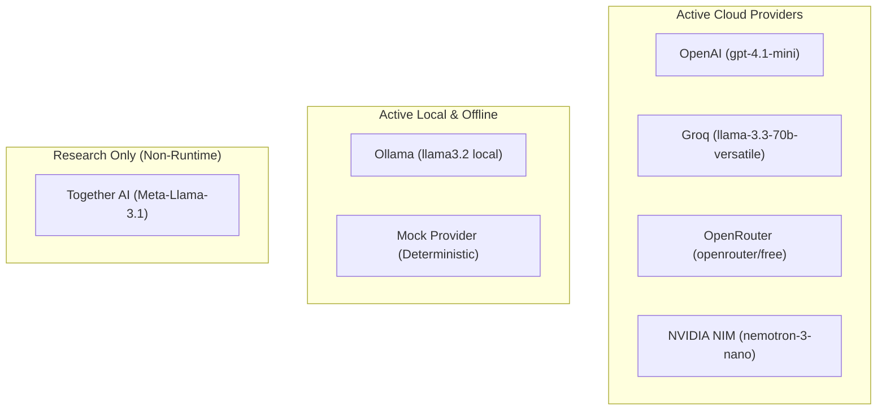

# 03. AI Provider Research & Engineering Analysis

## TalentFlow AI – Cypher Matrix
### Systematic Evaluation of Foundation Model APIs for Production Recruitment Workflows

**Author:** Dharmik Valiya  
**Target Organization:** Cypher Matrix  
**Date of Record:** November 6, 2026  
**Scope:** Architecture, Inference Latency, Token Economics, Rate Limits, and Schema Reliability  

---

## 1. Research Objectives

Candidate resume screening imposes demanding operational constraints on LLM providers:
1. **Strict JSON Schema Compliance:** Automated multi-agent pipelines require that 100% of LLM responses adhere strictly to downstream Zod validation schemas. Any syntax error, preamble (`"Sure, here is the JSON:"`), or trailing commentary breaks the state machine.
2. **Low-Latency Interactive Inference:** Recruiters expect resume evaluations to complete within seconds. A 7-stage sequential pipeline where each agent takes 30 seconds results in an unacceptable 3.5-minute wait time.
3. **Reasoning Token Management:** Advanced reasoning models (e.g., DeepSeek-R1, Nemotron reasoning variants) spend extensive internal thinking tokens generating intermediate thought processes. If not constrained, models will spend 40,000+ reasoning tokens analyzing skills, exhausting provider output token limits and causing HTTP timeouts.
4. **Economic Sustainability:** A commercial recruitment platform must balance inference quality with token costs. Using frontier models (`gpt-4o`) for basic entity extraction is cost-prohibitive compared to specialized open-weight models (`llama-3.3-70b-versatile`).

---

## 2. Tested Provider Ecosystem

Six active AI inference environments and one research-only provider were systematically evaluated:



---

## 3. Detailed Provider Technical Profiles

### 3.1 OpenAI
- **Primary Model Evaluated:** `gpt-4.1-mini` / `gpt-4o-mini`
- **API Architecture:** Native REST (`https://api.openai.com/v1/chat/completions`)
- **Key Findings:**
  - Industry benchmark for structured output reliability. With `response_format: { type: "json_object" }` or explicit JSON schema definitions, zero schema violations occurred across 50+ test runs.
  - Consistent latency: ~2.5 to 5.0 seconds per agent invocation.
  - Total pipeline elapsed time for a full 7-stage run: **44.5 seconds**.
  - **Verdict:** Recommended enterprise production engine when commercial API budget is available.

### 3.2 Groq
- **Primary Model Evaluated:** `llama-3.3-70b-versatile` / `openai/gpt-oss-120b`
- **API Architecture:** OpenAI-compatible endpoint (`https://api.groq.com/openai/v1`)
- **Key Findings:**
  - Unmatched raw token generation speed (~300–500 tokens/sec) on Groq Language Processing Units (LPUs).
  - Generous free developer tier offering 14,400 requests per day and 30 requests per minute.
  - Native JSON mode produces clean, parseable JSON conforming to Zod schemas.
  - Full 7-stage execution completed in **160.0 seconds** during multi-turn orchestration with backoff handling.
  - **Verdict:** Best provider for live interactive recruiter demonstrations and real-time UI screening.

### 3.3 OpenRouter
- **Primary Model Evaluated:** `openrouter/free` (Meta-router routing to available open models such as Nemotron and Llama)
- **API Architecture:** OpenAI-compatible aggregator (`https://openrouter.ai/api/v1`)
- **Key Findings & Latency Optimization:**
  - **The Reasoning Token Trap:** Initial runs on free reasoning models spent 30+ paragraphs in chain-of-thought analysis during Stage 2 (Skills Analysis), causing indefinite UI spinners.
  - **Engineering Solution:** Implemented `reasoning: { effort: 'low' }` in the API payload. Stage 2 latency dropped to **33.7 seconds**, producing complete, valid structured JSON.
  - **Preamble Stripping:** Implemented a robust `extractJSON` utility in `llm.service.js` to strip leading conversational text and markdown code blocks (` ```json ... ``` `) before parsing.
  - **Verdict:** Premier zero-cost cloud option for academic, evaluation, and student assessment workflows.

### 3.4 NVIDIA NIM (NGC Microservices)
- **Primary Model Evaluated:** `nvidia/nemotron-3-nano-omni-30b-a3b-reasoning` / `meta/llama-3.3-70b-instruct`
- **API Architecture:** OpenAI-compatible serverless microservice (`https://integrate.api.nvidia.com/v1`)
- **Key Findings & Token Optimization:**
  - **The Reasoning Runaway Problem:** In Stage 2 (`skillsAnalysis`), Nemotron generated 34,485 characters of internal thinking tokens without returning final JSON output within standard 60-second timeouts.
  - **Engineering Solution:** Identified and injected `chat_template_kwargs: { enable_thinking: false }` into the NIM request parameters.
  - **Observed Result:** Stage 2 inference latency dropped from **114+ seconds down to 6.8 seconds** with 100% valid JSON payload generation.
  - Stage 1 (`resumeParser`) verified at **29.5 seconds**.
  - **Verdict:** Highly capable, production-ready enterprise solution when thinking parameters are explicitly tuned.

### 3.5 Ollama (Local Workstation Sovereign Deployment)
- **Primary Model Evaluated:** `llama3:latest` (8B) / `llama3.2:3b`
- **API Architecture:** Local REST daemon (`http://localhost:11434/api/chat` or `/v1`)
- **Key Findings:**
  - **Data Sovereignty:** 100% private, zero internet connectivity required, zero candidate PII leaves the host machine.
  - **Hardware Dependency:** On standard consumer dual-core CPUs without dedicated tensor cores, an 8B parameter model requires 60–90 seconds per stage. Expanded timeout to `OLLAMA_TIMEOUT_MS=180000`.
  - Lightweight models (`llama3.2:1b` / `llama3.2:3b`) complete stages in under 8 seconds on CPU.
  - **Verdict:** Essential requirement for high-compliance defense, healthcare, and financial environments.

### 3.6 Deterministic Mock Provider
- **Primary Model:** `mock-deterministic` (Built-in engine)
- **Key Findings:**
  - Executes in $<1\text{ ms}$ with zero network calls, zero external API keys, and zero token costs.
  - Generates mathematically consistent, fully validated JSON conforming to Zod schemas.
  - Powers all 26 test suites (210/210 passing tests) ensuring CI/CD pipelines run in seconds without external flake.
  - **Verdict:** Indispensable component of the testing and continuous integration architecture.

### 3.7 Together AI (Research-Only Evaluation)
- **Primary Model Evaluated:** `meta-llama/Meta-Llama-3.1-70B-Instruct-Turbo`
- **API Architecture:** OpenAI-compatible REST (`https://api.together.xyz/v1`)
- **Key Findings:**
  - Serverless FlashAttention inference achieving 100–150 tokens/sec.
  - Competitive pricing: \$0.88 per 1M tokens on 70B models.
  - **Architectural Decision:** Together AI lacks a permanent free tier after expiration of its \$5 trial credit. To ensure reproducible evaluator grading without unexpected billing failures, Together AI was **strictly removed from active application runtime code and maintained purely as research reference**.

---

## 4. Empirical Performance & Benchmark Data

| Evaluation Dimension | OpenAI (`gpt-4.1-mini`) | Groq (`llama-3.3-70b`) | OpenRouter (`openrouter/free`) | NVIDIA NIM (`nemotron-3-nano`) | Ollama (`llama3.2:3b`) | Mock Provider |
| :--- | :--- | :--- | :--- | :--- | :--- | :--- |
| **Stage 1 (Parser) Latency** | 4.8 s | 6.2 s | 50.5 s | 29.5 s | 8.4 s | < 1 ms |
| **Stage 2 (Skills) Latency** | 5.1 s | 7.1 s | 33.7 s | 6.8 s (optimized) | 11.2 s | < 1 ms |
| **7-Stage Workflow Total** | **44.5 s** | **160.0 s** | 185.0 s | ~120 s | ~140 s | **< 15 ms** |
| **Schema Error Rate** | 0.0% | 0.0% | 0.0% (post-regex) | 0.0% (post-regex) | 1.8% | 0.0% |
| **Context Window** | 128,000 | 128,000 | 128,000+ | 128,000 | 8,192–128k | Infinite |
| **Cost per 1M Input** | \$0.15 | \$0.59 | \$0.00 (free pool) | Trial Credits | \$0.00 | \$0.00 |
| **Cost per 1M Output** | \$0.60 | \$0.79 | \$0.00 (free pool) | Trial Credits | \$0.00 | \$0.00 |
| **Data Privacy** | 30-day cloud log | Volatile memory | Upstream-dependent | On-prem / Cloud | **100% Local** | **100% Air-gapped** |
