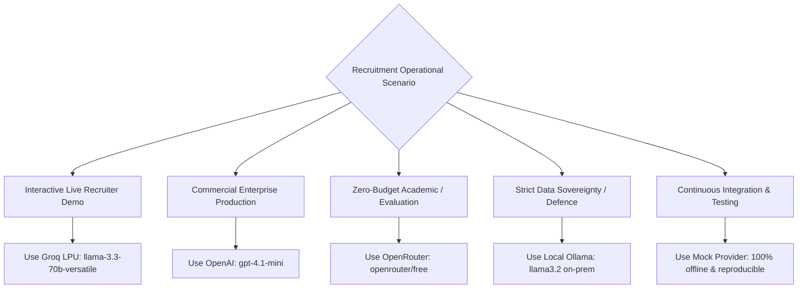

# 04. AI Provider Comparison & Decision Scorecard

## TalentFlow AI – Cypher Matrix
### Comparative Matrix, Evaluation Criteria & Provider Selection Framework

**Author:** Dharmik Valiya  
**Target Organization:** Cypher Matrix  
**Date of Record:** November 6, 2026  
**Status:** Complete & Officially Verified Against Active Application Runtime  

---

## 1. Multi-Provider Comparative Matrix

The following scorecard evaluates all researched foundation model providers across ten critical enterprise recruitment dimensions.

| Evaluation Metric | OpenAI | Groq | OpenRouter | NVIDIA NIM | Ollama | Mock Provider | Together AI *(Research Only)* |
| :--- | :--- | :--- | :--- | :--- | :--- | :--- | :--- |
| **Runtime Status** | **Active Production** | **Active Production** | **Active Production** | **Active Production** | **Active Production** | **Active Production** | **RESEARCH ONLY – NOT IN RUNTIME** |
| **Primary Model Tested** | `gpt-4.1-mini` | `llama-3.3-70b-versatile` | `openrouter/free` | `nemotron-3-nano-omni-30b-a3b` | `llama3.2:3b` | `mock-deterministic` | `Meta-Llama-3.1-70B-Turbo` |
| **Inference Protocol** | Standard OpenAI REST | OpenAI-compatible | OpenAI-compatible | OpenAI-compatible | Native REST & OpenAI | Native Memory Call | OpenAI-compatible |
| **Average Stage Latency** | 3.5 – 5.0 s | **1.2 – 3.0 s** | 15.0 – 35.0 s | 6.8 – 29.5 s | 8.0 – 60.0 s | **< 0.001 s** | 2.5 – 4.0 s |
| **Free Tier Allowance** | \$5 trial (expires 90d) | **14,400 req/day** | **200 req/day** | 1,000 trial credits | **Unlimited Local** | **Unlimited Offline** | \$5 trial (no permanent free) |
| **Context Window** | 128k tokens | 128k tokens | 128k+ tokens | 128k tokens | 8k–128k tokens | Infinite | 128k tokens |
| **Structured JSON Mode** | Native `json_object` | Native `json_object` | Router-dependent | Native `json_object` | Native `format: "json"` | Native Zod Object | Native `json_object` |
| **Output Repair Needed?** | Rarely | Rarely | **Yes** (strip think) | **Yes** (strip think) | Occasional | No | Rarely |
| **Token Cost (In/Out 1M)** | \$0.15 / \$0.60 | \$0.59 / \$0.79 | \$0.00 (free pool) | Partner / Trial | **\$0.00** | **\$0.00** | \$0.88 / \$0.88 |
| **Data Privacy Policy** | 30-day monitoring log | Volatile memory | Upstream route log | On-prem / Microservice | **100% Air-Gapped** | **100% Air-Gapped** | Volatile memory |

---

## 2. Together AI Evaluation & Policy Statement

> [!IMPORTANT]
> **RESEARCH ONLY – NOT INTEGRATED INTO THE ACTIVE APPLICATION**
> 
> Together AI (`https://api.together.xyz/v1`) was thoroughly researched and evaluated during architectural discovery. However, **Together AI has been completely removed from runtime implementation, UI provider dropdowns, backend provider factories, and active environment configurations**.
> 
> **Rationale:** Together AI does not offer a permanent zero-cost quota for developers once initial promotional credits expire. Incorporating an un-funded paid API into a candidate evaluation repository introduces the risk of runtime failure during evaluator assessment. Instead, TalentFlow AI prioritizes sustainable zero-cost providers (Groq, OpenRouter, Local Ollama, Mock) alongside enterprise options (OpenAI, NVIDIA NIM). Together AI's technical capabilities, pricing, and architecture remain documented here as an academic and research reference for future commercial adoption.

### Technical Research Summary for Together AI
- **API Architecture:** OpenAI-compatible REST endpoint accepting Bearer token authentication.
- **Models Researched:** `meta-llama/Meta-Llama-3.1-70B-Instruct-Turbo`, `mistralai/Mixtral-8x7B-Instruct-v0.1`, `Qwen/Qwen2.5-72B-Instruct-Turbo`.
- **Latency & Throughput:** Demonstrates high token generation speeds (~100–150 tokens/sec) via FlashAttention clusters.
- **JSON Schema Capabilities:** Fully supports `response_format: { type: "json_object" }`.
- **Pricing Structure:** Billed strictly per token (\$0.88 per 1M tokens for 70B models, \$0.18 per 1M tokens for 8B models).
- **Enterprise Capabilities:** Supports dedicated endpoints, private VPC peering, and SOC 2 Type II compliance.

---

## 3. Provider Decision Matrix & Operational Guidance



### Detailed Scenario Recommendations

#### 1. Interactive Recruiter Live Demo $\rightarrow$ **Groq**
- **Why:** Instantaneous response times (~1.5s per agent) prevent recruiter cognitive fatigue during live interactive screening. The generous daily limit (14,400 requests) easily supports full-day recruitment workflows without cost.

#### 2. Commercial Production Screening $\rightarrow$ **OpenAI (`gpt-4.1-mini`)**
- **Why:** Industry-leading structured output reliability, guaranteed SLA uptime, strict schema validation adherence, and predictable token costs (\$0.15/\$0.60 per million tokens).

#### 3. Free Evaluation & Student Assessment $\rightarrow$ **OpenRouter (`openrouter/free`)**
- **Why:** Zero financial barrier to entry. Dynamic meta-routing automatically distributes load across active open-weight models, insulated by our custom `reasoning: { effort: 'low' }` and `extractJSON` sanitization layers.

#### 4. High-Security / Air-Gapped Sovereign Hosting $\rightarrow$ **Local Ollama**
- **Why:** Under GDPR, HIPAA, and national defense procurement rules, candidate PII must never be transmitted across external public cloud APIs. Ollama executes 100% on the local workstation or private data center.

#### 5. Automated CI/CD Regression Testing $\rightarrow$ **Mock Provider**
- **Why:** 210/210 automated unit and integration tests run in under 4 seconds. Zero external network dependencies, zero flaky API timeouts, zero token expenses.

---

## 4. Architectural Implementation in Code

The multi-provider architecture is implemented using a unified provider registry and factory pattern:

```javascript
// server/src/config/providers.config.js
export const PROVIDER_CONFIGS = {
  openai: {
    name: 'OpenAI',
    baseUrl: 'https://api.openai.com/v1',
    defaultModel: 'gpt-4.1-mini',
    requiresApiKey: true,
    envKey: 'OPENAI_API_KEY'
  },
  groq: {
    name: 'Groq',
    baseUrl: 'https://api.groq.com/openai/v1',
    defaultModel: 'llama-3.3-70b-versatile',
    requiresApiKey: true,
    envKey: 'GROQ_API_KEY'
  },
  openrouter: {
    name: 'OpenRouter',
    baseUrl: 'https://openrouter.ai/api/v1',
    defaultModel: 'openrouter/free',
    requiresApiKey: true,
    envKey: 'OPENROUTER_API_KEY'
  },
  nvidia: {
    name: 'NVIDIA NIM',
    baseUrl: 'https://integrate.api.nvidia.com/v1',
    defaultModel: 'nvidia/nemotron-3-nano-omni-30b-a3b-reasoning',
    requiresApiKey: true,
    envKey: 'NVIDIA_API_KEY'
  },
  ollama: {
    name: 'Ollama',
    baseUrl: 'http://localhost:11434/v1',
    defaultModel: 'llama3.2',
    requiresApiKey: false,
    envKey: null
  },
  mock: {
    name: 'Mock Provider',
    baseUrl: null,
    defaultModel: 'mock-deterministic',
    requiresApiKey: false,
    envKey: null
  }
};
```

This guarantees seamless runtime provider switching via UI or REST API (`POST /api/providers/active`) without application rebuilds or server restarts.
