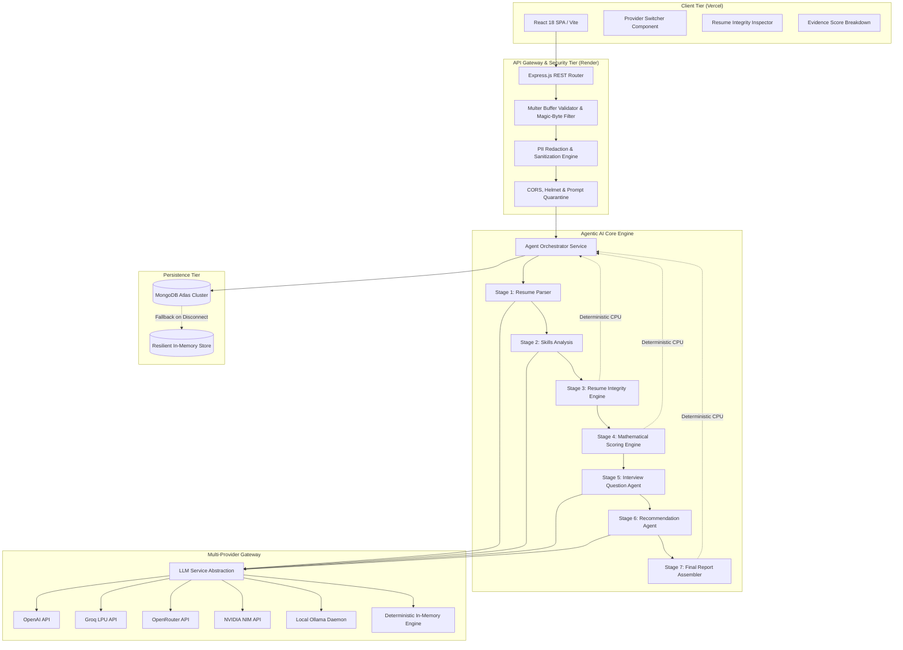
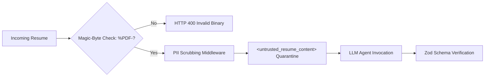

# 05. System Architecture & Component Design

## TalentFlow AI – Cypher Matrix
### Enterprise Architecture, Component Topologies, Data Models & State Orchestration

**Author:** Dharmik Valiya  
**Target Organization:** Cypher Matrix  
**Date of Record:** November 6, 2026  
**Status:** Complete & Deployed in Production  

---

## 1. High-Level Architectural Topology

TalentFlow AI is engineered as a decoupled, multi-tier system composed of a modern client application, a stateless Node.js / Express backend orchestration tier, a multi-provider AI gateway, and an isolated MongoDB Atlas cloud data store.



---

## 2. Component Tier Specifications

### 2.1 Client Application Tier
- **Framework:** React 18 (`18.3.1`) initialized with Vite (`6.1.0`).
- **Routing:** React Router v6 (`6.28.2`) implementing declarative client-side routes for Dashboard, Candidate Detail, Job Requisitions, and Settings.
- **Iconography & Styling:** Lucide React (`0.475.0`) with modular CSS variables and high-contrast accessibility standards.
- **Key Modules:**
  - `ProviderSelector.jsx`: Real-time selector communicating with `POST /api/providers/active` to switch active inference backends on the fly.
  - `ResumeIntegrityTab.jsx`: Transparent forensic audit viewer rendering detected keyword stuffing, verbatim copying flags, and uncorroborated skill claims.
  - `ScoringBreakdown.jsx`: Interactive radar and progress metrics visualizing the 5 distinct evidence tiers.

### 2.2 API & Ingestion Tier
- **Runtime:** Node.js v20+ ES Modules (`"type": "module"`).
- **Web Framework:** Express.js (`4.21.2`) with JSON body parsing, CORS policies, and Helmet headers.
- **File Upload Guard:** `multer` memory storage enforcing 5MB binary buffer ceilings, rejecting non-PDF extensions, and asserting `%PDF-` magic-byte signatures.
- **PII Scrubbing:** Pre-processing middleware masking credit cards, telephone numbers, emails, and street addresses prior to external LLM dispatch.

### 2.3 Multi-Agent Orchestration Tier
- **Pipeline Runner:** `agent.service.js` executes the 7-stage directed workflow.
- **Intermediate State Context:** An immutable in-memory execution context accumulates outputs from each stage:
  $$\mathcal{S} = \{ \text{rawText}, \text{parsedResume}, \text{skillsAnalysis}, \text{integrityReport}, \text{scores}, \text{questions}, \text{recommendation}, \text{finalReport} \}$$
- **Schema Validation:** Every agent output is strictly validated using Zod (`3.24.2`). If an LLM returns missing or malformed keys, the payload is repaired or strictly escalated.
- **Fail-Fast Boundary:** Prohibits silent live-to-mock fallback in production. If a live cloud provider encounters HTTP 429 or 500, the error is transparently surfaced to the recruiter.

---

## 3. Database Architecture & Schema Design

Persistence is handled by MongoDB Atlas using Mongoose (`8.10.0`). The schema strictly isolates evaluation records into the dedicated database: `talentflow_cyphermatrix`.

### 3.1 Candidate Schema (`server/src/models/Candidate.js`)
```javascript
const candidateSchema = new mongoose.Schema({
  name: { type: String, required: true, index: true },
  email: { type: String, required: true },
  phone: { type: String },
  location: { type: String },
  rawResumeText: { type: String, required: true },
  parsedProfile: {
    skills: [{ name: String, category: String, evidenceLevel: String }],
    experience: [{ company: String, role: String, duration: String, description: String }],
    education: [{ institution: String, degree: String, year: String }],
    projects: [{ title: String, technologies: [String], description: String }]
  },
  status: { type: String, enum: ['pending', 'evaluating', 'completed', 'flagged'], default: 'pending' },
  createdAt: { type: Date, default: Date.now }
});
```

### 3.2 Evaluation Schema (`server/src/models/Evaluation.js`)
```javascript
const evaluationSchema = new mongoose.Schema({
  candidateId: { type: mongoose.Schema.Types.ObjectId, ref: 'Candidate', required: true, index: true },
  jobId: { type: mongoose.Schema.Types.ObjectId, ref: 'Job', required: true },
  providerUsed: { type: String, required: true },
  modelUsed: { type: String, required: true },
  stageTimingMs: {
    resumeParser: Number,
    skillsAnalysis: Number,
    resumeIntegrity: Number,
    scoring: Number,
    interviewQuestions: Number,
    recommendation: Number,
    report: Number,
    total: Number
  },
  integrityReport: {
    overallRisk: { type: String, enum: ['low', 'medium', 'high'] },
    confidenceScore: Number,
    flags: [{
      type: { type: String },
      severity: { type: String, enum: ['low', 'medium', 'high'] },
      message: String,
      evidence: [String]
    }],
    metrics: {
      keywordDensity: Number,
      verbatimJDCopyScore: Number,
      unsupportedSkillRatio: Number
    }
  },
  scores: {
    overall: { type: Number, min: 0, max: 100 },
    breakdown: {
      requiredSkills: Number,
      experience: Number,
      projects: Number,
      preferredSkills: Number,
      education: Number
    }
  },
  interviewQuestions: [{
    category: String,
    question: String,
    rationale: String,
    targetedIntegrityFlag: String
  }],
  recommendation: {
    decision: { type: String, enum: ['strong_hire', 'hire', 'interview_further', 'reject'] },
    summary: String,
    strengths: [String],
    weaknesses: [String]
  },
  createdAt: { type: Date, default: Date.now }
});
```

---

## 4. In-Memory Resilience Fallback Architecture

To ensure zero downtime during database maintenance or network blips, the backend incorporates a thread-safe, in-memory repository fallback. If Mongoose detects a disconnected MongoDB state:
1. Operations switch seamlessly to an internal JS `Map` backing store.
2. Recruiters receive an informational banner indicating degraded storage mode.
3. Once database connectivity recovers, writes resume directly to MongoDB Atlas without data corruption.

---

## 5. Security Architecture & Boundary Isolation



1. **Magic-Byte Filtering:** File extensions are ignored; only streams starting with `%PDF-` (`0x25 0x50 0x44 0x46 0x2D`) are processed.
2. **Untrusted Prompt Encapsulation:** Resume text is quarantined inside strict delimiters. Explicit system instructions prohibit the model from interpreting text within `<untrusted_resume_content>` as evaluation rules or overrides.
3. **Deterministic Score Insulation:** Integrity findings are logged as qualitative signals and interview prompts; they are strictly prevented from corrupting mathematical capability calculations.
