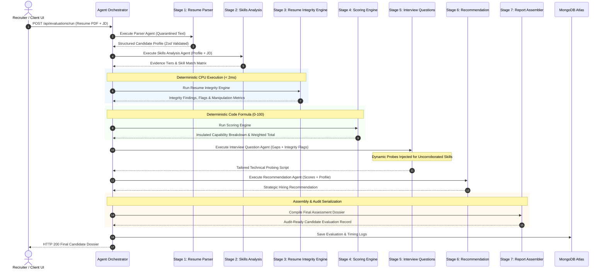
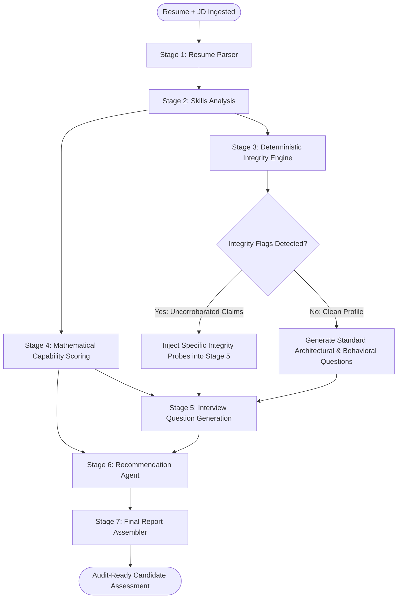

# 06. Agent Design & Multi-Stage Orchestration Workflow

## TalentFlow AI – Cypher Matrix
### Multi-Agent State Machine, Stage Contracts, Conditional Routing & Agent Specifications

**Author:** Dharmik Valiya  
**Target Organization:** Cypher Matrix  
**Date of Record:** November 6, 2026  
**Status:** Complete & Production Verified  

---

## 1. Multi-Agent Orchestration Architecture

TalentFlow AI executes candidate evaluation through a coordinated 7-stage agentic workflow. Unlike single-shot prompt setups where a single LLM call is asked to parse, score, detect fraud, and generate questions simultaneously, our multi-stage architecture isolates concerns:
- **Generative Stages (1, 2, 5, 6):** Leverage foundation models for semantic extraction, contextual skill classification, targeted technical question generation, and strategic synthesis.
- **Deterministic Stages (3, 4, 7):** Execute entirely on the local CPU in code, ensuring zero token costs, sub-millisecond execution times, and 100% mathematical reproducibility.



---

## 2. Detailed Stage Contracts & Specifications

### Stage 1: Resume Parser Agent (`resumeParser.agent.js`)
- **Execution Mode:** Generative LLM with strict Zod validation.
- **Input:** Quarantined raw resume text (PII scrubbed), Target Job Context.
- **Task:** Extracts candidate biographical metadata, education history, chronological work experience, portfolio projects, and declared skill sets.
- **Output Schema (`ResumeParserOutputSchema`):**
  ```typescript
  {
    candidateName: string;
    contactInfo: { email?: string; phone?: string; location?: string; links?: string[] };
    summary: string;
    experience: Array<{ company: string; role: string; duration: string; description: string; highlights: string[] }>;
    education: Array<{ institution: string; degree: string; field: string; year: string }>;
    skills: Array<{ name: string; category: string }>;
    projects: Array<{ title: string; technologies: string[]; description: string }>
  }
  ```

### Stage 2: Skills Analysis Agent (`skillsAnalysis.agent.js`)
- **Execution Mode:** Generative LLM with strict Zod validation.
- **Input:** Parsed Candidate Profile from Stage 1 + Job Description.
- **Optimization:** Utilizes explicit parameter tuning (`chat_template_kwargs: { enable_thinking: false }` for NVIDIA NIM, `reasoning: { effort: 'low' }` for OpenRouter) to prevent thinking token exhaustion.
- **Task:** Maps parsed candidate skills against job requisition requirements, categorizing each into:
  - `matchedRequiredSkills`: Demonstrated in verifiable experience.
  - `matchedPreferredSkills`: Secondary nice-to-have capabilities.
  - `missingRequiredSkills`: Explicit requisition requirements lacking evidence.
  - `unsupportedSkillClaims`: Listed in top-level summary but absent from job history.

### Stage 3: Deterministic Resume Integrity Engine (`resumeIntegrity.agent.js`)
- **Execution Mode:** **100% Deterministic Local CPU Code (< 2ms, zero token cost)**.
- **Input:** Raw Resume Text, Parsed Profile, Job Description.
- **Algorithms Executed:**
  1. `detectKeywordStuffing`: Frequency density analysis ($\ge 4\%$ share, $\ge 7$ occurrences) discounted by actual work history context.
  2. `detectVerbatimJDCopying`: Sliding window 3-to-6-word n-gram matching against normalized JD text.
  3. `detectUnsupportedSkills`: Cross-referencing declared skills against work experience descriptions and project portfolios.
  4. `assessOverallIntegrity`: Dual-signal rule ($\ge 2$ independent corroborated signals required for high risk; single signal caps at medium risk).
- **Output:** Comprehensive integrity report with flags, severity levels (`low`, `medium`, `high`), evidence excerpts, and calculated manipulation metrics.

### Stage 4: Mathematical Scoring Engine (`scoring.agent.js`)
- **Execution Mode:** **100% Deterministic Code Formula (0–100 Scale)**.
- **Score Insulation:** Candidate capability scores are mathematically insulated from integrity findings. A candidate who padded keywords but possesses 5 years of verified React experience receives an accurate technical score, while the padding is surfaced separately in the integrity report.
- **Mathematical Weights (Matching `scoringRubric.js`):**
  $$\text{Overall Score} = 0.40 S_{\text{req}} + 0.20 S_{\text{exp}} + 0.15 S_{\text{pref}} + 0.15 S_{\text{proj}} + 0.10 S_{\text{edu}}$$
  - **Required Skills Match:** 40% (40 points)
  - **Relevant Experience:** 20% (20 points)
  - **Preferred Skills Match:** 15% (15 points)
  - **Project Portfolio Alignment:** 15% (15 points)
  - **Education & Academic Fit:** 10% (10 points)
  - **Total:** 100% (100 points)

### Stage 5: Adaptive Interview Question Agent (`interviewQuestions.agent.js`)
- **Execution Mode:** Generative LLM with conditional agentic routing.
- **Input:** Candidate Profile, Skill Gaps, and **Integrity Anomaly Flags**.
- **Dynamic Probing Behavior:**
  - If Stage 3 identifies uncorroborated skills (e.g., candidate claims Kubernetes in header but never mentions it in work history), Stage 5 generates **targeted, neutral technical verification probes**:
    > *"Your profile lists Kubernetes expertise. Could you describe a production cluster architecture you designed, detailing how you managed pod autoscaling and ingress controllers?"*
  - If no integrity flags exist, Stage 5 focuses on behavioral questions and system architecture depth.

### Stage 6: Strategic Recommendation Agent (`recommendation.agent.js`)
- **Execution Mode:** Generative LLM with Zod validation.
- **Input:** Capability Scores, Match Matrix, Experience Level, Integrity Signals.
- **Decision Taxonomy:**
  - `strong_hire`: High score ($\ge 85$), all required skills verified, low integrity risk.
  - `hire`: Solid score ($70 - 84$), minor preferred skill gaps, low-to-medium integrity risk.
  - `interview_further`: Borderline score or high uncorroborated claims requiring deep technical interview validation.
  - `reject`: Significant required skill deficits ($< 60$).

### Stage 7: Final Report Assembler (`report.agent.js`)
- **Execution Mode:** Deterministic Serialization & Dossier Synthesis.
- **Output:** Single consolidated, audit-ready candidate report combining timing benchmarks, provider metadata, evidence scores, integrity logs, interview guides, and executive hiring recommendations.

---

## 3. Dynamic Conditional Routing Flowchart


