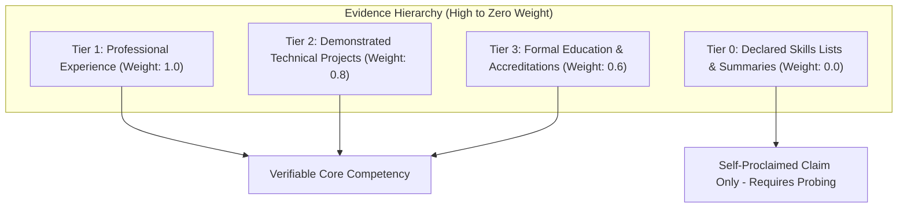
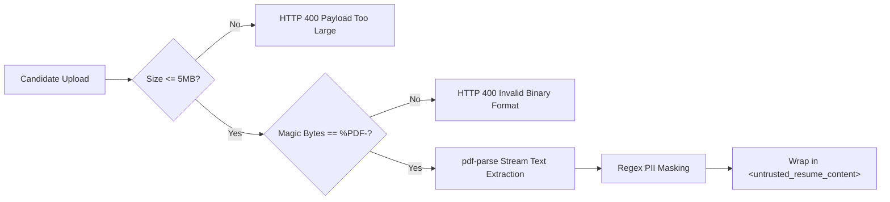

# 07. Intelligent Resume & PDF Analysis Methodology

## TalentFlow AI – Cypher Matrix
### Evidence-Grounded Parsing, Hierarchical Evidence Tiers & Skill Qualification

**Author:** Dharmik Valiya  
**Target Organization:** Cypher Matrix  
**Date of Record:** November 6, 2026  
**Status:** Complete & Production Verified  

---

## 1. The Core Problem with Conventional Parsing

Conventional Applicant Tracking Systems (ATS) and naive LLM prompts treat a candidate resume as a "bag of words." If the string `"Kubernetes"` appears anywhere in the document—whether in a bullet describing 4 years of production cluster management or in a footer keyword list—traditional parsers assign it equal weight.

This creates severe perverse incentives:
1. Candidates inflate their match scores by appending unelaborated skill lists to their resumes.
2. Unqualified applicants bypass automated screens ahead of experienced engineers who omit buzzword lists in favor of concise achievement descriptions.
3. Automated evaluators succumb to ungrounded hallucinations when summarizing candidate qualifications.

---

## 2. Multi-Tier Hierarchical Evidence Model

TalentFlow AI enforces a **Hierarchical Evidence Tier Model**. Skills and qualifications are strictly categorized and weighted based on where and how they appear within the candidate's verified document structure:

### Tier Definitions

| Evidence Tier | Document Sources | Evidentiary Weight | Verification Requirement |
| :--- | :--- | :--- | :--- |
| **Tier 1: Professional Employment** | Work History, Employment Chronology, Client Engagements | **1.0 (Maximum)** | Contextualized action verb + quantifiable impact + duration of role. |
| **Tier 2: Technical Projects** | Open-Source Repositories, Personal Projects, Hackathon Submissions | **0.8 (High)** | Architectural role + technical stack list + outcome or repository URL. |
| **Tier 3: Formal Education** | University Degrees, Accredited Industry Certifications (AWS, GCP, CKA) | **0.6 (Moderate)** | Degree title + accredited institution + graduation or issue year. |
| **Tier 0: Self-Proclaimed Claims** | Header Summaries, Core Competencies blurbs, Sidebar skill chips | **0.0 (Zero)** | **Explicitly excluded from direct capability scoring**. Classified as uncorroborated claims. |

---

## 3. PDF Ingestion & Binary Security Pipeline

Before any textual analysis occurs, the raw binary upload undergoes rigorous sanitization and extraction:

1. **Buffer Size Ceiling:** Upload middleware enforces a strict 5MB limit in memory buffers to prevent resource exhaustion attacks.
2. **Magic-Byte Signature Inspection:** File extensions (`.pdf`) and client MIME types (`application/pdf`) are untrusted. The system inspects the first 5 bytes of the binary buffer, asserting that they match ASCII `%PDF-` (`0x25 0x50 0x44 0x46 0x2D`). Files disguised as PDFs (e.g. renamed executables or HTML pages) are rejected immediately.
3. **Stream Parsing & Text Recovery:** The binary buffer is decoded using `pdf-parse`, recovering raw text streams while extracting metadata (creation dates, producer software, page count).
4. **PII Masking & Isolation:** The extracted plain text is scrubbed of direct identifiers (phone numbers, physical addresses, emails) before transmission to downstream agents.

---

## 4. Skill Extraction & Taxonomy Normalization

Raw resume text is parsed into a normalized technical taxonomy to eliminate false negatives caused by synonym variations and acronyms:

### Normalization Examples

| Raw Candidate String | Normalized Canonical Skill | Category | Synonyms Handled |
| :--- | :--- | :--- | :--- |
| `"React.js"`, `"ReactJS"`, `"React 18"` | `React` | Frontend | `React Native` (differentiated) |
| `"Node"`, `"NodeJS"`, `"Node.js"` | `Node.js` | Backend | `Express.js`, `NestJS` |
| `"Postgres"`, `"PostgreSQL 14"` | `PostgreSQL` | Database | `RDBMS`, `SQL` |
| `"K8s"`, `"Kubernetes Cluster"` | `Kubernetes` | DevOps / Cloud | `Container Orchestration` |
| `"AWS Lambda"`, `"Amazon Web Services"` | `AWS` | Cloud Platform | `Cloud Infrastructure` |

### Extraction Logic & Prompting Safeguards
In Stage 1 (`resumeParser.agent.js`), the model is instructed with strict boundary constraints:
- Extract only skills that are explicitly mentioned in the text.
- Never extrapolate or hallucinate unmentioned frameworks (e.g., do not infer `TypeScript` merely because `JavaScript` is mentioned).
- Annotate each skill with its document location (`experience`, `projects`, `education`, or `summary_only`).
- Validate the generated JSON payload against `ResumeParserOutputSchema` via Zod before proceeding to Stage 2.
