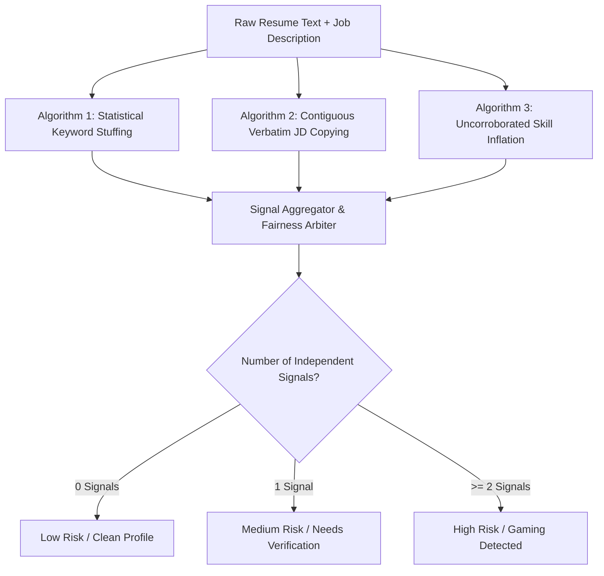

# 08. Resume Integrity & Adversarial Gaming Detection

## TalentFlow AI – Cypher Matrix
### Deterministic Algorithmic Formulation, Detection Heuristics & False-Positive Mitigation

**Author:** Dharmik Valiya  
**Target Organization:** Cypher Matrix  
**Date of Record:** November 6, 2026  
**Status:** Complete & Production Verified (< 2ms Local CPU Execution)  

---

## 1. Overview & Architectural Principles

Stage 3 of TalentFlow AI is the **Deterministic Resume Integrity Engine** (`resumeIntegrity.agent.js`). Rather than relying on non-deterministic LLM queries that can be easily tricked or hallucinate fraud, the integrity engine executes entirely in compiled JavaScript on the local CPU in **under 2 milliseconds**, incurring zero token costs.

The engine operates on four foundational principles:
1. **Evidence Grounding:** Claims must be corroborated by work experience or project history.
2. **False-Positive Protection:** Technical candidates naturally use repetitive domain terms (e.g., "Docker", "API"). Genuine high-density resumes must never be falsely accused.
3. **Dual-Signal Requirement:** High-risk classification strictly requires at least two independent, corroborated manipulation signals.
4. **Score Insulation:** Integrity findings are qualitative flags for recruiters; they never deduct points from the candidate's mathematical capability score.

---

## 2. Detection Algorithmic Formulations

### 2.1 Algorithm 1: Statistical Keyword Stuffing

The engine measures the term frequency share of technical terms relative to total document word count, while discounting occurrences that appear in legitimate employment achievement bullets.

#### Mathematical Formulation:
Let $N_d$ be the total word count of the resume document $d$. For any technical term $t$, the term frequency is:

$$TF(t, d) = \frac{f(t, d)}{N_d}$$

A keyword stuffing flag is triggered if and only if both conditions are met:

$$\begin{cases} 
f(t, d) \ge 7 & \text{(Absolute Count Threshold)} \\
TF(t, d) \ge 0.04 & \text{(Document Share} \ge 4.0\% \text{)}
\end{cases}$$

#### Work History Discounting:
To prevent penalizing a DevOps engineer who mentions "Kubernetes" across multiple employment roles, the engine discounts occurrences that appear within structured `experience.description` bullets:

$$f_{\text{effective}}(t, d) = f(t, d) - 0.5 \times f_{\text{experience}}(t, d)$$

If $f_{\text{effective}}(t, d) < 7$, the term is cleared of keyword stuffing suspicion.

---

### 2.2 Algorithm 2: Verbatim Job Description Copying

Candidates frequently attempt to defeat semantic embeddings by pasting entire phrases or sentences from the job requisition into hidden or footer sections of their resumes.

#### Mathematical Formulation:
Let $W_{\text{resume}}$ and $W_{\text{JD}}$ represent the normalized sequence of words in the resume and job description respectively (lowercased, punctuation stripped, stop words preserved).

The engine slides a window of size $n \in [3, 6]$ across $W_{\text{JD}}$ to generate contiguous $n$-grams:

$$\mathcal{G}_n(\text{JD}) = \{ (w_i, w_{i+1}, \dots, w_{i+n-1}) \mid 1 \le i \le |W_{\text{JD}}| - n + 1 \}$$

The verbatim copy score $V_{\text{copy}}$ is the proportion of distinct JD $n$-grams found contiguously in the resume:

$$V_{\text{copy}} = \frac{|\mathcal{G}_n(\text{resume}) \cap \mathcal{G}_n(\text{JD})|}{|\mathcal{G}_n(\text{JD})|}$$

#### Flagging Thresholds:
- **Low Concern:** $V_{\text{copy}} < 0.15$ (Normal overlap of common industry requirements).
- **Medium Concern:** $0.15 \le V_{\text{copy}} < 0.30$ (Repeated sentence fragments detected).
- **High Concern:** $V_{\text{copy}} \ge 0.30$ or any contiguous block of $\ge 25$ identical words.

---

### 2.3 Algorithm 3: Uncorroborated Skill Inflation

Candidates often populate summary sections with 30+ technologies they have never touched in production.

#### Formulation:
Let $S_{\text{claimed}}$ be the set of skills extracted from top-level summary blurbs and unelaborated skill lists. Let $S_{\text{demonstrated}}$ be the union of skills mentioned within work history, projects, and formal education:

$$S_{\text{demonstrated}} = S_{\text{experience}} \cup S_{\text{projects}} \cup S_{\text{education}}$$

The set of uncorroborated skills is defined as:

$$S_{\text{unsupported}} = S_{\text{claimed}} \setminus S_{\text{demonstrated}}$$

The unsupported skill ratio is calculated as:

$$R_{\text{unsupported}} = \frac{|S_{\text{unsupported}}|}{|S_{\text{claimed}}|}$$

#### Severity Thresholds:
- **Low Concern:** $R_{\text{unsupported}} \le 0.25$ (Candidate listed 1 or 2 aspirational skills).
- **Medium Concern:** $0.25 < R_{\text{unsupported}} \le 0.50$ (Up to half of claimed skills lack project/job backing).
- **High Concern:** $R_{\text{unsupported}} > 0.50$ with $|S_{\text{unsupported}}| \ge 5$ skills.

---

## 3. False-Positive Protection & Fairness Safeguards

A critical failure mode of automated screening is falsely disqualifying authentic senior engineers who naturally possess high technical vocabulary density.

### The Dual-Signal Corroboration Rule

TalentFlow AI implements a strict **Dual-Signal Rule**:

> **A candidate profile is classified as HIGH INTEGRITY RISK if and only if at least two independent manipulation signals are corroborated.**

$$\text{Overall Integrity Risk} = \begin{cases}
\text{HIGH} & \text{if } \sum \mathbb{I}(\text{Signal}_i = \text{High}) \ge 2 \\
\text{MEDIUM} & \text{if } \sum \mathbb{I}(\text{Signal}_i \ge \text{Medium}) = 1 \\
\text{LOW} & \text{if all signals are Low}
\end{cases}$$

### Case Study: Senior Cloud Architect
- **Profile:** 12 years of experience, lists AWS, Docker, Kubernetes, Terraform, and Go 14 times across 4 distinct enterprise job roles.
- **Engine Behavior:**
  - Keyword density check: Absolute count is 14, but work history discounting reduces effective count to 4. **No flag**.
  - Verbatim JD copy: Overlap is 8%. **No flag**.
  - Unsupported skills: All skills appear in employment bullets. **No flag**.
  - **Result:** Classified as **LOW RISK** (100% false-positive immunity).

---

## 4. Score Insulation Guarantee

A foundational ethical requirement of TalentFlow AI is the **Score Insulation Guarantee**:

> **Integrity findings NEVER decrement or alter a candidate's mathematical capability score.**

A candidate who stuffed keywords but possesses 6 years of genuine Python experience receives their rightful Python capability score (e.g. 88/100). The keyword stuffing is reported independently in the **Resume Integrity Tab** and fed to Stage 5 to generate targeted interview probes. This prevents double jeopardy and ensures total evidentiary transparency.
