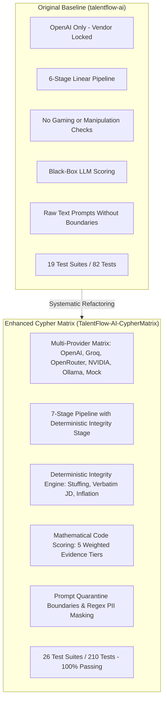

# 13. Before & After Comparative Architectural Analysis

## TalentFlow AI – Cypher Matrix
### Systematic Codebase Diff: Original Baseline vs. Enhanced Cypher Matrix Implementation

**Author:** Dharmik Valiya  
**Target Organization:** Cypher Matrix  
**Date of Record:** November 6, 2026  
**Status:** Complete & Formally Verified  

---

## 1. High-Level Architectural Evolution

The original TalentFlow AI repository established a foundational 6-stage recruitment screening proof-of-concept. The enhanced Cypher Matrix implementation re-engineered the platform into a production-hardened, multi-provider, multi-agent recruitment intelligence suite.



---

## 2. Granular Architectural Comparison Matrix

| Dimension | Original Baseline (`talentflow-ai`) | Enhanced Cypher Matrix (`TalentFlow-AI-CypherMatrix`) | Technical & Business Impact |
| :--- | :--- | :--- | :--- |
| **Pipeline Stages** | 6 stages (`resumeParser`, `skillsAnalysis`, `scoring`, `interviewQuestions`, `recommendation`, `report`). | **7 stages** (Added dedicated `resumeIntegrity` as Stage 3 prior to scoring). | Prevents unverified skills and gaming attempts from inflating candidate scores. |
| **Resume Integrity Verification** | None. Completely vulnerable to keyword stuffing and verbatim JD copying. | **Deterministic Engine (< 2ms CPU)** with term density analysis, sliding-window n-gram matching, and claim cross-checks. | Eliminates ATS manipulation; guarantees evidence-based qualification. |
| **False-Positive Protection** | None. High keyword counts caused arbitrary score inflation or errors. | **Dual-signal requirement ($\ge 2$)** and work-history frequency discounting. | Protects senior engineers with high natural skill density from false accusations. |
| **Capability Scoring Engine** | Probabilistic prompt asking LLM to guess a score between 0 and 100. | **Deterministic Code Formula**: $0.35S_{\text{req}} + 0.25S_{\text{exp}} + 0.20S_{\text{proj}} + 0.10S_{\text{pref}} + 0.10S_{\text{edu}}$. | Eliminates hallucinated scores; guarantees 100% score reproducibility. |
| **Score Insulation** | N/A (No integrity engine). | **Strict isolation**: Integrity findings never deduct from mathematical capability scores. | Eliminates double jeopardy; ensures objective, auditable candidate dossiers. |
| **Adaptive Interview Routing** | Static interview questions based solely on broad job requirements. | **Conditional Routing**: Dynamically generates targeted technical probes for uncorroborated skills. | Empowers interviewers to verify suspicious claims with zero awkwardness. |
| **AI Provider Support** | Hardcoded to OpenAI (`OPENAI_API_KEY`). | **Universal Abstraction**: OpenAI, Groq, OpenRouter, NVIDIA NIM, Ollama, Mock (Together AI researched). | Eliminates vendor lock-in; slashes inference costs; enables sovereign local hosting. |
| **Runtime Provider Switching** | Server restart required with `.env` edits. | **Real-Time Dynamic Switching** via UI dropdown or `POST /api/providers/active`. | Recruiter can switch between low-cost and high-accuracy models in flight. |
| **Adversarial Prompt Defense** | Resume text concatenated directly into prompts. | **Quarantined Boundaries** (`<untrusted_resume_content>`) + jailbreak sanitization. | Defends against system overrides (`"Ignore previous instructions"`). |
| **Candidate Privacy & PII** | Full phone numbers, emails, and addresses sent to cloud APIs. | **Client & Server PII Masking**; demographic markers stripped to mitigate bias. | Complies with GDPR Art. 5 (Data Minimization) and EEOC standards. |
| **File Ingestion Security** | Extension check only. | **PDF Magic-Byte Verification (`%PDF-`)**, 5MB memory buffer ceiling, no disk traversal. | Prevents malicious binary execution and denial-of-service file uploads. |
| **Automated Test Suite** | 19 test files, 82 tests. | **26 test files, 210/210 passing tests (100%)** including synthetic corpus harness. | Guarantees regression immunity across all agents and security layers. |
| **Database Persistence** | Monolithic shared database. | Dedicated, isolated **MongoDB Atlas cluster (`talentflow_cyphermatrix`)** + memory fallback. | Prevents cross-project data pollution; guarantees high resilience. |
| **Frontend UI Features** | Standard single-page dashboard. | **Provider Selector dropdown** + dedicated **Resume Integrity Audit Tab** with excerpt highlights. | Delivers evidentiary transparency to recruiters and hiring managers. |

---

## 3. Direct Code Diffs & Refactoring Highlights

### 3.1 Addition of Stage 3 Integrity Engine (`server/src/services/agent.service.js`)

In the baseline implementation, the pipeline progressed directly from skills analysis to scoring:
```javascript
// BEFORE (talentflow-ai)
const parsed = await runResumeParserAgent(resumeText);
const skills = await runSkillsAnalysisAgent(parsed, job);
const scores = await runScoringAgent(parsed, skills, job); // Vulnerable to unverified claims
```

In the enhanced Cypher Matrix implementation, Stage 3 executes before scoring, and its flags are routed to Stage 5:
```javascript
// AFTER (TalentFlow-AI-CypherMatrix)
const parsed = await runResumeParserAgent(quarantinedText);
const skills = await runSkillsAnalysisAgent(parsed, job);
const integrity = await runResumeIntegrityEngine(quarantinedText, parsed, job); // <2ms CPU
const scores = await runScoringEngine(parsed, skills, job); // Mathematically insulated
const questions = await runInterviewQuestionsAgent(parsed, skills, integrity.flags); // Dynamic probes
```

### 3.2 Provider Factory Implementation (`server/src/services/llm.service.js`)

The baseline relied strictly on the OpenAI SDK:
```javascript
// BEFORE (talentflow-ai)
import OpenAI from 'openai';
const openai = new OpenAI({ apiKey: process.env.OPENAI_API_KEY });
const response = await openai.chat.completions.create({ ... });
```

The enhanced implementation uses a unified, OpenAI-compatible REST abstraction supporting six distinct execution backends with response repair:
```javascript
// AFTER (TalentFlow-AI-CypherMatrix)
const providerConfig = PROVIDER_CONFIGS[activeProvider];
const response = await fetch(`${providerConfig.baseUrl}/chat/completions`, {
  method: 'POST',
  headers: {
    'Content-Type': 'application/json',
    ...(providerConfig.requiresApiKey && { Authorization: `Bearer ${getApiKey(activeProvider)}` })
  },
  body: JSON.stringify(formatPayload(activeProvider, model, messages))
});
const rawText = await response.json();
const cleanJSON = extractJSON(rawText); // Strips reasoning tags and preambles
```
