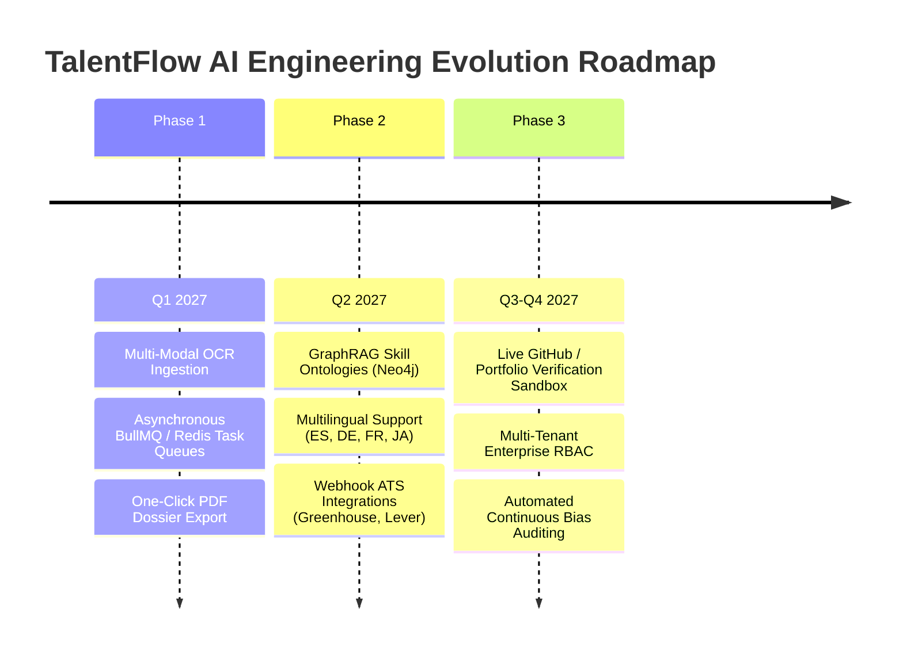

# 15. Future Improvements & Production Engineering Roadmap

## TalentFlow AI – Cypher Matrix
### Strategic Product Evolution, Architecture Enhancements & Phased Implementation Plan

**Author:** Dharmik Valiya  
**Target Organization:** Cypher Matrix  
**Date of Record:** November 6, 2026  
**Status:** Approved Technical Roadmap  

---

## 1. Roadmap Overview & Strategic Objectives

Following the production deployment of TalentFlow AI v2.0.0, the engineering roadmap focuses on scaling candidate throughput, expanding multi-modal document extraction, integrating semantic knowledge graphs (GraphRAG), and establishing native integrations with enterprise Applicant Tracking Systems (ATS).

---

## 2. Granular Phased Implementation Plan

### Phase 1: Near-Term Enhancements (Q1 2027)

#### 1.1 Multi-Modal Optical Character Recognition (OCR) Engine
- **Objective:** Enable flawless parsing of flattened image PDFs, scanned paper resumes, and Canva vector exports.
- **Architecture:** Integrate a lightweight on-premise PaddleOCR container or AWS Textract worker that triggers automatically when `pdf-parse` yields fewer than 100 characters.

#### 1.2 Asynchronous Job Queue (BullMQ + Redis)
- **Objective:** Support high-volume recruiter batch uploads (e.g. 50 resumes uploaded simultaneously) without blocking the Node.js event loop or timing out HTTP connections.
- **Architecture:** Decouple pipeline execution into background worker processes with real-time WebSocket progress updates streamed to the React dashboard.

#### 1.3 Audit-Ready Candidate PDF Export
- **Objective:** Enable hiring managers to download print-ready executive dossiers containing candidate capability radar charts, integrity flags, and tailored interview guides.

---

### Phase 2: Medium-Term Enhancements (Q2 2027)

#### 2.1 GraphRAG Skill Ontologies (Neo4j / Knowledge Graphs)
- **Objective:** Transcend flat keyword taxonomies by mapping complex semantic relationships between programming languages, frameworks, architectural patterns, and libraries.
- **Example:** Recognizing that 4 years of deep `Erlang` experience confers strong foundational competency in `Elixir` and concurrent actor models, even if Elixir was not explicitly listed.

#### 2.2 Multilingual Natural Language Parsing
- **Objective:** Expand the parsing, token density analysis, and stop-word dictionaries to natively support Spanish, French, German, Japanese, and Mandarin.

#### 2.3 Bi-Directional ATS Webhooks
- **Objective:** Eliminate manual file uploads by synchronizing candidate profiles and evaluations directly with Greenhouse, Lever, and Workday APIs.

---

### Phase 3: Long-Term Capabilities (Q3–Q4 2027)

#### 3.1 Autonomous GitHub & Code Repository Verification Sandbox
- **Objective:** Validate candidate claims by automatically inspecting public GitHub repositories linked in resumes.
- **Verification Metrics:** Commit frequency, code complexity, test coverage in authored PRs, and verification of original authorship versus cloned boilerplate.

#### 3.2 Enterprise Multi-Tenancy & Role-Based Access Control (RBAC)
- **Objective:** Provide granular permissions separating Sourcers, Recruiters, Hiring Managers, and Compliance Auditors, backed by tamper-evident audit logs.

#### 3.3 Continuous Automated Demographic Bias Auditing
- **Objective:** Maintain ongoing statistical monitoring (Four-Fifths Rule compliance) across candidate cohorts to ensure algorithmic evaluations remain demonstrably free from gender, ethnic, or age bias.
