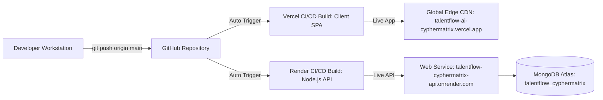

# 16. Production Deployment & Operational Runbook

## TalentFlow AI – Cypher Matrix
### Infrastructure Configuration, Cloud Deployment, Environment Setup & Operational Runbooks

**Author:** Dharmik Valiya  
**Target Organization:** Cypher Matrix  
**Date of Record:** November 6, 2026  
**Status:** Live in Production  

---

## 1. Live Deployment Endpoints

TalentFlow AI is deployed across high-availability cloud platforms:

- **Frontend Client Application:** [https://talentflow-ai-cyphermatrix.vercel.app](https://talentflow-ai-cyphermatrix.vercel.app) (Hosted on Vercel Edge Network)
- **Backend API Gateway & Agent Engine:** [https://talentflow-cyphermatrix-api.onrender.com](https://talentflow-cyphermatrix-api.onrender.com) (Hosted on Render Web Service)
- **Cloud Database:** MongoDB Atlas Dedicated Sharded Cluster (`ac-bqp0sql-shard-00-02.5nljvcm.mongodb.net/talentflow_cyphermatrix`)

---

## 2. Infrastructure Architecture & CI/CD Pipeline



---

## 3. Environment Variable Configuration Reference

The backend runtime requires the following environment variables configured in `.env` (local) or the Render Environment Dashboard (production):

### Core Server & Database Variables
```bash
# Server Port & Mode
PORT=5000
NODE_ENV=production

# MongoDB Connection String (Dedicated Database)
MONGODB_URI=mongodb+srv://<user>:<password>@cluster0.5nljvcm.mongodb.net/talentflow_cyphermatrix?retryWrites=true&w=majority

# Active Default AI Provider (openai, groq, openrouter, nvidia, ollama, mock)
LLM_PROVIDER=openai
```

### Active AI Provider Credentials
```bash
# OpenAI Configuration
OPENAI_API_KEY=sk-...
OPENAI_MODEL=gpt-4.1-mini

# Groq Configuration (Ultra-fast LPU inference)
GROQ_API_KEY=gsk_...
GROQ_MODEL=llama-3.3-70b-versatile

# OpenRouter Configuration (Free dynamic meta-router)
OPENROUTER_API_KEY=sk-or-v1-...
OPENROUTER_MODEL=openrouter/free

# NVIDIA NIM Configuration (Enterprise microservices)
NVIDIA_API_KEY=nvapi-...
NVIDIA_MODEL=nvidia/nemotron-3-nano-omni-30b-a3b-reasoning

# Local Ollama Configuration (On-Premises Sovereignty)
OLLAMA_BASE_URL=http://localhost:11434
OLLAMA_MODEL=llama3.2
OLLAMA_TIMEOUT_MS=180000
```

> [!IMPORTANT]
> **Together AI is Research-Only**: In accordance with project requirements, Together AI is excluded from the active runtime environment. No `TOGETHER_API_KEY` or `TOGETHER_MODEL` variables are used in production.

---

## 4. Local Development & Build Commands

### Backend Setup (`server/`)
```powershell
# Navigate to backend directory
cd server

# Install production and development dependencies
npm install

# Run complete automated test suite (26 suites, 210 tests)
npm test

# Launch backend in development mode with auto-reload
npm run dev

# Launch backend in production mode
npm start
```

### Frontend Setup (`client/`)
```powershell
# Navigate to client directory
cd client

# Install frontend dependencies
npm install

# Execute production build
npm run build

# Preview production build locally
npm run preview
```

---

## 5. Health Checks & Operational Verification

### 5.1 System Health Endpoint
Verify backend availability and database connectivity:
```http
GET https://talentflow-cyphermatrix-api.onrender.com/api/health
```
**Expected Response:**
```json
{
  "status": "healthy",
  "environment": "production",
  "activeProvider": "openai",
  "database": {
    "status": "connected",
    "name": "talentflow_cyphermatrix"
  },
  "version": "2.0.0"
}
```

### 5.2 Dynamic Provider Switch Verification
Switch the active inference provider on the live server:
```http
POST https://talentflow-cyphermatrix-api.onrender.com/api/providers/active
Content-Type: application/json

{
  "provider": "groq",
  "model": "llama-3.3-70b-versatile"
}
```
**Expected Response:**
```json
{
  "success": true,
  "activeProvider": "groq",
  "activeModel": "llama-3.3-70b-versatile"
}
```
