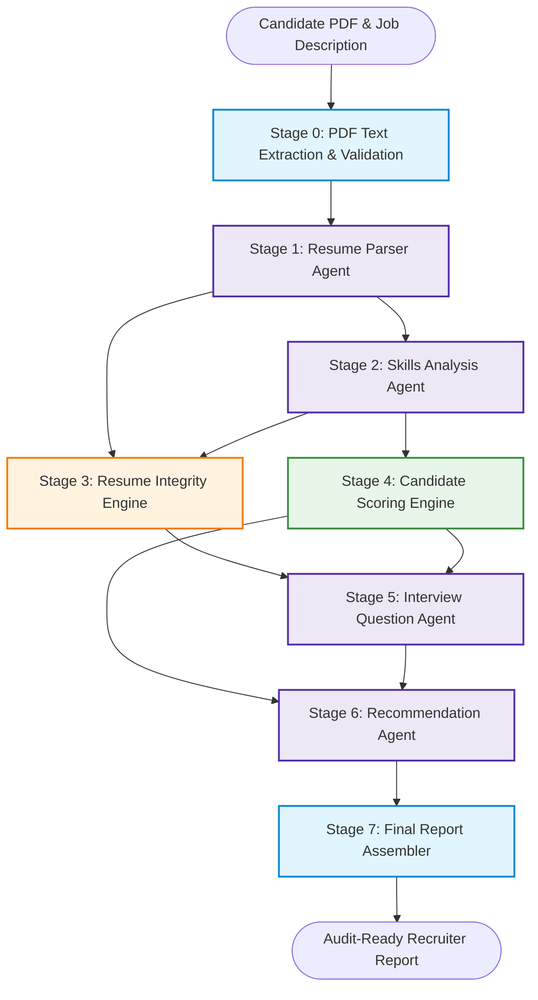
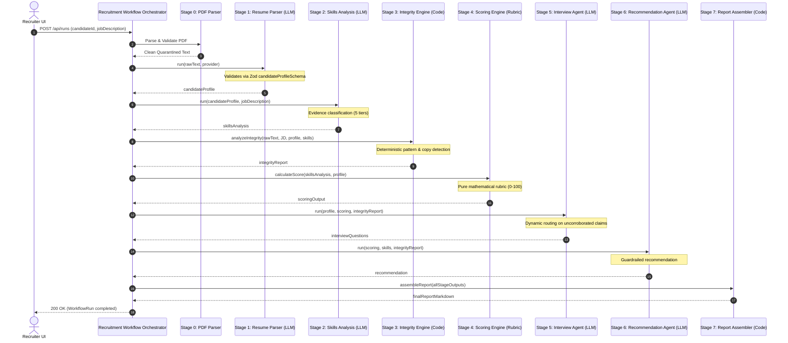

# Agent Architecture & Multi-Agent Orchestration Specification
## TalentFlow AI – Cypher Matrix

**Document Status:** Complete & Verified  
**System:** TalentFlow AI – Cypher Matrix  
**Architecture Pattern:** Controlled Sequential Orchestration with Dynamic Routing  
**Author:** Dharmik Valiya (Senior Full-Stack & Agentic AI Architect)  

---

## 1. Architectural Philosophy

Many multi-agent recruitment proposals introduce unconstrained autonomous loops, agent-to-agent peer chatter, and black-box decision making. In recruitment and hiring compliance (EEOC, GDPR, EU AI Act), such unconstrained architectures create:
1. Non-deterministic scoring variance.
2. Inability to explain why a candidate was accepted or rejected.
3. Vulnerability to cascading prompt-injection attacks.
4. High token waste and latency.

TalentFlow AI rejects unconstrained multi-agent sprawl in favor of a **Controlled Orchestrator with Specialized Components**. Each agent has a single, strictly bounded responsibility, a formal Zod input/output contract, and explicit failure/retry boundaries.

---

## 2. Component Specifications

### 2.1 Stage 0: Document Extraction & Upload Security
- **Type:** Deterministic Code Engine (`pdf.service.js`)
- **Inputs:** Binary file stream from Multer upload.
- **Responsibilities:**
  - Validates PDF magic bytes (`%PDF-`).
  - Enforces 5MB size ceiling.
  - Extracts raw plain text and page metadata using `pdf-parse`.
  - Detects scanned image PDFs without selectable text and emits an explicit `UNSUPPORTED_PDF_FORMAT` error instead of silently passing empty strings.
  - Deletes temporary disk files immediately after extraction.
- **Output:** Raw text string, page count, and document metadata.

### 2.2 Stage 1: Resume Parser Agent
- **Type:** Generative LLM Agent with Zod Schema Enforcement (`resumeParser.agent.js`)
- **Inputs:** PII-masked, untrusted resume text inside `<untrusted_resume_content>` boundaries.
- **Responsibilities:**
  - Extracts candidate name, professional summary, structured education, work experience, projects, and listed skills.
  - Categorizes experience by title, organization, dates, bulleted achievements, and referenced technologies.
- **Zod Schema:** `candidateProfileSchema` (validates types, non-empty arrays, string sanitization).
- **Failure & Retry Policy:** Automatic single retry on truncated JSON; falls back to `repairTruncatedJSON` with strict re-validation.

### 2.3 Stage 2: Skills Analysis Agent
- **Type:** Grounded Generative LLM Agent (`skillsAnalysis.agent.js`)
- **Inputs:** Structured candidate profile (from Stage 1) and raw Job Description text.
- **Responsibilities:**
  - Extracts required skills, preferred skills, minimum experience years, and core responsibilities from the JD.
  - Cross-references candidate work history, projects, and education against JD requirements.
  - Assigns each required skill a 5-tier evidence classification: `Strongly Supported`, `Moderately Supported`, `Weakly Supported`, `Claimed Without Evidence`, or `Not Found`.
  - Captures verbatim evidence excerpts, section name, and confidence score.
- **Zod Schema:** `skillsAnalysisSchema`.

### 2.4 Stage 3: Resume Integrity Engine
- **Type:** Deterministic Code Engine (`resumeIntegrity.service.js`)
- **Inputs:** Raw resume text, JD text, Stage 1 profile, and Stage 2 skill matches.
- **Responsibilities:**
  - **Statistical Keyword Stuffing:** Detects terms exceeding 4% of total word count and appearing $\ge 7$ times, corroborating against genuine work history to avoid false positives.
  - **Verbatim JD Phrase Copying:** Scans 3-to-6-word contiguous n-grams between resume and JD.
  - **Unsupported Skill Claims:** Identifies skills claimed in candidate summaries that have zero project/experience corroboration.
  - **Fairness Guarantee:** Requires $\ge 2$ independent signals to assign `high` risk.
  - **Score Insulation:** Integrity findings are logged independently and never arbitrarily subtract points from candidate capability.
- **Output:** `integrityReportSchema` (`riskLevel`: low/medium/high, detected manipulation flags, evidence snippets, recruiter notes).

### 2.5 Stage 4: Candidate Scoring Engine
- **Type:** Deterministic Mathematical Rubric (`scoring.agent.js`)
- **Inputs:** Stage 2 skill matches, candidate experience, project count, and education.
- **Responsibilities:**
  - Computes transparent 0–100 score using weighted formula:
    - 40% Required Skills Match (40 pts)
    - 20% Relevant Experience (20 pts)
    - 15% Preferred Skills Match (15 pts)
    - 15% Project Portfolio Alignment (15 pts)
    - 10% Education / Qualifications (10 pts)
    - Total: 100% (100 pts)
  - Generates transparent breakdown, strengths list, weaknesses list, and gap analysis.
- **Output:** `scoringOutputSchema` (numerical score 0–100, component breakdowns, explanation).

### 2.6 Stage 5: Interview Question Agent
- **Type:** Generative LLM Agent with Conditional Dynamic Routing (`interviewQuestions.agent.js`)
- **Inputs:** Candidate profile, scoring output, and Stage 3 integrity findings.
- **Conditional Agentic Behavior:**
  - When Stage 3 flags `unsupported_skills` or `keyword_stuffing`, Stage 5 dynamically generates neutral, targeted technical verification questions to give the candidate an opportunity to prove hands-on knowledge.
  - For strongly supported skills, generates deep architectural and behavioral scenario questions.
- **Output:** `interviewQuestionsSchema` (behavioral, technical, verification, and situational questions with evaluation criteria).

### 2.7 Stage 6: Recommendation Agent
- **Type:** Guardrailed Generative LLM Agent (`recommendation.agent.js`)
- **Inputs:** Candidate score, required skill coverage, integrity report, and interview questions.
- **Guardrails:**
  - Explicit recommendation tier (`Strong Hire`, `Hire`, `Weak Hire`, `Do Not Hire`).
  - Score guardrail: Scores $<50$ cannot receive `Strong Hire`; scores $\ge 85$ with low integrity risk cannot receive `Do Not Hire`.
  - Produces executive summary, risks, onboarding roadmap, and human reviewer action items.
- **Output:** `recommendationSchema`.

### 2.8 Stage 7: Final Report Assembler
- **Type:** Deterministic Markdown Assembler (`reportAssembler.js`)
- **Inputs:** Outputs from Stages 1 through 6.
- **Responsibilities:**
  - Combines all audit traces, scores, evidence tables, integrity disclosures, and interview questions into a single downloadable, publication-ready Markdown dossier.
- **Output:** Audit-ready Markdown string and JSON summary.

---

## 3. Sequential Workflow Execution & Error Recovery

---

## 4. Failure Boundaries and Retry Policies

1. **Transient Network Timeouts:** Handled with exponential backoff ($2\text{s}, 4\text{s}$) up to 3 attempts.
2. **Rate Limits (HTTP 429):** Reads `retry-after` header. If wait time $>60\text{s}$, fails fast with clear human-readable advice rather than blocking backend threads.
3. **Truncated JSON Responses:** Handled by `repairTruncatedJSON()` which completes unclosed brackets and braces before executing strict Zod schema validation.
4. **Invalid Schema Output:** Triggers one clean retry with targeted error prompt feedback explaining which schema fields were missing.
5. **Stage Failure Isolation:** If a stage fails after retries, the run status is marked `FAILED` with explicit error context, and downstream stages are cleanly skipped. Upstream outputs are preserved for human inspection.
