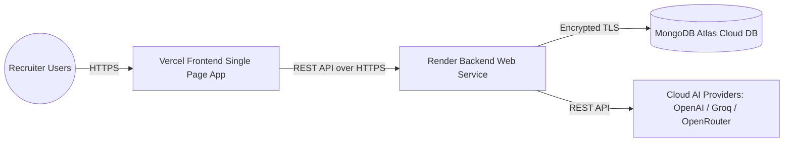

# Production Deployment Guide: Render & Vercel
## TalentFlow AI – Cypher Matrix

**Document Status:** Complete & Production Ready  
**System:** TalentFlow AI – Cypher Matrix  
**Frontend Platform:** Vercel  
**Backend Platform:** Render Web Service  
**Database:** MongoDB Atlas (Cloud) / In-Memory Resilience Fallback  
**Author:** Dharmik Valiya (Senior Full-Stack, Security & DevOps Engineer)  

---

## 1. Architecture & Deployment Isolation

The enhanced **TalentFlow AI – Cypher Matrix** application is strictly isolated from the original prework deployment:
- **Dedicated GitHub Repository:** `https://github.com/dharmikvaliya/TalentFlow-AI-CypherMatrix`
- **Separate Production URLs:**
  - Frontend: `https://talentflow-ai-alpha.vercel.app` (Vercel)
  - Backend: `https://talentflow-ai-zytt.onrender.com` (Render)
- **Database Namespace Isolation:** Uses isolated MongoDB database `talentflow_cyphermatrix` on MongoDB Atlas.
- **Strict CORS Protection:** Backend CORS accepts only the authorized Vercel frontend origin and local developer environments. Unrestricted wildcard origins (`*`) are strictly prohibited in production.



---

## 2. Backend Production Deployment (Render)

### 2.1 Web Service Configuration
In the Render Dashboard (or via `render.yaml`):
- **Service Name:** `talentflow-api`
- **Environment:** `Node`
- **Region:** US East (Ohio / Oregon) or closest to database
- **Root Directory:** `server`
- **Build Command:** `npm install`
- **Start Command:** `node src/server.js`
- **Health Check Path:** `/api/health`
- **Plan:** Free or Starter

### 2.2 Render Environment Variables Checklist
Configure these environment variables in the Render Dashboard under **Environment**:

| Variable Key | Required? | Recommended Production Value | Description |
| :--- | :--- | :--- | :--- |
| `NODE_ENV` | Yes | `production` | Enables production error masking, disables debug logs |
| `PORT` | Yes | `10000` | Port assigned by Render |
| `CLIENT_ORIGIN` | Yes | `https://talentflow-ai-alpha.vercel.app` | Target Vercel frontend URL for production CORS |
| `MONGODB_URI` | Yes | `mongodb+srv://<user>:<password>@cluster.mongodb.net/talentflow_cyphermatrix` | Private Atlas connection URI (Isolated namespace) |
| `LLM_PROVIDER` | Yes | `mock` or `openai` or `groq` or `openrouter` | Active AI provider |
| `LLM_MOCK` | Yes | `false` (for live AI) or `true` (for zero-cost demo) | Safe demo fallback toggle |
| `LLM_ALLOW_MOCK_FALLBACK` | Yes | `false` | Strictly prohibit synthetic fallback in production |
| `OPENAI_API_KEY` | Optional | `sk-...` | Production OpenAI API key (if OpenAI active) |
| `GROQ_API_KEY` | Optional | `gsk_...` | Groq API key (if Groq active) |
| `OPENROUTER_API_KEY` | Optional | `sk-or-v1-...` | OpenRouter API key (if OpenRouter active) |
| `MAX_RUNS_PER_DAY` | Yes | `3` | Demo quota limiter per rolling 24 hours per IP |

---

## 3. Frontend Production Deployment (Vercel)

### 3.1 Vercel Project Configuration
In the Vercel Dashboard:
- **Project Name:** `talentflow-ai-cyphermatrix`
- **Framework Preset:** `Vite`
- **Root Directory:** `client`
- **Build Command:** `npm run build`
- **Output Directory:** `dist`

### 3.2 Vercel Single-Page Application (SPA) Routing
The root `vercel.json` provides rewrite rules ensuring that client-side page refreshes (e.g. `/runs/:id`) route correctly to `index.html`:
```json
{
  "framework": "vite",
  "buildCommand": "npm run build --workspace=client",
  "outputDirectory": "client/dist",
  "rewrites": [
    {
      "source": "/(.*)",
      "destination": "/"
    }
  ]
}
```

### 3.3 Vercel Environment Variables Checklist
Configure in Vercel Dashboard under **Project Settings $\rightarrow$ Environment Variables**:

| Variable Key | Required? | Value | Description |
| :--- | :--- | :--- | :--- |
| `VITE_API_URL` | Yes | `https://talentflow-ai-zytt.onrender.com` | Live Render backend API URL (No trailing slash) |

> [!CAUTION]
> **Never set private API keys (`OPENAI_API_KEY`, `GROQ_API_KEY`) in Vercel environment variables!** All AI calls must route through the secure Render backend.

---

## 4. Post-Deployment Verification Checklist

Execute these smoke tests after deployment to confirm end-to-end production readiness:

- [ ] **1. Backend Health Check:**
  Navigate to `https://talentflow-ai-zytt.onrender.com/api/health`.
  Verify response returns HTTP 200 with `status: "healthy"` and database connection status.
- [ ] **2. Frontend Initial Load:**
  Navigate to `https://talentflow-ai-alpha.vercel.app`.
  Verify the navbar displays active provider status and that no console errors appear.
- [ ] **3. Candidate Upload & Text Extraction:**
  Upload a sample candidate resume PDF and paste a job description.
  Confirm PDF magic bytes validate and candidate is saved.
- [ ] **4. 7-Stage Workflow Execution:**
  Click **Start Analysis**. Observe real-time pipeline status progressing from `resumeParser` through `report`.
- [ ] **5. Resume Integrity Tab:**
  Click the **Resume Integrity** tab. Verify that manipulation flags, evidence tiers, and recruiter verification notes render cleanly.
- [ ] **6. Audit Report Download:**
  Download the final Markdown report. Confirm all sections (Profile, Scoring, Integrity, Interview Probes, Recommendation) are populated.
