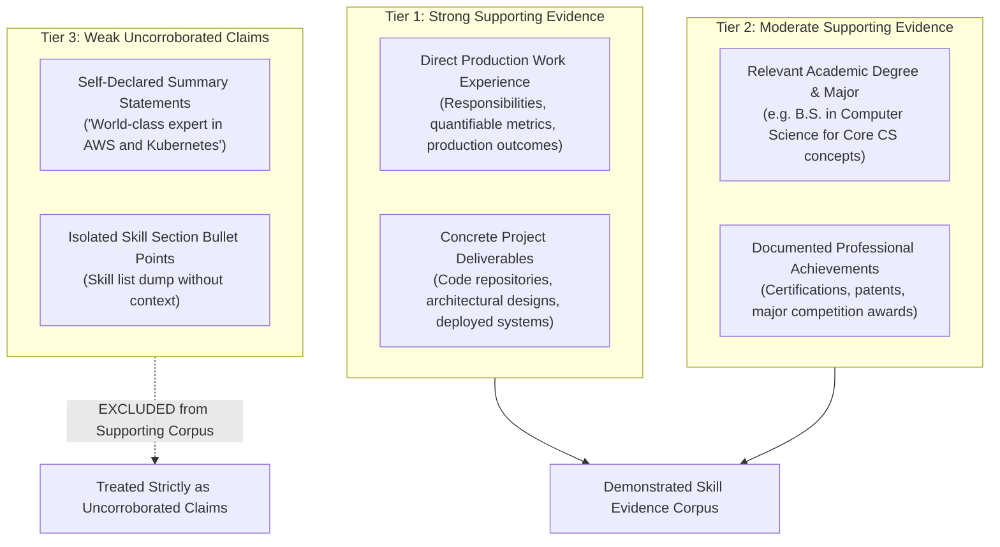

# Resume Analysis Methodology & Evidence Verification
## TalentFlow AI – Cypher Matrix

**Document Status:** Complete & Verified  
**System:** TalentFlow AI – Cypher Matrix  
**Methodology Revision:** Evidence Grounding & Hierarchical Skill Verification  
**Author:** Dharmik Valiya (Senior Full-Stack & Agentic AI Architect)  

---

## 1. Executive Overview

In automated recruitment technology, there is a fundamental distinction between a **demonstrated skill** and a **keyword merely present in a resume**. Primitive keyword-matching Applicant Tracking Systems (ATS) incentivize candidates to game ranking algorithms through keyword stuffing, job-description phrase copying, and declaring extensive skill lists without practical experience.

TalentFlow AI resolves this failure mode by implementing an **evidence-grounded recruitment methodology**:
1. Candidate claims are categorized into hierarchical **evidence tiers**.
2. Self-declared summaries and raw skill lists are classified as **weak claims**, not demonstrated evidence.
3. A deterministic **Resume Integrity Engine** detects textual gaming patterns without penalizing legitimate high-density technical experts.
4. Capability evaluation (fit score) is insulated from integrity evaluation (manipulation risk).
5. High integrity risk triggers **targeted human verification**, rather than automated rejection.

---

## 2. Hierarchical Evidence Tiers

To prevent self-declared keyword repetition from masquerading as verified competence, the system establishes a four-tier evidence hierarchy:



### 2.1 Strong Supporting Evidence (Tier 1)
- Contextual usage of a technology within a documented job role (company, role, timeline).
- Implementation descriptions citing quantifiable outcomes (e.g. *"Architected Kubernetes clusters across AWS EKS managing 140+ microservices"*).
- Technical projects citing demonstrated tool usage and problem-solving trade-offs.

### 2.2 Moderate Supporting Evidence (Tier 2)
- Formal university degree fields or relevant coursework (e.g. a degree in Computer Science providing foundational support for data structures, algorithms, or SQL).
- Industry certifications (e.g. AWS Solutions Architect, Kubernetes CKA).
- *Limitation:* Academic mentions indicate theoretical exposure but are not treated as equivalent to production software engineering tenure.

### 2.3 Weak Claims (Tier 3) — The Summary Isolation Rule
- Self-declared summary claims (e.g. *"AWS and Kubernetes expert"*) and raw skill lists are classified strictly as **weak claims**.
- **Crucial Rule:** The Resume Integrity Engine explicitly excludes `summary` and `skillsListed` from the supporting evidence corpus. If a candidate lists a technology in their summary or skill block but mentions it nowhere in their work experience, projects, or education, that technology is classified as **unsupported**.

---

## 3. 5-Tier Evidence Classification per Skill

For every required and preferred skill identified in the Job Description, Stage 2 (`skillsAnalysis`) assigns one of five formal classification ratings:

| Classification | Meaning | Evidence Standard Required | Score Weight Contribution |
| :--- | :--- | :--- | :--- |
| **Strongly Supported** | Direct, proven production experience | Specific job/project bullet point citing tool usage with quantifiable achievements or production outcomes | 100% of skill weight |
| **Moderately Supported** | Demonstrated usage without deep metrics | Mentioned in context of work tasks, secondary project deliverables, or relevant degree coursework | 70% of skill weight |
| **Weakly Supported** | Mentioned without context | Listed alongside other tools without descriptive verbs or implementation details | 35% of skill weight |
| **Claimed Without Evidence** | Listed in summary or header only | Appears solely in candidate summary or raw skill list with 0 occurrences in experience or projects | 10% of skill weight |
| **Not Found** | Completely absent from document | Skill is missing from all sections of the resume | 0% of skill weight |

### Zero-Hallucination Evidence Grounding
For every matched skill, the agent must output:
```json
{
  "skill": "React",
  "category": "Frontend",
  "evidence": "Built responsive recruitment dashboard using React 18, Vite, and Tailwind CSS serving 10k daily recruiters.",
  "section": "Professional Experience",
  "supportLevel": "Strongly Supported",
  "confidence": 0.95
}
```
If no verbatim evidence excerpt exists in the resume text, the agent is strictly prohibited from inventing text. It must assign `Not Found` or `Claimed Without Evidence`.
