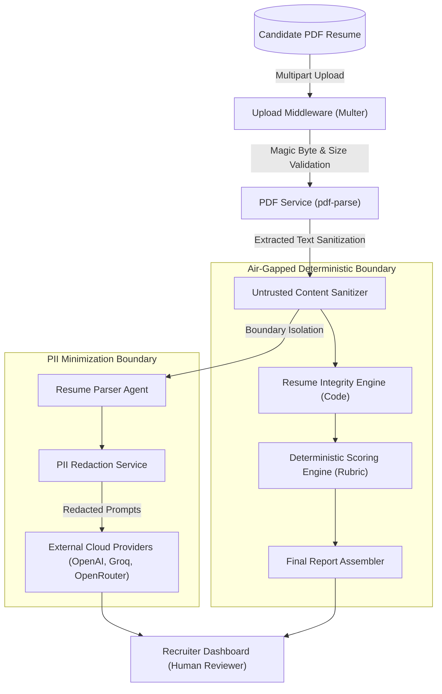

# Security & Privacy Architecture
## TalentFlow AI – Cypher Matrix

**Document Status:** Complete & Verified  
**System:** TalentFlow AI – Cypher Matrix  
**Security Classification:** Enterprise Architecture & Compliance Specification  
**Author:** Dharmik Valiya (Senior Full-Stack, Security & DevOps Engineer)  

---

## 1. Executive Summary

TalentFlow AI processes candidate resumes containing Personally Identifiable Information (PII) including real names, emails, phone numbers, home addresses, and employment histories. Because recruitment systems directly impact employment opportunities and operate at the boundary between public file uploads and backend language models, **data privacy, file upload security, sanitized logging, and prompt-injection defense** are foundational design requirements.

---

## 2. PII Handling & Data Minimization

The application adheres to the data minimization principle (GDPR Article 5(1)(c) and EEOC compliance guidelines):

1. **Client-Side & Server-Side Redaction (`piiRedaction.service.js`):**
   - Candidate email addresses are masked: `sarah.chen@example.com` $\rightarrow$ `[REDACTED_EMAIL]`.
   - Candidate phone numbers are masked: `+1 (555) 234-5678` $\rightarrow$ `[REDACTED_PHONE]`.
   - Physical street addresses and postal codes are stripped.
   - External links (GitHub profiles, personal websites) are sanitized to prevent URL-based tracking.
2. **External Cloud Boundary:**
   - Prompts sent to external AI providers (OpenAI, Groq, OpenRouter, Together AI) contain **only professional qualifications, skills, and work history bullets**. Personal contact info is never transmitted.
3. **Local Private Execution:**
   - When configured with **Ollama** or **Mock Mode**, candidate resume data never leaves the local machine, providing 100% air-gapped privacy.

---

## 3. File Upload Security

Uploaded files represent a primary attack vector for web applications. TalentFlow enforces multi-stage upload defenses:

1. **File Extension & MIME Validation:**
   - Only `.pdf` extensions with `application/pdf` MIME type are accepted. Renamed executables (`.exe` renamed to `.pdf`) or documents (`.docx` renamed to `.pdf`) are rejected with `INVALID_FILE_TYPE`.
2. **PDF Magic-Byte Verification:**
   - The file buffer is inspected for valid PDF magic bytes: `%PDF-` (bytes `0x25, 0x50, 0x44, 0x46, 0x2D`). Files failing header inspection are immediately rejected.
3. **Payload Size Ceilings:**
   - Multer enforces a hard 5MB size limit. Oversized payloads return HTTP 413 `FILE_TOO_LARGE` before consuming memory.
4. **Path Traversal Defense:**
   - Uploaded files are renamed using cryptographically secure random UUIDs (`crypto.randomUUID()`). User-supplied filenames are never used for filesystem paths.
5. **Ephemeral Storage & Cleanup:**
   - Uploaded files are temporarily stored in `server/uploads/` during text extraction and **permanently unlinked (deleted) immediately upon completion of PDF parsing**. Uploaded files are never exposed in public static web directories.

---

## 4. API Key & Secret Sanitization in Logs

To prevent accidental leakage of third-party API credentials in server output, deployment logs, or client error payloads:

1. **Regex Redaction Filter (`llm.service.js`):**
   Every outgoing log message and incoming error string passes through `redactSecretPatterns()`:
   - OpenAI keys: `/sk-[a-zA-Z0-9_-]{10,}/g` $\rightarrow$ `[REDACTED_API_KEY]`
   - Groq keys: `/gsk_[a-zA-Z0-9_-]{10,}/g` $\rightarrow$ `[REDACTED_API_KEY]`
   - NVIDIA keys: `/nvapi-[a-zA-Z0-9_-]{10,}/g` $\rightarrow$ `[REDACTED_API_KEY]`
   - Bearer tokens: `/Bearer\s+[a-zA-Z0-9_.-]{20,}/gi` $\rightarrow$ `Bearer [REDACTED_TOKEN]`
2. **Production Error Masking:**
   In `NODE_ENV=production`, internal error stack traces and database connection strings are masked. Clients receive standardized error codes (`INTERNAL_SERVER_ERROR`, `LLM_PROVIDER_ERROR`) with sanitized diagnostic descriptions.

---

## 5. Third-Party AI Provider Privacy Policies

| Provider | Data Retention Policy | Model Training on API Data? | Privacy Compliance URL |
| :--- | :--- | :--- | :--- |
| **OpenAI** | 30 days for abuse detection; zero retention available under BAA | **No** (Enterprise API data is not used for model training) | [openai.com/enterprise-privacy](https://openai.com/enterprise-privacy) |
| **Groq** | Volatile RAM during inference; operational logs retained up to 30 days | **No** (Customer inputs/outputs are never used for training) | [groq.com/privacy-policy](https://groq.com/privacy-policy) |
| **OpenRouter** | Transmits to chosen upstream provider; user can toggle zero-logging in settings | **Configurable** (Subject to selected underlying model) | [openrouter.ai/docs/privacy](https://openrouter.ai/docs/privacy) |
| **NVIDIA NIM** | Self-hosted: 100% on-premises; Hosted: No training on API data | **No** (Cloud microservices do not retain customer data for training) | [nvidia.com/en-us/about-nvidia/privacy-policy](https://www.nvidia.com/en-us/about-nvidia/privacy-policy/) |
| **Ollama** | **Zero retention, zero transmission** (Runs 100% locally on host machine) | **No** (Completely offline open-source binary) | [github.com/ollama/ollama](https://github.com/ollama/ollama) |
| **Mock Mode** | **Zero transmission** (Pure in-memory simulation) | **No** (100% offline) | Built-in |
