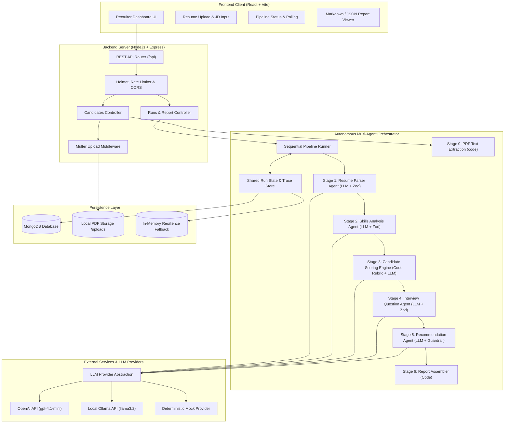
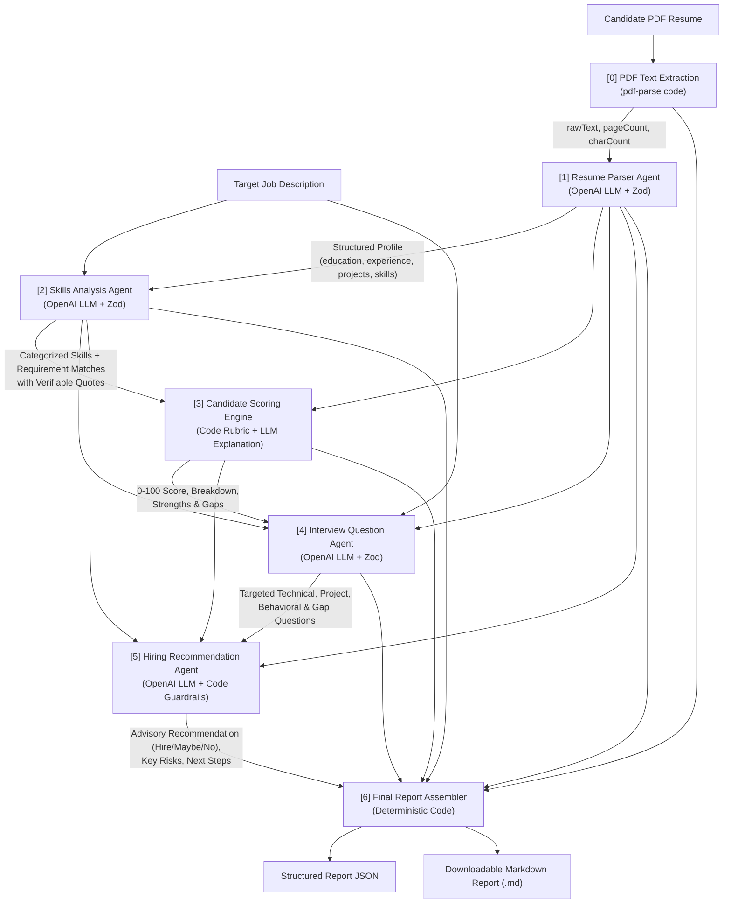
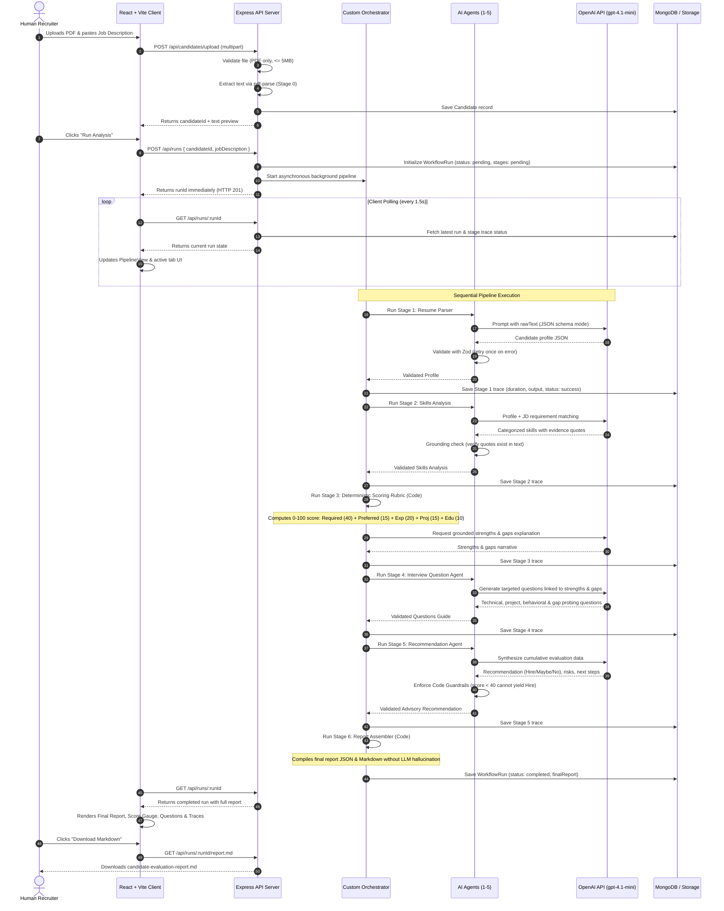

# TalentFlow AI — System Architecture & Workflow Specifications

This document outlines the system architecture, sequential agent pipeline, and interaction sequence of **TalentFlow AI**.

---

## 1. System Architecture Overview

---

## 2. Pipeline Data Flow

---

## 3. End-to-End Execution Sequence Diagram

