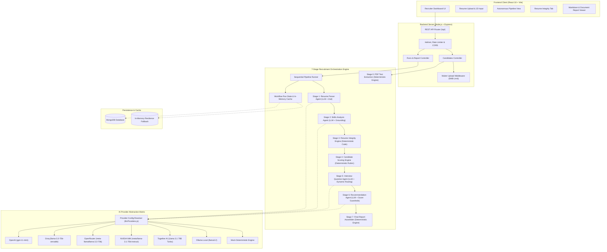
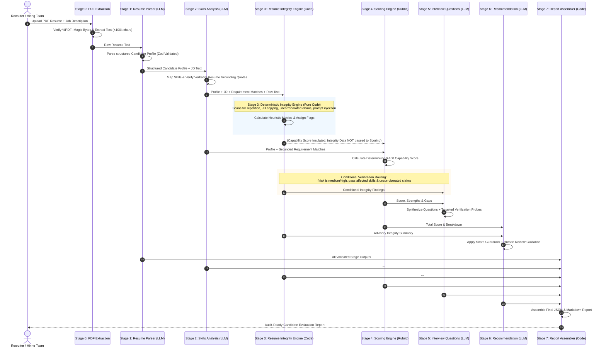
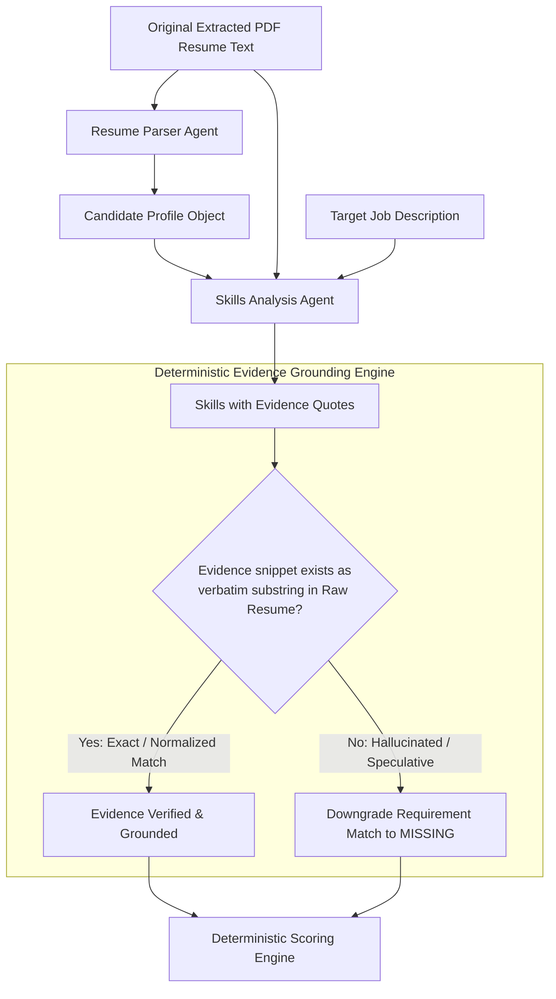
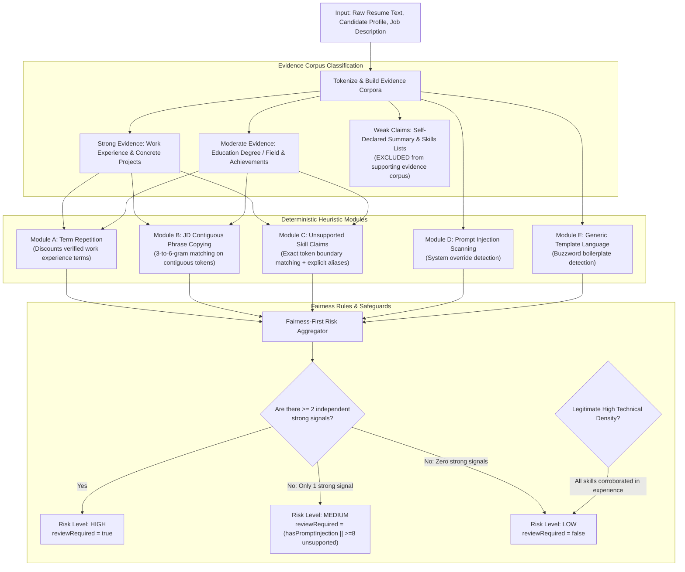
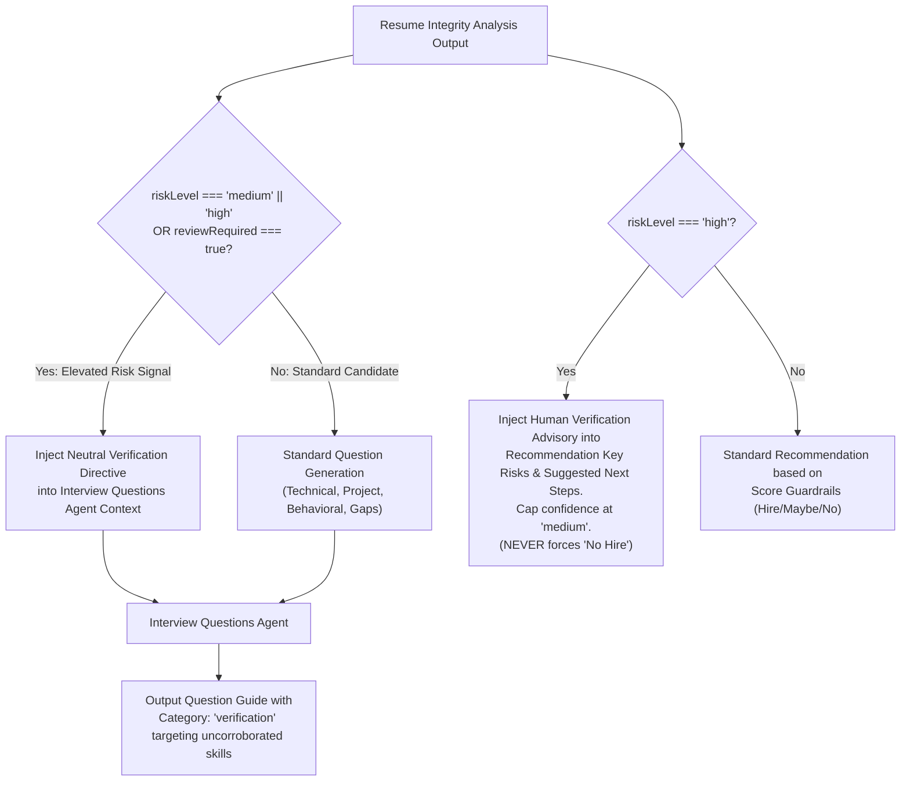
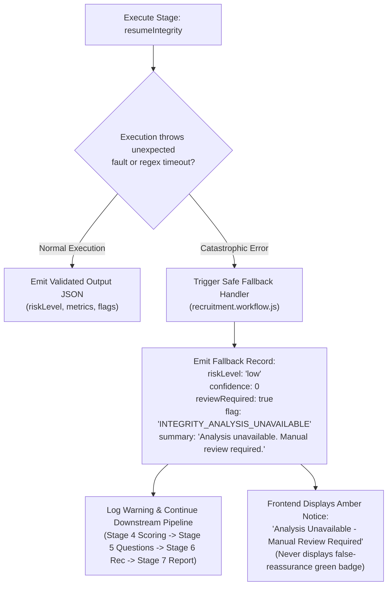
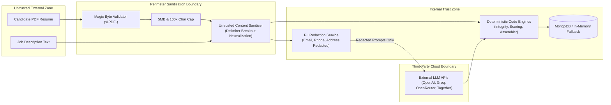

# TalentFlow AI — System Architecture & Workflow Specifications

**Document Status:** Complete & Verified
**System:** TalentFlow AI (CypherMatrix)
**Workflow Revision:** 7-Stage Pipeline (Integrated Resume Integrity Engine)

---

## 1. System Architecture Overview

---

## 2. 7-Stage Workflow Pipeline

The recruitment pipeline executes seven strictly ordered stages, ensuring that textual integrity is evaluated before interview generation and hiring recommendations:

---

## 3. Resume Evidence & Grounding Flow

---

## 4. Resume Integrity Analysis Flow

---

## 5. Conditional Verification-Question & Recommendation Routing

---

## 6. Error Handling & Safe Fallback Architecture

---

## 7. Security Trust Boundaries

