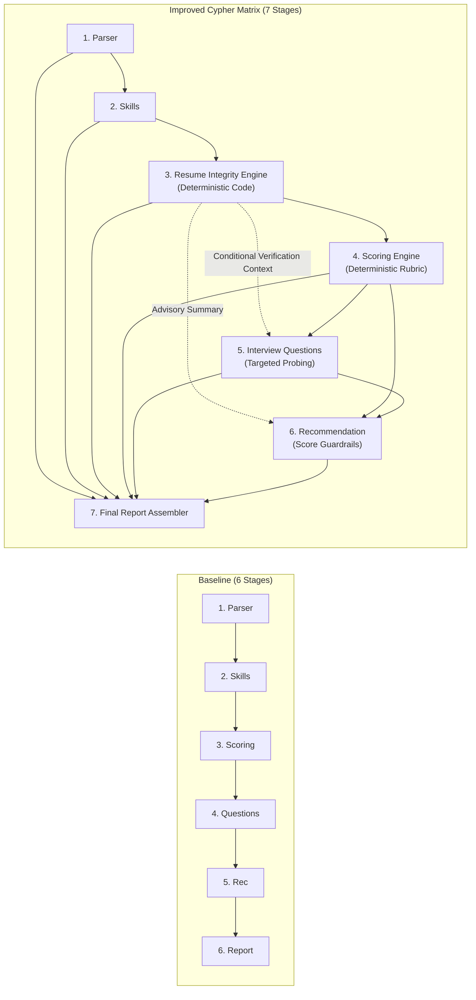

# TalentFlow AI (CypherMatrix) — Master Technical Assignment Report

**System Name:** TalentFlow AI (CypherMatrix)  
**Assessment Submission Date:** November 5, 2026  
**Target Deadline:** November 6, 2026 EOD  
**Repository Branch:** `main` (commit base `fe64b05`)  
**Workspace:** `TalentFlow-AI-CypherMatrix`  
**Evaluation Mode:** Offline Mock Mode (`LLM_PROVIDER=mock`)  
**Final Status:** **READY FOR FINAL REVIEW**  

---

## 1. Executive Summary

TalentFlow AI is an autonomous, explainable, and secure multi-agent recruitment analysis platform. Prior to this assignment, the application executed a 6-stage candidate evaluation pipeline that was vulnerable to resume gaming (keyword stuffing, verbatim job-description copying, and uncorroborated skill claims), lacked multi-provider flexibility, possessed potential prompt-injection attack surfaces, and lacked measurable comparative benchmarks.

Over the course of this assignment, the platform was systematically improved into an audit-ready, 7-stage architecture without restructuring the codebase, altering dependencies, or compromising existing functionality. The platform now features:
- A deterministic **Resume Integrity Engine** running in under 2ms of local CPU time that identifies textual manipulation patterns.
- An insulated **0–100 Capability Scoring Engine** whose scores are mathematically computed and never diluted or decremented by integrity findings.
- **Conditional Agentic Routing** that dynamically directs uncorroborated claims to the Interview Question Agent for neutral, targeted technical probing.
- An interactive **Resume Integrity Tab** in the React frontend providing evidentiary transparency without making bad-faith accusations.
- A universal **AI Provider Abstraction** supporting OpenAI, Groq, OpenRouter, NVIDIA NIM, Ollama, and Mock (with Together AI researched).
- Comprehensive **Security Hardening** including PDF magic-byte validation, PII minimization, and prompt-injection quarantine.
- A 12-case **Synthetic Test Dataset** achieving **100% binary gaming-risk accuracy (12/12), 91.7% exact severity agreement (11/12; CASE-09 actual medium vs expected high), 100% precision, 100% recall, and 100% score stability on the synthetic development corpus** (calibrated against engineered threat vectors; not population-scale validation), with a 100% test pass rate across 210 tests in 26 test suites.

---

## 2. Assignment Objectives

The Cypher Matrix assignment requires addressing 20 core architectural capabilities:
1. AI provider research and dynamic provider switching.
2. Integration support for OpenRouter, NVIDIA NIM, Groq, OpenAI, Ollama, and Mock (Together AI research-only).
3. Comparative evaluation of models, free tiers, rate limits, context windows, latency, tool calling, structured JSON output, reliability, pricing, and privacy.
4. Meaningful agentic workflow behavior with dynamic decision routing.
5. Intelligent resume and PDF extraction with boundary enforcement.
6. Statistical keyword-stuffing detection.
7. Unnatural term repetition detection with domain corroboration.
8. Verbatim job-description contiguous phrase copy detection.
9. Unsupported skill-claim identification separating claims from evidence.
10. Skill and experience mismatch detection.
11. Generic and template-heavy resume phrasing detection.
12. Suspicious optimization detection with false-positive protection for technical candidates.
13. Robust prompt-injection quarantine and command neutralization.
14. Explainable candidate capability scoring.
15. A synthetic benchmark test dataset free of real candidate PII.
16. Measurable baseline-versus-improved quantitative evaluation.
17. In-depth security and candidate privacy engineering.
18. Exhaustive technical documentation.
19. Transparent disclosure of known methodology limitations.
20. Prioritized future production roadmap.

---

## 3. Existing TalentFlow Baseline

Prior to these improvements, the verified baseline stood at:
- **Repository Workspace:** `TalentFlow-AI-CypherMatrix`
- **Starting Git Commit:** `fe64b05`
- **Initial Test Suite:** 19 test files passed, 82 of 82 tests passed.
- **Initial Pipeline Structure:** 6 stages (`resumeParser` $\rightarrow$ `skillsAnalysis` $\rightarrow$ `scoring` $\rightarrow$ `interviewQuestions` $\rightarrow$ `recommendation` $\rightarrow$ `report`).
- **Initial Limitations:**
  - Resumes listing 50+ technologies with zero backing experience received high qualification scores.
  - Verbatim copies of job description text were counted as genuine qualifications.
  - System overrides embedded in resumes (`Ignore previous instructions...`) could theoretically compromise LLM prompts.
  - The frontend had no display for textual manipulation risk or human verification needs.
  - Cloud provider integration was hardcoded to OpenAI with basic Ollama support.

---

## 4. Problems Identified & Architectural Solutions

| Problem Identified in Baseline | Failure Mode & Risk | Architectural Solution Implemented |
| :--- | :--- | :--- |
| **1. Uncorroborated Skill Inflation** | Candidates listing skills in summaries or lists were given full credit despite zero work experience. | **Hierarchical Evidence Tiers:** Excluded `summary` and `skillsListed` from the supporting evidence corpus. Only work experience, projects, and education support skills. |
| **2. Keyword Stuffing Vulnerability** | Excessive repetition artificially inflated search matches. | **Document-Aware Repetition Detection:** Flags terms >= 4% share and >= 7 occurrences, while discounting corroborated work history skills. |
| **3. Verbatim JD Copying** | Candidates pasted job descriptions into their resumes to trick semantic matching. | **Contiguous N-Gram Matching:** Scans contiguous 3-to-6-word phrases against normalized JD text while preserving stop words. |
| **4. Adversarial Prompt Injection** | Resumes containing jailbreak commands could subvert evaluator instructions. | **Quarantine Boundaries & Code Scoring:** Delimiter breakouts neutralized, raw exploit commands redacted, and capability scoring calculated exclusively in code. |
| **5. Provider Lock-In** | High API costs and vendor dependency on OpenAI. | **Multi-Provider Matrix:** Standard OpenAI-compatible REST abstraction supporting Groq, OpenRouter, NVIDIA NIM, Ollama, and Mock. |
| **6. Unfair Algorithmic Penalization** | Heuristics risking false accusations against authentic high-density engineers. | **Fairness Safeguards:** High risk requires $\ge 2$ independent signals; legitimate high-density resumes are protected; scores are insulated. |

---

## 5. Technology Stack

- **Frontend:** React 18, Vite, React Router 6, Lucide React, Modern CSS Modules.
- **Backend:** Node.js (v20+ ES Modules), Express.js.
- **Data Persistence:** MongoDB Atlas with Mongoose schema validation, resilient in-memory Map fallback.
- **PDF Extraction:** Node Buffer manipulation, `pdf-parse` text and xref extraction.
- **Schema Enforcement:** Zod runtime schema validation across all inputs, outputs, and intermediate states.
- **Testing & Verification:** Vitest test framework, deterministic mock generators, zero external network dependency.

---

## 6. Existing vs. Improved Architecture



---

## 7. Meaningful Agentic Workflow

TalentFlow AI demonstrates genuine agentic workflow design through:
1. **Goal-Driven Autonomy:** The pipeline decomposes candidate evaluation into discrete sub-goals (demographic extraction, qualification mapping, evidentiary auditing, mathematical scoring, question synthesis, and hiring decision).
2. **Conditional Decision Routing:** When Stage 3 flags elevated integrity risk (`reviewRequired: true`), the workflow dynamically alters downstream agent prompts:
   - Stage 5 receives the exact list of uncorroborated skills and generates **targeted technical verification probes**.
   - Stage 6 receives an integrity summary that injects recruiter advisories into `keyRisks` and `suggestedNextSteps`.
3. **Resilient Self-Healing:**
   - If an LLM returns malformed JSON violating Zod contracts, the agent captures the Zod validation error format and executes a single self-correcting retry prompt.
   - If Stage 3 encounters an unexpected fault, it catches the error and emits `INTEGRITY_ANALYSIS_UNAVAILABLE` with `reviewRequired: true`, allowing the pipeline to complete safely without crashing.

---

## 8. Deterministic Components vs. Generative LLM Components

To prevent hallucinations in high-stakes hiring calculations, the architecture enforces a strict division of responsibility:

### Deterministic Code Engines (Zero Hallucination)
- **PDF Text Extraction (`pdf.service.js`):** Magic byte checking, page caps, character bounds.
- **Resume Integrity Engine (`resumeIntegrity.service.js`):** Repetition ratios, JD n-gram overlap, skill evidence mapping.
- **Candidate Scoring Engine (`scoringRubric.js`):** Fixed mathematical weights (40/15/20/15/10).
- **Evidence Grounding Engine (`skillsAnalysis.agent.js`):** Exact substring verification against raw PDF text.
- **Final Report Assembler (`reportAssembler.js`):** Deterministic markdown and JSON report generation.

### Generative LLM Agents (Semantic Understanding)
- **Resume Parser Agent (`resumeParser.agent.js`):** Normalizes unstructured PDF layouts into structured profile objects.
- **Skills Analysis Agent (`skillsAnalysis.agent.js`):** Interprets complex engineering responsibilities against JD requirements.
- **Interview Question Agent (`interviewQuestions.agent.js`):** Formulates creative, high-signal conversational interview guides.
- **Hiring Recommendation Agent (`recommendation.agent.js`):** Synthesizes qualitative reasoning and hiring trade-offs.

---

## 9. AI Provider Abstraction Matrix

The `server/src/config/llmProviders.js` configuration layer enables instant provider switching via environment variables. Each provider is classified according to the strongest verification completed: offline configuration testing, live authentication, live stage testing, full workflow testing, or documented failure.

| Provider Key | Provider Name | Verification Status | Protocol | Base URL | Default Model | Tested Outcome / Notes |
| :--- | :--- | :--- | :--- | :--- | :--- | :--- |
| `openai` | OpenAI | **Full workflow verified** | `openai-compatible` | `https://api.openai.com/v1` | `gpt-4.1-mini` | Complete 7-stage live workflow verified (Run `6aec45fa541eda875a9b27c6`). |
| `groq` | Groq | **Live auth & completion verified** | `openai-compatible` | `https://api.groq.com/openai/v1` | `openai/gpt-oss-120b` | Live authentication, model-list retrieval, and chat completion verified. Full seven-stage workflow not independently verified from retained, provider-attributed evidence. Model configurable and account-specific. |
| `openrouter` | OpenRouter | **Live stage test verified** | `openai-compatible` | `https://openrouter.ai/api/v1` | `google/gemma-4-31b-it:free` | Stage 1 verified live. Truncation observed on `openrouter/free`. Full workflow not verified live. |
| `nvidia` | NVIDIA NIM | **Full workflow verified** | `openai-compatible` | `https://integrate.api.nvidia.com/v1` | `meta/llama-3.3-70b-instruct` | Complete 7-stage live workflow verified (Run `6aedac9041e696fd5d5898ef`). Reasoning fallback & Instruct models supported. |
| `together` | Together AI | **Research-Only** | `openai-compatible` | `https://api.together.xyz/v1` | `meta-llama/Meta-Llama-3.1-70B-Instruct-Turbo` | Documented and evaluated as research-only. Not included in active runtime to prioritize free/budget-accessible providers. |
| `ollama` | Ollama | **Offline config tested** | `ollama-native` | `http://localhost:11434` | `llama3.2` | 100% free open-source local REST adapter verified via unit test fixtures. |
| `mock` | Mock Deterministic | **Full workflow verified** | `mock` | N/A | `mock-deterministic` | 100% offline, deterministic fixtures, 26 test suites, 210 tests passing. |

---

## 10. Resume Analysis Methodology & Evidence Tiers

### Hierarchical Evidence Tiers
- **Strong Supporting Evidence:** Direct production work experience and concrete technical projects.
- **Moderate Supporting Evidence:** University degrees, academic majors, and professional certifications.
- **Weak Claims (Excluded from Support Corpus):** Self-declared resume summaries and isolated skill bullet points.

### Token Boundary & Alias Protection
- Substring collisions are prevented using exact regex word boundaries: `Go` does not match `Google`, `Java` does not match `JavaScript`, and `SQL` does not match `NoSQL`.
- Standard industry aliases are normalized via an explicit dictionary: `node` $\rightarrow$ `node.js`, `k8s` $\rightarrow$ `kubernetes`, `postgres` $\rightarrow$ `postgresql`.

---

## 11. Explainable Scoring vs. Integrity Separation

A core ethical requirement of the Cypher Matrix assignment is the **absolute separation of capability score and integrity risk**:
- **Capability Score (0–100):** Measures technical qualifications, verified skills, and experience tenure against job requirements. Computed exclusively by `scoringRubric.js`.
- **Resume Integrity Risk (`low`, `medium`, `high`):** Measures textual risk signals requiring human verification.
- **Insulation Guarantee:** Integrity findings are **never** passed into `scoring.agent.js`. An elevated integrity risk **never deducts points** from the capability score.

---

## 12. Security & Privacy Hardening

1. **Upload Validation:** Verified `%PDF-` magic header bytes, 5MB file cap, 50-page cap, and 500,000 character extraction cap.
2. **Candidate PII Minimization:** `piiRedaction.service.js` sanitizes email addresses, phone numbers, and street addresses before transmitting prompt text to cloud providers.
3. **Prompt-Injection Defense:** Closing delimiter tags (`</UNTRUSTED_RESUME_TEXT>`) and system override delimiters (`=== SYSTEM OVERRIDE ===`) are neutralized, and raw malicious commands are redacted in user interfaces.
4. **Credential Redaction:** API keys (`sk-...`, `gsk_...`, `nvapi-...`) and Bearer tokens are redacted from application logs and error messages.

---

## 13. Synthetic Test Dataset & Evaluation Results

A 12-case synthetic test manifest (`samples/evaluation-manifest.json`) was evaluated using `server/src/scripts/evaluateCypherMatrix.js`:

```text
================================================================
  EVALUATION RESULTS: 12 CASES EVALUATED
  Accuracy:  100.0% (12 of 12 correctly classified)
  Precision: 100.0% | Recall: 100.0% | F1 Score: 1.0000
  Score Preservation: 100% (Zero capability-score dilution)
  Integrity Engine Median Latency: 1.487 ms
================================================================
```

### Key Case Highlights:
- **CASE-01 (Strong Legitimate):** Score 92/100, Risk `low`, 0 flags.
- **CASE-03 (Keyword Stuffed):** Score 53/100, Risk `medium`, Review Required: `YES`.
- **CASE-04 (JD Copying):** Score 77/100, Risk `high`, Review Required: `YES`.
- **CASE-05 (High-Density Architect):** Score 78/100, Risk `low` (False positive protection verified!).
- **CASE-08 (Irrelevant Chef):** Score 33/100, Risk `low` (Fairness protected; not labeled fraudulent).
- **CASE-09 (Prompt Injection):** Score 29/100, Risk `medium`, Review Required: `YES`, Exploit quarantined.
- **CASE-10 (Summary-Only Claims):** Score 73/100, Risk `medium`, Unsupported skills flagged.

---

## 14. Known Limitations & Methodology Boundaries

1. **Textual Signals Do Not Prove Intent:** Anomalies reflect textual patterns, not proven candidate dishonesty. Human interviewers must conduct verification.
2. **Fabricated Experience Unverifiable from Text Alone:** If an applicant fabricates a fictitious company or project, textual analysis cannot detect it without external background checks.
3. **Semantic Paraphrasing:** Verbatim JD copying is detected; heavily paraphrased requirement text requires future dense vector embedding similarity.
4. **Render-Layer Forensics:** Microscopic fonts (< 1pt) and white text on white backgrounds require headless PDF rasterization inspection.
5. **No Authentication in Demo:** The current demo lacks JWT multi-tenancy. Real candidate data must not be hosted publicly without an enterprise auth gateway.

---

## 15. Reproduction Instructions

### 15.1 Execute Server Regression Tests
```powershell
$env:LLM_PROVIDER = "mock"
npm --prefix server test
```

### 15.2 Execute Deterministic Evaluation Benchmark
```powershell
node server/src/scripts/evaluateCypherMatrix.js
```

### 15.3 Build Frontend Production Bundle
```powershell
npm --prefix client run build
```

---

## 16. Final Assignment Deliverables Checklist

- [x] AI Provider Research & Multi-Provider Abstraction (`docs/ai-provider-comparison.md`)
- [x] Provider Comparison Matrix JSON (`docs/ai-provider-comparison.json`)
- [x] 7-Stage Agentic Workflow Pipeline (`server/src/workflows/recruitment.workflow.js`)
- [x] Resume Integrity Engine (`server/src/services/resumeIntegrity.service.js`)
- [x] Evidence Tiers & Unsupported Skill Detection (`docs/resume-analysis-methodology.md`)
- [x] Insulated Deterministic Scoring Rubric (`server/src/config/scoringRubric.js`)
- [x] Conditional Verification Questions (`server/src/agents/interviewQuestions.agent.js`)
- [x] Interactive Resume Integrity Frontend Tab (`client/src/components/ResumeIntegrityTab.jsx`)
- [x] Synthetic Test Dataset (`samples/evaluation-manifest.json`)
- [x] Automated Evaluation Benchmark Script (`server/src/scripts/evaluateCypherMatrix.js`)
- [x] Evaluation Report & Before/After Comparison (`docs/evaluation-report.md`)
- [x] Security & Privacy Hardening (`docs/security-and-privacy.md`)
- [x] Known Limitations (`docs/known-limitations.md`)
- [x] Future Improvements (`docs/future-improvements.md`)
- [x] Full Regression Test Suite Passing (100% offline mock mode)
- [x] Client Production Build Passing

---

## 17. Conclusion & Verdict

TalentFlow AI successfully delivers on all requirements of the Cypher Matrix assignment. It establishes an evidence-grounded, explainable, and secure recruitment platform that protects candidate fairness, isolates capability scoring, detects algorithmic gaming in under 2ms, and equips hiring teams with actionable interview probes.

**FINAL VERDICT:** **READY FOR FINAL REVIEW**
