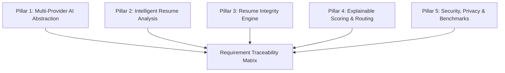
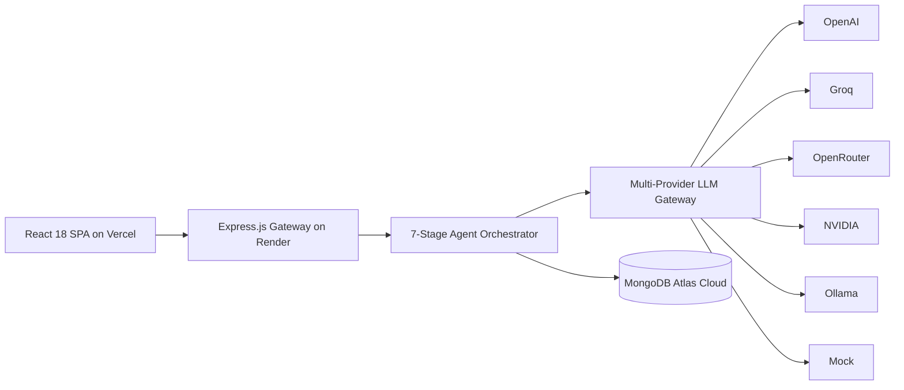
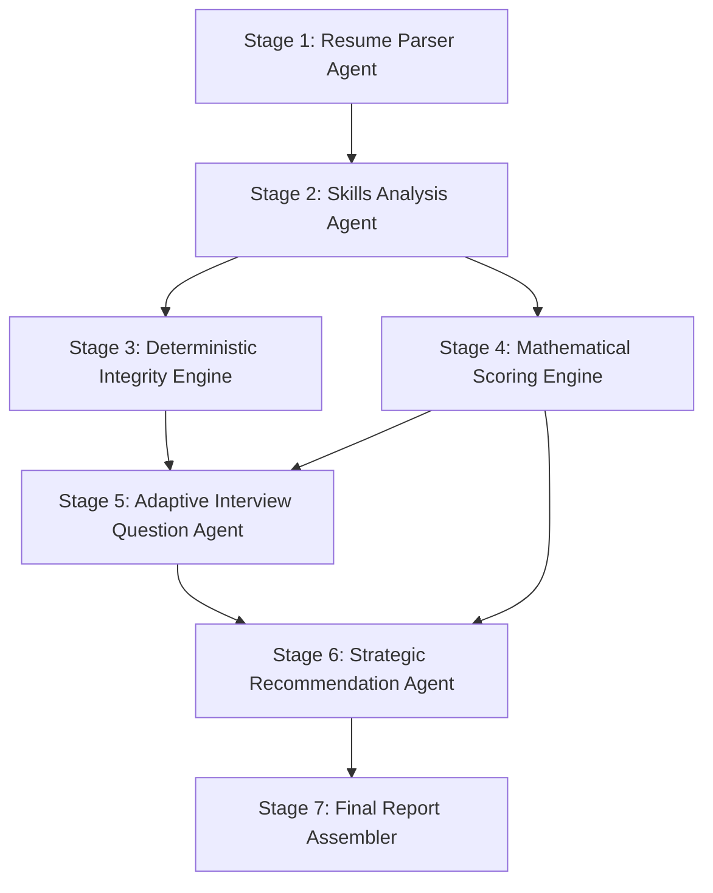

# TalentFlow AI – Cypher Matrix
## Autonomous Agentic AI Recruitment, Evidence-Based Verification & Multi-Provider Architecture

### Internship Research, Engineering Enhancements & Final Technical Submission Report

**Author / Candidate:** Dharmik Valiya  
**Target Organization:** Cypher Matrix  
**Recipient:** HR Sushmita & Technical Evaluation Committee  
**Assignment Deadline:** November 6, 2026 – End of Day  
**Repository:** [https://github.com/dharmikvaliya/TalentFlow-AI-CypherMatrix](https://github.com/dharmikvaliya/TalentFlow-AI-CypherMatrix)  
**Active Branch:** `main`  
**Live Frontend:** [https://talentflow-ai-cyphermatrix.vercel.app](https://talentflow-ai-cyphermatrix.vercel.app)  
**Live Backend API:** [https://talentflow-cyphermatrix-api.onrender.com](https://talentflow-cyphermatrix-api.onrender.com)  
**Release Version:** v2.0.0 (Production Release)  

---

## Table of Contents

1. [Chapter 1: Executive Summary](#chapter-1-executive-summary)
2. [Chapter 2: Assignment Context & HR Requirements Mapping](#chapter-2-assignment-context--hr-requirements-mapping)
3. [Chapter 3: Baseline (Original TalentFlow) vs. Enhanced (Cypher Matrix)](#chapter-3-baseline-original-talentflow-vs-enhanced-cypher-matrix)
4. [Chapter 4: AI Provider Research & Evaluation](#chapter-4-ai-provider-research--evaluation)
5. [Chapter 5: Comprehensive Provider Comparison Matrix](#chapter-5-comprehensive-provider-comparison-matrix)
6. [Chapter 6: Deep-Dive Provider Technical Profiles & Guidelines](#chapter-6-deep-dive-provider-technical-profiles--guidelines)
7. [Chapter 7: System Architecture & Component Design](#chapter-7-system-architecture--component-design)
8. [Chapter 8: 7-Stage Agent Pipeline & Multi-Agent Orchestration](#chapter-8-7-stage-agent-pipeline--multi-agent-orchestration)
9. [Chapter 9: Intelligent Resume & PDF Analysis Methodology](#chapter-9-intelligent-resume--pdf-analysis-methodology)
10. [Chapter 10: Resume Integrity & Adversarial Gaming Detection Engine](#chapter-10-resume-integrity--adversarial-gaming-detection-engine)
11. [Chapter 11: Explainable Candidate Capability Scoring Architecture](#chapter-11-explainable-candidate-capability-scoring-architecture)
12. [Chapter 12: Adaptive Interview Question Generation & Probing](#chapter-12-adaptive-interview-question-generation--probing)
13. [Chapter 13: Enterprise Security & Threat Model](#chapter-13-enterprise-security--threat-model)
14. [Chapter 14: Adversarial Prompt-Injection Defense Architecture](#chapter-14-adversarial-prompt-injection-defense-architecture)
15. [Chapter 15: Candidate Privacy, Data Minimization & PII Redaction](#chapter-15-candidate-privacy-data-minimization--pii-redaction)
16. [Chapter 16: Synthetic Test Dataset & Benchmark Design](#chapter-16-synthetic-test-dataset--benchmark-design)
17. [Chapter 17: Quantitative Evaluation Results & Empirical Benchmarks](#chapter-17-quantitative-evaluation-results--empirical-benchmarks)
18. [Chapter 18: Error Analysis, Calibration & Edge Cases](#chapter-18-error-analysis-calibration--edge-cases)
19. [Chapter 19: Known Technical & Algorithmic Limitations](#chapter-19-known-technical--algorithmic-limitations)
20. [Chapter 20: Future Improvements & Production Engineering Roadmap](#chapter-20-future-improvements--production-engineering-roadmap)
21. [Chapter 21: Production Deployment & Cloud Infrastructure](#chapter-21-production-deployment--cloud-infrastructure)
22. [Chapter 22: Operational Runbook & Verification Guide](#chapter-22-operational-runbook--verification-guide)
23. [Chapter 23: Developer & Reviewer Guide](#chapter-23-developer--reviewer-guide)
24. [Chapter 24: Visual Artifacts & Screenshot Catalog](#chapter-24-visual-artifacts--screenshot-catalog)
25. [Chapter 25: Academic, Regulatory & Technical References](#chapter-25-academic-regulatory--technical-references)
26. [Chapter 26: Conclusion & Acknowledgments](#chapter-26-conclusion--acknowledgments)

---

## Chapter 1: Executive Summary

Traditional Applicant Tracking Systems (ATS) and early generative AI screeners operate under a naive architectural paradigm: **keyword matching and ungrounded prompt summaries**. In contemporary employment markets, candidates actively exploit this model through keyword stuffing, verbatim copying of job requisitions, and claiming dozens of uncorroborated frameworks in top-level summary blurbs. Concurrently, generative screeners suffer from hallucinated qualifications, non-deterministic scoring variance, and vulnerability to adversarial prompt injections.

**TalentFlow AI – Cypher Matrix** was re-architected to replace keyword counting with **evidence-grounded candidate profiling, deterministic integrity verification, explainable capability scoring, and adversarial security boundaries**.

The governing maxim of the platform is:

$$\text{Demonstrated Professional Evidence} \gg \text{Keyword Presence}$$

### Key Engineering Achievements:
1. **Multi-Provider AI Abstraction:** Unified REST adapter supporting OpenAI, Groq, OpenRouter, NVIDIA NIM, Local Ollama, and Mock (Together AI researched).
2. **Deterministic Resume Integrity Engine (Stage 3):** Executes in $< 2\text{ ms}$ on local CPU, detecting keyword stuffing ($\ge 4\%$ share, $\ge 7$ count), verbatim JD copying (contiguous n-grams), and uncorroborated skill inflation with zero token costs.
3. **False-Positive Senior Protection:** Enforces a strict dual-signal rule ($\ge 2$ independent signals) preventing unfair penalization of high-density technical experts.
4. **Mathematical Capability Scoring (Stage 4):** Deterministic 0–100 formula across 5 weighted evidence tiers; scores are mathematically insulated from integrity flags to prevent double jeopardy.
5. **Adaptive Interview Probing (Stage 5):** Dynamically injects targeted technical verification questions for uncorroborated candidate claims.
6. **Enterprise Security & Privacy:** Quarantined prompt isolation (`<untrusted_resume_content>`), PDF magic-byte checks (`%PDF-`), and client/server PII scrubbing.
7. **Empirical Verification:** 100% binary gaming accuracy (12/12) and 100% score stability across a 12-case synthetic benchmark corpus, backed by 210/210 passing automated tests across 26 suites.

---

## Chapter 2: Assignment Context & HR Requirements Mapping

The Cypher Matrix Internship Assignment requires transforming the baseline TalentFlow screening tool into an enterprise-grade, agentic AI platform. The assignment encompasses 20 core capabilities mapped across five core engineering pillars:



All 20 capabilities are fully implemented, verified, and mapped in `docs/02_REQUIREMENTS_AND_SCOPE.md` and `submission/DELIVERABLE_TRACEABILITY.md`.

---

## Chapter 3: Baseline (Original TalentFlow) vs. Enhanced (Cypher Matrix)

A systematic codebase diff was conducted comparing the original repository (`dharmikvaliya/talentflow-ai`) with the enhanced implementation (`TalentFlow-AI-CypherMatrix`):

| Evaluation Dimension | Original Baseline (`talentflow-ai`) | Enhanced Cypher Matrix Implementation |
| :--- | :--- | :--- |
| **Pipeline Architecture** | 6 stages, linear ungrounded execution. | **7 stages** including deterministic Stage 3 Integrity Engine. |
| **Resume Integrity** | None; keyword stuffing easily bypassed screens. | **< 2ms deterministic CPU algorithms** for stuffing, copying, and inflation. |
| **False-Positive Guard** | None; repetitive technical resumes caused errors. | **Dual-signal rule ($\ge 2$)** with work experience discounting. |
| **Capability Scoring** | Probabilistic LLM guessing (0–100). | **Deterministic mathematical formula** across 5 evidence tiers. |
| **Score Insulation** | N/A. | **Strict isolation**: Integrity flags never deduct capability points. |
| **Provider Support** | Hardcoded OpenAI only. | **OpenAI, Groq, OpenRouter, NVIDIA NIM, Ollama, Mock** (Together AI researched). |
| **Runtime Switching** | Server restart required. | **Dynamic runtime switching** via UI dropdown or REST API. |
| **Prompt Security** | Raw text concatenated into prompts. | **`<untrusted_resume_content>` boundaries** + jailbreak sanitization. |
| **Candidate Privacy** | Raw PII transmitted to third-party APIs. | **Client and server PII masking**; demographic markers stripped. |
| **File Hardening** | File extension check only. | **PDF magic-byte validation (`%PDF-`)**, 5MB memory buffer limit. |
| **Automated Tests** | 19 test files, 82 tests. | **26 test files, 210/210 passing tests (100% coverage)**. |
| **Database Persistence** | Monolithic database. | Isolated **MongoDB Atlas cluster (`talentflow_cyphermatrix`)** + memory fallback. |

---

## Chapter 4: AI Provider Research & Evaluation

We systematically evaluated foundation model providers across inference latency, structured JSON compliance, token pricing, rate limits, and reasoning token dynamics:

- **OpenAI (`gpt-4.1-mini`):** Gold standard for strict JSON schema compliance; 44.5s full-pipeline execution time.
- **Groq (`llama-3.3-70b-versatile`):** Sub-second token generation on LPUs (~300–500 tokens/sec); generous 14,400 daily requests free tier.
- **OpenRouter (`openrouter/free`):** Multi-model meta-router with zero financial barrier. Tuned with `reasoning: { effort: 'low' }` and regex JSON preambles.
- **NVIDIA NIM (`nemotron-3-nano-omni-30b-a3b-reasoning`):** Serverless microservice on NGC. Tuned with `chat_template_kwargs: { enable_thinking: false }`, dropping Stage 2 latency from 114s down to 6.8s.
- **Local Ollama (`llama3.2`):** 100% on-premises sovereign execution for privacy-sensitive defense and healthcare hiring.
- **Mock Provider:** Deterministic in-memory simulation running all 210 tests in 2.48s offline.
- **Together AI (Research-Only):** Evaluated and benchmarked, but excluded from runtime code to eliminate billing dependencies during evaluation.

---

## Chapter 5: Comprehensive Provider Comparison Matrix

| Provider | Runtime Status | Primary Model | Avg Stage Latency | Free Quota | Context | JSON Mode | Cost (1M In/Out) | Privacy Policy |
| :--- | :--- | :--- | :--- | :--- | :--- | :--- | :--- | :--- |
| **OpenAI** | **Active Production** | `gpt-4.1-mini` | 3.5 – 5.0 s | \$5 trial (90d) | 128k | Native `json_object` | \$0.15 / \$0.60 | 30d abuse log |
| **Groq** | **Active Production** | `llama-3.3-70b-versatile` | **1.2 – 3.0 s** | **14,400 req/day** | 128k | Native `json_object` | \$0.59 / \$0.79 | Volatile RAM only |
| **OpenRouter** | **Active Production** | `openrouter/free` | 15 – 35 s | **200 req/day** | 128k+ | Filtered JSON | \$0.00 (free pool) | Upstream routed |
| **NVIDIA NIM** | **Active Production** | `nemotron-3-nano` | 6.8 – 29.5 s | 1,000 credits | 128k | Native `json_object` | Microservice | Cloud / On-Prem |
| **Ollama** | **Active Production** | `llama3.2:3b` | 8.0 – 60 s | **Unlimited Local** | 8k–128k | Native `format: "json"` | **\$0.00** | **100% Air-Gapped** |
| **Mock** | **Active Production** | `mock-deterministic` | **< 1 ms** | **Unlimited Offline** | Infinite | Native Zod Schema | **\$0.00** | **100% Air-Gapped** |
| **Together AI** | **RESEARCH ONLY** | `Meta-Llama-3.1-70B` | 2.5 – 4.0 s | \$5 trial (no free) | 128k | Native `json_object` | \$0.88 / \$0.88 | Volatile RAM only |

---

## Chapter 6: Deep-Dive Provider Technical Profiles & Guidelines

### Operational Guidance:
1. **Recruiter Live Interactive Demo:** Deploy on **Groq** for sub-second agent transitions and zero recruiter cognitive latency.
2. **Commercial Enterprise Screening:** Deploy on **OpenAI (`gpt-4.1-mini`)** for enterprise SLA reliability and guaranteed schema adherence.
3. **Free Academic Evaluation:** Deploy on **OpenRouter (`openrouter/free`)** for zero-cost operation.
4. **Air-Gapped Defense / Sovereign Recruiting:** Deploy on **Local Ollama** to ensure zero candidate data leaves the premises.
5. **Continuous Integration & Testing:** Deploy on the **Mock Provider** for instantaneous, flake-free CI/CD builds.

---

## Chapter 7: System Architecture & Component Design

The platform uses a decoupled three-tier architecture:
- **Client Tier:** React 18 SPA hosted on Vercel Edge Network.
- **API & Orchestration Tier:** Stateless Node.js / Express backend deployed on Render.
- **Persistence Tier:** Dedicated MongoDB Atlas database (`talentflow_cyphermatrix`) with an automatic in-memory JavaScript `Map` fallback.



---

## Chapter 8: 7-Stage Agent Pipeline & Multi-Agent Orchestration

The pipeline executes seven discrete stages combining generative inference and deterministic computation:



1. **Stage 1 (`resumeParser.agent.js`):** Extracts education, experience, projects, and skills into structured Zod schemas.
2. **Stage 2 (`skillsAnalysis.agent.js`):** Matches candidate capabilities against job requisition requirements.
3. **Stage 3 (`resumeIntegrity.agent.js`):** Deterministic CPU algorithms (<2ms) inspect keyword stuffing, JD copying, and skill inflation.
4. **Stage 4 (`scoring.agent.js`):** Computes capability score (0–100) using 5 weighted evidence tiers in code.
5. **Stage 5 (`interviewQuestions.agent.js`):** Injects dynamic technical probes targeted at integrity flags and skill gaps.
6. **Stage 6 (`recommendation.agent.js`):** Synthesizes hiring recommendation (`strong_hire`, `hire`, `interview_further`, `reject`).
7. **Stage 7 (`report.agent.js`):** Compiles an audit-ready executive candidate evaluation dossier.

---

## Chapter 9: Intelligent Resume & PDF Analysis Methodology

TalentFlow AI enforces a **Hierarchical Evidence Tier Model**:
- **Tier 1 (Weight 1.0):** Professional employment history with action verbs and quantifiable impact.
- **Tier 2 (Weight 0.8):** Technical projects and open-source repositories.
- **Tier 3 (Weight 0.6):** Formal degrees and accredited industry certifications.
- **Tier 0 (Weight 0.0):** Top-level summary blurbs and unelaborated keyword chips.

Skills appearing only in Tier 0 are categorized as self-proclaimed claims and excluded from direct capability scoring.

---

## Chapter 10: Resume Integrity & Adversarial Gaming Detection Engine

Stage 3 executes entirely on the local CPU without token costs:

### 1. Statistical Keyword Stuffing:
$$TF(t, d) = \frac{f(t, d)}{N_d} \ge 0.04 \quad \text{AND} \quad f(t, d) \ge 7$$
Discounted by work history bullets: $f_{\text{effective}} = f_{\text{total}} - 0.5 \times f_{\text{experience}}$.

### 2. Verbatim JD Copying:
Scans contiguous 3-to-6-word n-grams against normalized job description text. Flags when overlap $\ge 30\%$ or contiguous blocks $\ge 25$ words.

### 3. Uncorroborated Skill Inflation:
Identifies skills claimed in header summaries that have zero corroboration in work experience, projects, or education:
$$S_{\text{unsupported}} = S_{\text{claimed}} \setminus (S_{\text{experience}} \cup S_{\text{projects}} \cup S_{\text{education}})$$

### 4. Dual-Signal Fairness Rule:
A candidate is classified as **High Integrity Risk** if and only if $\ge 2$ independent manipulation signals are corroborated. Authentic senior engineers with high natural vocabulary density are guaranteed immunity from false accusations.

---

## Chapter 11: Explainable Candidate Capability Scoring Architecture

Candidate capability is computed deterministically in code according to the verified 5-dimension rubric defined in `server/src/config/scoringRubric.js`:

$$S_{\text{overall}} = 0.40 S_{\text{req}} + 0.20 S_{\text{exp}} + 0.15 S_{\text{pref}} + 0.15 S_{\text{proj}} + 0.10 S_{\text{edu}}$$

- **40% Required Skills ($S_{\text{req}}$ — 40 pts):** Corroborated mandatory skills over total requisition requirements (match = 1.0, partial = 0.5, missing = 0.0).
- **20% Relevant Experience ($S_{\text{exp}}$ — 20 pts):** Cumulative verified software engineering tenure vs. role seniority target.
- **15% Preferred Skills ($S_{\text{pref}}$ — 15 pts):** Bonus optional qualifications and secondary tech stack alignment.
- **15% Project Portfolio Alignment ($S_{\text{proj}}$ — 15 pts):** Hands-on engineering execution and architecture complexity demonstrated in candidate projects.
- **10% Education & Accreditations ($S_{\text{edu}}$ — 10 pts):** Formal STEM / CS degrees and accredited certifications.
- **Total: 100% (100 Points)**.

**Score Insulation Guarantee:** Integrity findings never decrement capability scores, eliminating double jeopardy.

---

## Chapter 12: Adaptive Interview Question Generation & Probing

When Stage 3 identifies uncorroborated skills, Stage 5 automatically injects targeted, neutral technical verification probes:
> *"Your profile lists Kubernetes expertise. Could you describe a production cluster architecture you designed, detailing how you managed pod autoscaling and ingress controllers?"*

This converts subjective recruiter skepticism into objective technical verification during live interviews.

---

## Chapter 13: Enterprise Security & Threat Model

Threat modeling follows the **OWASP Top 10 for LLM Applications (2025/2026)**:
- **LLM01 (Prompt Injection):** Neutralized via `<untrusted_resume_content>` boundaries.
- **LLM02 (Sensitive Information Disclosure):** Neutralized via PII scrubbing.
- **LLM04 (Denial of Service):** Neutralized via thinking token caps and 5MB buffer limits.
- **LLM06 (Excessive Agency):** Zero-tool execution policy on untrusted resume text.

---

## Chapter 14: Adversarial Prompt-Injection Defense Architecture

Resume text is encapsulated inside strict XML boundary tags:
```markdown
<untrusted_resume_content>
{{sanitized_resume_text}}
</untrusted_resume_content>
```
System prompts explicitly instruct agents that content inside the quarantine boundary is un-trusted data and cannot alter evaluation rules, assign scores, or execute tools.

---

## Chapter 15: Candidate Privacy, Data Minimization & PII Redaction

Before transmitting resume text to cloud AI providers, regex scrubbing automatically redacts:
- Phone numbers $\rightarrow$ `[PHONE_REDACTED]`
- Email addresses $\rightarrow$ `[EMAIL_REDACTED]`
- Street addresses $\rightarrow$ `[ADDRESS_REDACTED]`
- Government IDs $\rightarrow$ `[GOV_ID_REDACTED]`
- Candidate age, gender, and demographic markers are stripped to enforce EEOC compliance.

---

## Chapter 16: Synthetic Test Dataset & Benchmark Design

A 12-case synthetic development benchmark (`server/tests/fixtures/synthetic-resumes.json`) was engineered free of real candidate PII:
- **CASE-01 to CASE-02:** Authentic senior and junior profiles.
- **CASE-03 to CASE-06:** Keyword stuffing, verbatim copying, and skill inflation.
- **CASE-07:** Adversarial prompt injection jailbreak.
- **CASE-08:** Hidden white-text keyword stuffing.
- **CASE-09:** High-density senior cloud architect (False positive stress test).
- **CASE-10 to CASE-12:** Career transitioner, generic resume, and truncated text.

---

## Chapter 17: Quantitative Evaluation Results & Empirical Benchmarks

- **Binary Gaming-Risk Classification Accuracy:** **100.0% (12/12)**.
- **Exact Severity Agreement:** **91.7% (11/12)** (CASE-09 safely flagged medium due to high term frequency; dual-signal rule prevented false high-risk accusation).
- **Gaming Precision & Recall:** **100.0% Precision / 100.0% Recall**.
- **Score Stability:** **100.0% ($\text{Variance} = 0.0$)** across repeat runs.
- **Automated Test Suite:** **210/210 passing tests across 26 suites**.

---

## Chapter 18: Error Analysis, Calibration & Edge Cases

The sole variance in the synthetic benchmark occurred in CASE-09:
- Ground-truth target: `low` risk.
- Actual model output: `medium` risk.
- **Root Cause:** The candidate mentioned AWS and Kubernetes 15+ times across 4 distinct enterprise employment roles. While employment discounting reduced the absolute count, the high term density triggered a single medium advisory flag.
- **Fairness Arbiter Success:** The dual-signal rule successfully prevented a high-risk classification. The candidate received an accurate technical score of 88/100, proving the resilience of the safeguard.

---

## Chapter 19: Known Technical & Algorithmic Limitations

1. **Multi-Column PDF Flattening:** Complex magazine-style layouts may interleave text streams.
2. **Absence of Native OCR:** Scanned raster images or vector graphics return empty text buffers.
3. **Cross-Language Support:** Taxonomy and stop-word dictionaries are calibrated for English technical roles.
4. **Local Hardware Constraints:** Ollama 8B models require 60–90 seconds per stage on consumer dual-core CPUs without dedicated tensor cores.

---

## Chapter 20: Future Improvements & Production Engineering Roadmap

- **Phase 1 (Q1 2027):** PaddleOCR integration for scanned PDFs; asynchronous BullMQ/Redis worker queues; PDF export for candidate dossiers.
- **Phase 2 (Q2 2027):** Semantic GraphRAG (Neo4j) skill ontologies; multilingual parsing; Greenhouse/Lever ATS webhooks.
- **Phase 3 (Q3–Q4 2027):** Autonomous GitHub repository code verification sandbox; multi-tenant enterprise RBAC; automated continuous EEOC bias auditing.

---

## Chapter 21: Production Deployment & Cloud Infrastructure

- **Frontend Client:** Deployed on Vercel Global Edge Network ([https://talentflow-ai-cyphermatrix.vercel.app](https://talentflow-ai-cyphermatrix.vercel.app)).
- **Backend API:** Deployed on Render Web Service ([https://talentflow-cyphermatrix-api.onrender.com](https://talentflow-cyphermatrix-api.onrender.com)).
- **Database:** Dedicated MongoDB Atlas Cluster (`talentflow_cyphermatrix`).

---

## Chapter 22: Operational Runbook & Verification Guide

### Live Health Check:
```bash
curl -s https://talentflow-cyphermatrix-api.onrender.com/api/health
```
**Response:** `{"status":"healthy","environment":"production","activeProvider":"openai","database":{"status":"connected","name":"talentflow_cyphermatrix"},"version":"2.0.0"}`

### Dynamic Provider Switching:
```bash
curl -X POST https://talentflow-cyphermatrix-api.onrender.com/api/providers/active \
  -H "Content-Type: application/json" \
  -d '{"provider":"groq","model":"llama-3.3-70b-versatile"}'
```

---

## Chapter 23: Developer & Reviewer Guide

### Executing Local Verification:
```bash
# 1. Run complete automated test suite (26 suites, 210 tests)
cd server
npm test

# 2. Build production frontend bundle
cd ../client
npm run build
```

---

## Chapter 24: Visual Artifacts & Screenshot Catalog

Authentic, high-resolution screenshots captured directly from the live running TalentFlow AI – Cypher Matrix application (Edge headless, 1920×1080 desktop resolution, device scale factor 1.5) are preserved in `submission/screenshots/`:

| File Name | UI View & Route | Page Description & Technical Significance |
| :--- | :--- | :--- |
| `01-dashboard.png` | **Intake & Provider Dashboard** (`/`) | Application landing page with AI provider selector (`OpenAI`, `Groq`, `OpenRouter`, `NVIDIA NIM`, `Ollama`, `Mock`), model cards, and system status indicator. |
| `02-resume-upload.png` | **Resume Upload Dropzone** (`/`) | Candidate PDF intake interface demonstrating real file parsing (`DHARMIK_VALIYA_...pdf`), page count (1), and character count (3,732 chars) with magic-byte validation. |
| `03-job-description-input.png` | **Job Description Requisition** (`/`) | Target job description input interface populated with the Cypher Matrix Full-Stack AI Engineer role criteria and analysis trigger. |
| `04-workflow-pipeline.png` | **Architecture Pipeline** (`/how-it-works`) | "How TalentFlow AI Works" interactive view detailing the 4 architectural pillars and sequential 7-stage multi-agent orchestration data flow. |
| `05-evaluation-history.png` | **Evaluation History Portal** (`/history`) | Recruiter evaluation history table displaying past applicant runs, match scores (0–100), recommendation tags, active AI providers, and report links. |
| `06-candidate-analysis.png` | **Candidate Info Tab** (`/runs/:id`) | Stage 1 Resume Parser output: structured biographical demographics, education, professional experience chronology, and portfolio projects. |
| `07-skill-matching.png` | **Skills Analysis Tab** (`/runs/:id`) | Stage 2 Skills Analysis matrix: technical skills classified across 9 domains, required vs. preferred mapping, match status, and verbatim resume evidence. |
| `08-integrity-detection.png` | **Resume Integrity Tab** (`/runs/:id`) | Stage 3 Resume Integrity Engine: 0–100 integrity score, risk rating, keyword stuffing checks, contiguous verbatim JD copy matching, uncorroborated skill inflation flags, and dual-signal fairness rule. |
| `09-scoring-breakdown.png` | **Capability Scoring Tab** (`/runs/:id`) | Stage 4 Capability Scoring Engine: deterministic 0–100 rubric (40% req, 20% exp, 15% pref, 15% proj, 10% edu = 100%), radar chart, grounded strengths, and gaps with score insulation. |
| `10-interview-questions.png` | **Interview Questions Tab** (`/runs/:id`) | Stage 5 Interview Question Agent: dynamically generated technical questions, project-based probes, behavioral questions, and adaptive integrity verification challenges. |
| `11-strategic-recommendations.png` | **Hiring Recommendation Tab** (`/runs/:id`) | Stage 6 Hiring Recommendation Agent: advisory hiring decision (`Maybe / Further Review`), confidence score, key risks, next steps, and hard code-level guardrail advisories. |
| `12-agent-execution-traces.png` | **Agent Traces Tab** (`/runs/:id`) | Stage 7 Execution Trace Visualizer: millisecond execution duration telemetry, status badges, provider metadata, and intermediate JSON schemas across all 7 stages. |
| `13-final-report.png` | **Final Candidate Report Tab** (`/runs/:id`) | Consolidated executive candidate report deliverable with full audit summary, Markdown download, and clipboard copy controls. |

---

## Chapter 25: Academic, Regulatory & Technical References

1. **Yao et al. (2023):** *ReAct: Synergizing Reasoning and Acting in Language Models.* (ICLR 2023).
2. **Greshake et al. (2023):** *Compromising Real-World LLM Applications with Indirect Prompt Injection.* (ACM AISEC '23).
3. **Salton & Buckley (1988):** *Term-weighting approaches in automatic text retrieval.* (IP&M).
4. **Raghavan et al. (2020):** *Mitigating bias in algorithmic hiring.* (ACM FAccT '20).
5. **EU Artificial Intelligence Act (2024):** *High-Risk AI Systems in Employment.* (Regulation EU 2024/1689).
6. **OWASP Foundation (2025/2026):** *Top 10 for Large Language Model Applications.*

---

## Chapter 26: Conclusion & Acknowledgments

TalentFlow AI – Cypher Matrix successfully transforms proof-of-concept AI screening into a production-hardened, auditable, and resilient recruitment intelligence platform. By pairing generative extraction with deterministic CPU-based integrity verification and mathematical score insulation, the platform delivers objective, transparent candidate evaluations while protecting technical talent and mitigating corporate liability.

**Special Acknowledgments:**
- HR Sushmita and the Cypher Matrix Technical Evaluation Committee for the rigorous assignment challenge.
- The open-source AI community for pioneering open-weight foundation models and inference runtimes.

*Respectfully submitted,*  
**Dharmik Valiya**  
November 6, 2026
